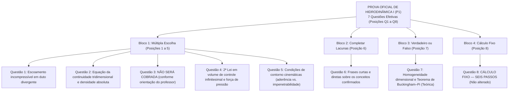

# Relatório de Auditoria Documental e Planejamento da P1 de Hidrodinâmica I

> **Status:** Planejamento Consolidado e Atualizado — Etapa 1.2 (Diretriz Definitiva da Questão 3)  
> **Finalidade:** Fixação definitiva da estrutura de avaliação, fundamentação documental estrita e estabelecimento de ressalvas técnicas obrigatórias para a P1 de Hidrodinâmica I.  
> **Arquivo Estruturador:** `direcionamento_do_professor_prova_1.txt`  
> **Atualização Crítica da Questão 3:** O professor confirmou que **NÃO vai apresentar a Questão 3 na prova**. Portanto, a Questão 3 não será cobrada e não há pendência aberta. A prova terá **7 questões efetivas**, preservando rigorosamente a identificação original das posições: **Q1, Q2, Q4, Q5, Q6, Q7 e Q8**.  
> **Declaração de Limites:** Esta etapa consolida decisões e ressalvas documentais. **A redação das questões do simulado NÃO foi iniciada.**

---

## 1. Identificação das Fontes Consultadas

A auditoria documental foi executada obedecendo estritamente à hierarquia de fontes estabelecida para o projeto:

### Fonte Primária 1 — Direcionamento Oral do Professor
- **Arquivo:** [`direcionamento_do_professor_prova_1.txt`](file:///c:/Users/Herlon%20Targino/Documents/quartz/content/Config/2.%20HID%20P1/Resumo_P1/direcionamento_do_professor_prova_1.txt) (65 linhas).
- **Conteúdo:** Registro das anotações tomadas pelo aluno em sala de aula a partir da orientação oral do professor quanto à estrutura da avaliação, formatos e temas específicos.
- **Atualização sobre a Questão 3:** Confirmação de que o professor não apresentará essa questão na prova. A posição é formalmente mantida como *"Questão 3 — NÃO SERÁ COBRADA, conforme orientação do professor"*, sem renumerar as demais.

### Fonte Primária 2 — Materiais Oficiais da Disciplina
- **`Questionário P1.pdf` (DOC-00):** Documento oficial do professor contendo 40 perguntas e respostas conceituais e analíticas estruturantes da disciplina.
- **Apostilas Teóricas da Unidade 1 (DOC-01 a DOC-08):**
  - `1_Leis_de_conservação-001-006.pdf` (DOC-01, pp. 1–6): Leis de conservação, volume de controle cúbico, vazão mássica e Equação da Continuidade 1D/2D/3D compressível e incompressível ($\nabla \cdot \mathbf{V} = 0$).
  - `1_Leis_de_conservação-007-011.pdf` (DOC-02, pp. 7–11): Momento linear, Segunda Lei de Newton, abordagens Euleriana e Lagrangeana, derivada material e acelerações local e convectiva.
  - `1_Leis_de_conservação-011-018.pdf` (DOC-03, pp. 11–18): Forças de superfície e forças de corpo, dedução diferencial do gradiente de pressão ($-\partial p/\partial x$) e tensões cisalhantes viscosas ($\tau = \mu \partial u/\partial y$).
  - `1_Leis_de_conservação-018-022.pdf` (DOC-04, pp. 18–22): Equação de Navier–Stokes vetorial e Primeira Lei da Termodinâmica.
  - `1_Leis_de_conservação-022-024.pdf` (DOC-05, pp. 22–24): Metodologia dos 6 passos gerais para escoamentos laminares axissimétricos e planos.
  - `1_Leis_de_conservação-024-027.pdf` (DOC-06, pp. 24–27): Escoamento plano de Poiseuille (placas paralelas fixas sob gradiente de pressão) e condições de contorno de aderência e impenetrabilidade.
  - `1_Leis_de_conservação-027-031.pdf` (DOC-07, pp. 27–31): Escoamento laminar em canal inclinado dominado por gravidade.
  - `1_Leis_de_conservação-031-034.pdf` (DOC-08, pp. 31–34): Escoamento plano de Couette (placa móvel sob arraste viscoso cisalhante puro).
- **Apostila Teórica da Unidade 2 (DOC-09):**
  - `2_O_Princípio_da_Homogeneidade_e_Análise_Dimensional.pdf` (Prof. Edson Mesquita, pp. 1–17): Sistemas de unidades $MLT$ e $FLT$, Princípio da Homogeneidade Dimensional, força de inércia, adimensionais clássicos ($Eu, Re, Fr, We$), Teorema $\pi$ de Buckingham (as seis etapas do procedimento), similaridades (geométrica, cinemática, dinâmica) e dilema de escala.
- **Transcrições de Gravações de Aulas (DOC-14):**
  - Arquivos de áudio transcritos em `Arquivos\Transcrições\` (`Hidro-p1Voz 260807_084705`, `HidVoz 260814_084304`, `HidVoz 260814_091758`, etc.).

### Fonte Secundária 3 — Materiais Estruturados Existentes no Projeto
- [`Planejamento_Simulado_P1.md`](file:///c:/Users/Herlon%20Targino/Documents/quartz/content/Config/2.%20HID%20P1/Resumo_P1/Planejamento_Simulado_P1.md)
- [`Mapa_Questoes_Fontes.md`](file:///c:/Users/Herlon%20Targino/Documents/quartz/content/Config/2.%20HID%20P1/Resumo_P1/Mapa_Questoes_Fontes.md)
- [`Resumo_Hidrodinamica_Prova.md`](file:///c:/Users/Herlon%20Targino/Documents/quartz/content/Config/2.%20HID%20P1/Resumo_P1/Resumo_Hidrodinamica_Prova.md)
- [`Resumo_Hidrodinamica_Intuitivo.md`](file:///c:/Users/Herlon%20Targino/Documents/quartz/content/Config/2.%20HID%20P1/Resumo_P1/Resumo_Hidrodinamica_Intuitivo.md)
- [`SIMULADO_P1_HIDRODINAMICA.md`](file:///c:/Users/Herlon%20Targino/Documents/quartz/content/Config/2.%20HID%20P1/Resumo_P1/SIMULADO_P1_HIDRODINAMICA.md)
- [`SIMULADO_P1_HIDRODINAMICA_GABARITO_COMENTADO.md`](file:///c:/Users/Herlon%20Targino/Documents/quartz/content/Config/2.%20HID%20P1/Resumo_P1/SIMULADO_P1_HIDRODINAMICA_GABARITO_COMENTADO.md)

---

## 2. Estrutura Definitiva Consolidada da Prova

A avaliação oficial P1 é estruturada sobre as **posições originais Q1 a Q8**, contando com **sete questões efetivas** em virtude da confirmação de que a Questão 3 não será cobrada:



### Grade Resumo da Estrutura Definitiva

1. **Questão 1 — Múltipla escolha:** Escoamento incompressível em duto divergente.
2. **Questão 2 — Múltipla escolha:** Equação da continuidade tridimensional e densidade absoluta.
3. **Questão 3 — NÃO SERÁ COBRADA, conforme orientação do professor.**
4. **Questão 4 — Múltipla escolha:** Segunda Lei de Newton aplicada ao volume de controle infinitesimal e força de pressão.
5. **Questão 5 — Múltipla escolha:** Condições de contorno cinemáticas.
6. **Questão 6 — Completar lacunas:** Frases curtas e diretas sobre os conceitos confirmados.
7. **Questão 7 — Verdadeiro ou Falso:** Homogeneidade dimensional e Teorema de Buckingham–Pi.
8. **Questão 8 — Cálculo Fixo:** **CÁLCULO FIXO — SEIS PASSOS.**

> [!IMPORTANT]
> **Total de questões efetivas da prova:** **7 questões**.  
> A numeração original foi estritamente preservada para manter correspondência direta com as anotações do professor em sala de aula (Q1, Q2, Q4, Q5, Q6, Q7 e Q8), sem renumerar as posições subsequentes.

---

## 3. Ressalvas Técnicas Obrigatórias para a Futura Elaboração

### 3.1. Questão 1 — Escoamento Incompressível em Duto Divergente

1. **Hipóteses Formais Obrigatórias:**
   - Regime permanente ($\frac{\partial}{\partial t} = 0$);
   - Fluido incompressível ($\rho = \text{constante}$ no espaço e no tempo);
   - Escoamento unidimensional ao longo da coordenada axial $x$ ($u = u(x)$, $v = w = 0$);
   - Velocidade axial positiva no sentido do escoamento ($u(x) > 0$);
   - Área da seção transversal crescente no sentido do escoamento ($\frac{dA}{dx} > 0$).
2. **Equação da Continuidade Aplicada:**
   $$Q = A(x) \cdot u(x) = \text{constante}$$
3. **Comportamento da Velocidade e Gradiente Axial:**
   $$u(x) = \frac{Q}{A(x)} \implies \frac{\partial u}{\partial x} = -\frac{Q}{[A(x)]^2} \frac{dA}{dx} < 0$$
   A velocidade diminui no sentido do avanço.
4. **Expressão e Interpretação Física da Aceleração Convectiva:**
   - Como o regime é permanente ($\frac{\partial u}{\partial t} = 0$), a aceleração material reduz-se estritamente à parcela convectiva:
     $$\boxed{a_{\text{conv}} = u \frac{\partial u}{\partial x} = (+)\cdot(-) < 0}$$
   - **Ressalva Conceitual Obrigatória:** A aceleração convectiva negativa indica aceleração com sentido oposto ao da velocidade local, caracterizando **desaceleração da partícula fluida sob essas condições específicas**.
   - **Proibição de Generalização:** Não generalizar essa conclusão para qualquer escoamento em duto divergente sem explicitar o conjunto de hipóteses necessárias (regime permanente, incompressibilidade e velocidade axial positiva).

---

### 3.2. Questão 4 — Segunda Lei de Newton e Força de Pressão

1. **Preservação da Dedução da Apostila (`1_Leis_de_conservação-011-018.pdf`, pp. 12–14):**
   - Volume de controle infinitesimal paralelepipédico de dimensões $dx, dy, dz$ (ou $\Delta x, \Delta y, \Delta z$) e volume $Vol = dx\,dy\,dz$.
   - A pressão atua perpendicularmente à superfície como tensão normal compressiva (empurrando sempre do exterior para o interior do elemento).
   - **Face esquerda de entrada ($x$):** Força compressiva no sentido positivo $+x$:
     $$F_{\text{in}} = + p(x)\,dy\,dz = + p\,dy\,dz$$
   - **Face direita de saída ($x + dx$):** Força compressiva no sentido negativo $-x$:
     $$F_{\text{out}} = - p(x+dx)\,dy\,dz = - \left(p + \frac{\partial p}{\partial x}dx\right)dy\,dz$$
2. **Força Resultante no Elemento Diferencial:**
   $$dF_{p,x} = F_{\text{in}} + F_{\text{out}} = p\,dy\,dz - \left(p + \frac{\partial p}{\partial x}dx\right)dy\,dz$$
   $$\boxed{dF_{p,x} = -\frac{\partial p}{\partial x}\,dx\,dy\,dz} \quad (\text{dimensão: Newton}, [MLT^{-2}])$$
3. **Expressão da Força por Unidade de Volume:**
   $$\boxed{f_{p,x} = \frac{dF_{p,x}}{dx\,dy\,dz} = -\frac{\partial p}{\partial x}} \quad (\text{dimensão: } \text{N/m}^3, [ML^{-2}T^{-2}])$$
   - *Ressalva Estrita:* Não confundir a força líquida diferencial ($-\frac{\partial p}{\partial x}dx\,dy\,dz$) com a força por unidade de volume ($-\frac{\partial p}{\partial x}$).
4. **Origem do Sinal Negativo e Fundamentação Formal:**
   - Para que o fluido sofra aceleração no sentido $+x$, a pressão na entrada deve ser superior à da saída ($p_1 > p_2 \implies \Delta p < 0 \implies \frac{\partial p}{\partial x} < 0$).
   - O sinal negativo é matematicamente e fisicamente indispensável para que o gradiente negativo resulte em força motriz positiva no sentido $+x$:
     $$f_{p,x} = -\left(\frac{\partial p}{\partial x}\right) > 0$$
   - **Proibição de Linguagem Informal:** Fica vedado o uso de expressões como *"aceleraria absurdamente em direção a pressões crescentes"*. A justificativa fundamenta-se no princípio físico de que um termo positivo ($+\frac{\partial p}{\partial x}$) produziria força no mesmo sentido do gradiente de pressão, implicando aceleração em direção a zonas de maior pressão, o que contraria o equilíbrio mecânico decorrente das tensões normais compressivas opostas estabelecido pela Segunda Lei de Newton.

---

### 3.3. Questão 6 — Completar Lacunas: Terminologia, Formato e Ambiguidades

1. **Formato Aprovado:**
   - Frases curtas e diretas para cada um dos conceitos confirmados.
   - **A redação das lacunas NÃO será realizada nesta etapa**, aguardando aprovação prévia.
2. **Preservação entre Anotação do Aluno e Terminologia da Apostila:**
   - *Anotação do Aluno:* Registrou a expressão *"partícula homóloga"* (no arquivo de anotações: *"particula homologo"*).
   - *Terminologia Oficial da Apostila U2 (pp. 13–15):* O texto utiliza formalmente a locução **pontos homólogos** (referindo-se às posições geometricamente correspondentes $a$ e $a'$ no modelo e protótipo através dos quais as partículas fluidas mantêm trajetórias proporcionais).
   - *Regra Estrita:* Não substituir silenciosamente um termo pelo outro; registrar a equivalência conceitual mantendo a rastreabilidade da fonte.
3. **Similaridade Cinemática e Razão Constante de Velocidades:**
   - Na similaridade cinemática, a correspondência proporcional exata das velocidades ao longo das áreas do modelo e protótipo exige que, em pontos homólogos e tempos homólogos, a razão entre as grandezas vetoriais seja constante:
     $$\frac{V_m}{V_p} = \text{constante} \quad (\beta \text{ ou } \sqrt{\alpha} \text{ sob semelhança de Froude})$$
4. **Registro Formal das Ambiguidades (Sem Presunção Antecipada):**
   - **Escoamento Laminar entre Placas Planas:**
     - *Poiseuille:* Escoamento entre **placas planas paralelas fixas** sob a ação de um **gradiente de pressão** (perfil parabólico de velocidades);
     - *Couette:* Escoamento entre placas planas paralelas induzido pelo **movimento de uma placa móvel** sob cisalhamento puro (arraste viscoso, perfil linear de velocidades).
     - *Ressalva:* Não presumir antecipadamente se a prova exigirá Poiseuille ou Couette; a formulação dependerá estritamente das condições de contorno expressas no enunciado.
   - **Número Adimensional Relacionado às Forças de Inércia:**
     - *Reynolds ($Re = \frac{\rho U L}{\mu}$):* Razão entre forças de inércia e forças **viscosas**;
     - *Froude ($Fr = \frac{U}{\sqrt{gL}}$):* Razão (em raiz quadrada) entre forças de inércia e forças **gravitacionais**.
     - *Ressalva:* Não escolher antecipadamente Reynolds ou Froude sem a especificação da classe de força de oposição indicada pelo professor.

---

### 3.4. Questão 7 — Verdadeiro ou Falso: Sequência Canônica de Buckingham–Pi

1. **Caráter Estritamente Teórico:**
   - A Questão 7 abordará exclusivamente conceitos fundamentais de homogeneidade dimensional e os princípios do Teorema $\pi$ de Buckingham.
   - **Não conterá problemas ou exercícios de cálculo.**
2. **Sequência Canônica Oficial da Apostila U2 (pp. 6–7):**  
   Preserva-se rigorosamente a ordem e a nomenclatura literais da fonte do professor, sem substituição por sequências genéricas ou externas:

```
==========================================================================================
AS SEIS ETAPAS DO PROCEDIMENTO DE BUCKINGHAM (Apostila U2, pp. 6–7)
==========================================================================================
Etapa 1. Liste as variáveis dimensionais do problema e conte-as (n), certificando-se de que são independentes.
Etapa 2. Liste as dimensões primárias presentes nessas variáveis (m). Na hidrodinâmica naval, tipicamente M, L, T.
Etapa 3. Descubra o número de agrupamentos adimensionais da análise calculando πs = n - m.
Etapa 4. Escolha as variáveis repetidas.
Etapa 5. Gere os πs agrupando os parâmetros com o uso de expoentes algébricos.
Etapa 6. Determine o valor de cada expoente aplicando a condição de homogeneidade dimensional, assumindo os expoentes zero no lado esquerdo do grupo.
==========================================================================================
```

3. **Requisitos Teóricos Obrigatórios das Variáveis Repetidas (Etapa 4 — Questionário P1 Q32 e Q33):**
   - Devem ser em número exatamente igual a $m$;
   - Devem conter, juntas, todas as dimensões primárias do problema;
   - **Não podem formar um agrupamento adimensional entre si**.

---

### 3.5. Questão 3 — Diretriz Definitiva de Não Cobrança

Fica formalmente consolidado que a Questão 3 recebe o seguinte registro definitivo:

$$\mathbf{Questão\ 3\ —\ NÃO\ SERÁ\ COBRADA,\ conforme\ orientação\ do\ professor}$$

- **Instruções Obrigatórias Cumpridas:**
  1. A Questão 3 não será cobrada;
  2. Não criar enunciado, alternativas ou questão substituta;
  3. Não selecionar outro assunto para ocupar essa posição;
  4. Manter a numeração original das demais questões, sem renumerá-las;
  5. A prova conterá **sete questões efetivas**: **Q1, Q2, Q4, Q5, Q6, Q7 e Q8**.

---

### 3.6. Questão 8 — Registro Formal do Cálculo Fixo

- **Identificação Oficial Padronizada:** **CÁLCULO FIXO — SEIS PASSOS**.
- **Diretriz Obrigatória:** O exercício já existe, está pronto e consolidado no repositório.
- **Proibições Estritas nesta Etapa:** Não procurar, não analisar, não copiar, não reproduzir e não modificar este exercício nesta etapa.

---

## 4. Matriz Completa das Posições e Fontes de Fundamentação

| Posição | Formato | Status / Tema Consolidado | Fontes Primárias que Fundamentam | Nível de Confirmação |
| :---: | :--- | :--- | :--- | :---: |
| **Q1** | Múltipla Escolha | Escoamento incompressível em duto divergente em regime permanente | `Questionário P1.pdf` (Pergunta 4); Apostila U1 (PDF 007-011, pp. 7–9). | **CONFIRMADO** |
| **Q2** | Múltipla Escolha | Equação da continuidade 3D incompressível e destino algébrico da densidade $\rho$ | `Questionário P1.pdf` (Pergunta 7); Apostila U1 (PDF 001-006, pp. 4–6). | **CONFIRMADO** |
| **Q3** | Múltipla Escolha | **NÃO SERÁ COBRADA, conforme orientação do professor** | Orientação oral do professor em sala de aula confirmada pelo aluno. | **NÃO SERÁ COBRADA** |
| **Q4** | Múltipla Escolha | Segunda Lei de Newton em volume infinitesimal, força líquida de pressão e sinal negativo | `Questionário P1.pdf` (Perguntas 11, 12 e 13); Apostila U1 (PDF 011-018, pp. 12–14). | **CONFIRMADO** |
| **Q5** | Múltipla Escolha | Condições de contorno cinemáticas (não-escorregamento/aderência vs. impenetrabilidade) | `Questionário P1.pdf` (Perguntas 15, 16 e 23); Apostila U1 (PDF 024-027 p. 25, PDF 031-034 p. 32). | **CONFIRMADO** |
| **Q6** | Completar Lacunas | Frases curtas e diretas sobre os conceitos confirmados (12 tópicos mapeados) | `Questionário P1.pdf` (Q1, Q3, Q6, Q14, Q20, Q21, Q22, Q24–Q28); Apostilas U1 e U2. | **CONFIRMADO (COM AMBIGUIDADES MAPEADAS)** |
| **Q7** | Verdadeiro ou Falso | Princípio da Homogeneidade Dimensional e as Seis Etapas Canônicas de Buckingham | Apostila U2 (`2_O_Princípio_da_Homogeneidade...`, pp. 2, 6–7); `Questionário P1.pdf` (Q29, Q31–Q33). | **CONFIRMADO** |
| **Q8** | Cálculo Fixo | **CÁLCULO FIXO — SEIS PASSOS** | Exercício oficial pré-existente (preservado sem alteração). | **CONFIRMADO** |

---

## 5. Lista de Assuntos Confirmados para a Questão 6 (Frases Curtas e Diretas)

Para orientar a redação futura, os 12 temas da Questão 6 encontram-se estruturados:

1. **Propriedades Físicas Fundamentais:** Massa específica ($\rho$), viscosidade dinâmica ($\mu$), pressão ($p$), velocidade ($V$), expressas em dimensões $M, L, T$.
2. **Conservação da Massa em Volume de Controle:** Origem direta da **Equação da Continuidade**.
3. **Perspectiva Euleriana:** Observação baseada em coordenadas espaciais estáticas / janela fixa no espaço.
4. **Perspectiva Lagrangeana:** Acompanhamento de partículas fluidas individuais identificáveis ao longo de suas trajetórias no tempo.
5. **Parcelas da Aceleração na Derivada Material:** Aceleração **local** ($\frac{\partial \mathbf{V}}{\partial t}$) e aceleração **convectiva** ($(\mathbf{V}\cdot\nabla)\mathbf{V}$).
6. **Classificação das Forças em Fluidos:** Forças de **superfície** (pressão e atrito viscoso) e forças de **corpo** (gravidade).
7. **Escoamento Laminar entre Placas Planas (Ambiguidade Mapeada):**
   - Placas fixas com gradiente de pressão $\to$ **Poiseuille plano**;
   - Placa móvel com arraste por cisalhamento puro $\to$ **Couette plano**.
8. **Número Adimensional de Forças de Inércia (Ambiguidade Mapeada):**
   - Inércia comparada a forças viscosas $\to$ **Reynolds** ($Re$);
   - Inércia comparada a forças gravitacionais $\to$ **Froude** ($Fr$).
9. **Ensaios de Modelos em Tanques de Prova:** Métodos de extrapolação experimental de cascos reduzidos para o navio real (protótipo).
10. **Similaridade:** Correspondência física cumulativa entre modelo e protótipo (geométrica, cinemática e dinâmica).
11. **Similaridade Cinemática e Razão de Velocidades:** Proporcionalidade constante entre as velocidades de partículas homólogas em tempos homólogos ($\frac{V_m}{V_p} = \text{constante}$).
12. **Pontos Homólogos:** Posições espacialmente correspondentes na mesma proporção geométrica de escala $\alpha$ entre o modelo e o protótipo (anotado pelo aluno como "partícula homóloga", fundamentado na apostila como "pontos homólogos").

---

## 6. Declaração Formal de Encerramento da Etapa de Auditoria e Planejamento

- A auditoria documental e a consolidação do planejamento encontram-se **concluídas e auditadas**.
- A Questão 3 foi consolidada como **NÃO SERÁ COBRADA**, com a prova contendo **7 questões efetivas** nas posições originais **Q1, Q2, Q4, Q5, Q6, Q7 e Q8**.
- **Nenhuma questão do novo simulado foi redigida nesta etapa.**
- **Nenhum arquivo de simulado, gabarito ou resumo existente foi modificado ou alterado.**
- A elaboração da versão final do simulado (Etapa 2) aguarda a autorização expressa do aluno com base neste planejamento consolidado.
