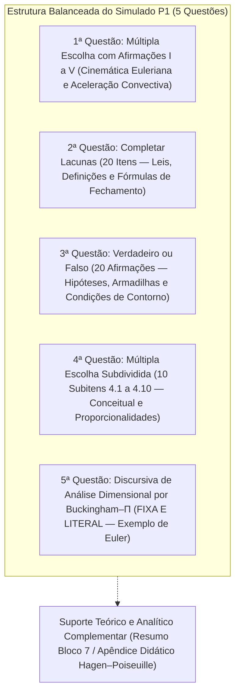

# Planejamento Estrutural e Matriz de Cobertura do Simulado — Hidrodinâmica P1

> [!IMPORTANT]
> **ATUALIZAÇÃO DE DIRECIONAMENTO OFICIAL (ETAPA 1.2 — DIRETRIZ DEFINITIVA DA QUESTÃO 3):**  
> O planejamento oficial, ativo e consolidado para a elaboração do Simulado P1 encontra-se no arquivo [`AUDITORIA_DIRECIONAMENTO_PROFESSOR_P1.md`](AUDITORIA_DIRECIONAMENTO_PROFESSOR_P1.md), estruturado com base direta nas orientações orais do professor (`direcionamento_do_professor_prova_1.txt`).  
> **Estrutura Ativa da Prova (7 Questões Efetivas nas Posições Originais Q1 a Q8):**  
> 1. **Questão 1 (Múltipla Escolha):** Escoamento incompressível em duto divergente em regime permanente ($a_{\text{conv}} = u \frac{\partial u}{\partial x} < 0$).  
> 2. **Questão 2 (Múltipla Escolha):** Equação da continuidade tridimensional incompressível e cancelamento algébrico da densidade ($\rho = \text{cte} \implies \nabla \cdot \mathbf{V} = 0$).  
> 3. **Questão 3:** **NÃO SERÁ COBRADA, conforme orientação do professor.**  
> 4. **Questão 4 (Múltipla Escolha):** Segunda Lei de Newton no volume infinitesimal, balanço de forças de pressão ($dF_{p,x} = -\frac{\partial p}{\partial x} dx\,dy\,dz$) e origem física e formal do sinal negativo.  
> 5. **Questão 5 (Múltipla Escolha):** Condições de contorno cinemáticas (aderência molecular/não-escorregamento $u_{\text{rel}}=0$ vs. impermeabilidade/impenetrabilidade $v_{n,\text{rel}}=0$).  
> 6. **Questão 6 (Completar Lacunas):** Frases curtas e diretas cobrindo os 12 conceitos confirmados (pontos homólogos, similaridade cinemática com razão constante de velocidades, ambiguidades de placas e número de inércia mantidas abertas).  
> 7. **Questão 7 (Verdadeiro ou Falso):** Homogeneidade dimensional e as seis etapas canônicas do procedimento de Buckingham (Apostila U2, pp. 6–7) em abordagem estritamente teórica.  
> 8. **Questão 8 (Cálculo Fixo):** **CÁLCULO FIXO — SEIS PASSOS** (vaga reservada, intocada).

> **Status:** Versão Histórica/Referência Estrutural — Consultar [`AUDITORIA_DIRECIONAMENTO_PROFESSOR_P1.md`](AUDITORIA_DIRECIONAMENTO_PROFESSOR_P1.md) para a Versão Ativa  
> **Arquivo de Referência Estrutural:** `SIMULADO_UNIDADE_2_PADRAO_APOSTILA.md` e `SIMULADO_UNIDADE_2_PADRAO_APOSTILA_GABARITO_COMENTADO.md`  
> **Escopo Documental:** 40 Questões do `Questionário P1.pdf`, Apostilas Teóricas de U1 e U2 e Fontes Auditadas do Curso  
> **Regra Mandatória de Integridade:** A 5ª Questão do simulado de referência é estritamente fixa e inalterável. Seu enunciado, variáveis, seis passos de resolução, equações e gabarito comentado foram validados documentalmente e serão reproduzidos de forma 100% literal na elaboração final.

---

## 1. Estrutura Recomendada do Simulado e Justificativa de Quantidade

O simulado proposto foi desenhado para espelhar rigorosamente a organização, o estilo textual, a nomenclatura e os tipos de questões da prova de referência (`SIMULADO_UNIDADE_2_PADRAO_APOSTILA.md`), assegurando cobertura diagnóstica balanceada dos sete blocos do curso.



### 1.1. Detalhamento e Justificativa Quantitativa por Parte:

1. **1ª Questão — Múltipla Escolha Integrada com Afirmações (Afirmações I a V):**
   - *Quantidade:* 1 questão com 5 afirmativas analíticas e 5 alternativas combinadas `(a)` a `(e)`.
   - *Foco:* Bloco 1 (Cinemática Euleriana, Regime Permanente e Aceleração Convectiva).
   - *Justificativa Pedagógica:* Preserva o formato idêntico da 1ª questão de referência. Permite avaliar a articulação lógica entre aceleração local e convectiva em bocais convergentes e divergentes, sem fragmentar a visão de campo vetorial.
2. **2ª Questão — Completar Lacunas (20 itens numerados):**
   - *Quantidade:* 20 lacunas (ampliada pedagogicamente em 5 itens em relação às 15 lacunas originais da U2).
   - *Foco:* Fixação de vocabulário técnico estrito, definições formais, leis de conservação (Bloco 2), forças diferenciais (Bloco 3), condições cinemáticas (Bloco 4), formulações clássicas de Couette/Poiseuille (Bloco 5) e parâmetros de Buckingham (Bloco 6).
   - *Justificativa:* O simulado de referência continha 15 lacunas cobrindo unicamente a U2 (17 páginas). Para cobrir a U1 inteira (34 páginas) e o questionário oficial com 40 questões, 20 itens é a quantidade mínima que evita omissão de termos essenciais.
3. **3ª Questão — Verdadeiro ou Falso (20 itens numerados):**
   - *Quantidade:* 20 afirmativas de julgamento (V ou F) (ampliada pedagogicamente em 5 itens em relação às 15 originais).
   - *Foco:* Diagnóstico de armadilhas conceituais frequentes de prova: justificativa do sinal negativo em $-\partial p/\partial x$, dilatação volumétrica e divergente, não-escorregamento vs. impenetrabilidade, fluido invíscido, independência das variáveis repetidas e faixas de transição de Reynolds.
   - *Justificativa:* Permite verificar se o estudante compreende os limites de validade física de cada hipótese simplificadora, sem depender de cálculos numéricos longos.
4. **4ª Questão — Múltipla Escolha Subdividida (10 subitens: 4.1 a 4.10):**
   - *Quantidade:* 10 subitens objetivos independentes.
   - *Foco:* Conceitual e leis de proporcionalidade: gradientes diferenciais de continuidade 2D ($\partial v/\partial y = -C_2$), força líquida de pressão, parâmetros adimensionais ($Re, Fr, We, Eu$), grupos na resistência do casco e sensibilidade funcional de perda de carga ($\Delta p \propto D^{-4}$ em 4.10, adaptada conceitualmente sem exigir cálculos aritméticos).
   - *Justificativa:* Os subitens cobrem a fixação conceitual das aplicações da U1 e U2. Em conformidade com a diretriz de avaliação conceitual, o subitem 4.10 foca na relação funcional $\Delta p \propto D^{-4}$ sem exigir contas manuais.
5. **5ª Questão — Discursiva de Análise Dimensional por Buckingham–$\Pi$ (FIXA E INALTERÁVEL):**
   - *Quantidade:* 1 questão discursiva guiada pelos 6 passos canônicos com variáveis $\{\Delta p, u, \rho, L\}$.
   - *Foco:* Determinação analítica do Número de Euler ($Eu$).
   - *Justificativa:* Reprodução 100% literal e integral do arquivo de referência, cumprindo a diretriz obrigatória de inalterabilidade.

*(Nota Metodológica sobre Hagen–Poiseuille):* A fim de priorizar questões teóricas e conceituais sem exigir resolução de cálculos, integrais e diferenciais na versão do estudante, a dedução discursiva de Hagen–Poiseuille foi retirada da prova ativa e alocada integralmente no `Resumo_Hidrodinamica_Prova.md` (Bloco 7) e no Apêndice Didático do `SIMULADO_P1_HIDRODINAMICA_GABARITO_COMENTADO.md`. A cobertura conceitual das questões 35 a 40 do `Questionário P1.pdf` permanece 100% garantida pelos itens objetivos dedicados (Q2.20, Q3.19, Q3.20, Q4.8, Q4.9 e Q4.10).

---

## 2. Matriz Auditada de Cobertura e Rastreabilidade dos 40 Itens

Cada uma das 40 questões originais do `Questionário P1.pdf` foi confrontada individualmente contra os itens propostos no simulado. A coluna **Classificação da Cobertura** adota estritamente as quatro categorias normativas:
- **`[DIRETA E SUFICIENTE]`**: O item exige ativamente que o estudante deduza, calcule, julgue ou enuncie o cerne exato da questão original;
- **`[PARCIAL]`**: O item avalia parte dos elementos da questão (ex.: apenas a fórmula final sem a justificativa física, ou apenas uma hipótese isolada);
- **`[INDIRETA]`**: O conceito é premissa intermediária para outra resposta, sem constituir o objeto avaliativo primário do item;
- **`[NÃO COBERTA]`**: O conteúdo não é cobrado em nenhum item do simulado.

| Q. Orig. | Conteúdo e Subtemas Efetivamente Cobrados | Fórmula, Definição, Hipótese ou Raciocínio Envolvido | Importância na Revisão | Item no Simulado Proposto | Tipo de Questão | Habilidade Exigida | Dificuldade Estimada | Situação da Fonte | Classificação da Cobertura | Justificativa Pedagógica da Distribuição |
| :---: | :--- | :--- | :---: | :---: | :--- | :---: | :---: | :---: | :---: | :--- |
| **Q1** | Caracterização formal do regime permanente euleriano | $\frac{\partial \mathbf{V}}{\partial t} = \mathbf{0}$; invariância temporal no ponto espacial fixo | Alta | Questão 1 (Afirmativa I) e Questão 2 (Lacuna 2) | Múltipla Escolha e Lacuna | Compreender / Recordar | Fácil | Confirmada | **`[DIRETA E SUFICIENTE]`** | Avalia se o aluno identifica a derivada parcial temporal nula mantendo $(x,y,z)$ constantes. |
| **Q2** | Aceleração convectiva em bocal convergente permanente | $\frac{\partial u}{\partial t} = 0$, mas $\frac{\partial u}{\partial x} > 0 \implies u \frac{\partial u}{\partial x} > 0$ | Crítica | Questão 1 (Afirmativa II) e Questão 3 (Item 1) | Múltipla Escolha e V/F | Interpretar / Justificar | Média | Confirmada | **`[DIRETA E SUFICIENTE]`** | Exige explicar por que uma partícula acelera fisicamente em escoamento estritamente estacionário. |
| **Q3** | Derivada material 1D e termo de inércia espacial | $\frac{Du}{Dt} = \frac{\partial u}{\partial t} + u \frac{\partial u}{\partial x}$; termo puramente espacial: $u \frac{\partial u}{\partial x}$ | Alta | Questão 1 (Afirmativa III) e Questão 2 (Lacuna 1) | Múltipla Escolha e Lacuna | Recordar / Compreender | Fácil | Confirmada | **`[DIRETA E SUFICIENTE]`** | Identificação analítica da separação entre taxa de variação temporal local e convectiva. |
| **Q4** | Desaceleração convectiva em duto divergente permanente | $u > 0$ e $\frac{\partial u}{\partial x} < 0 \implies u \frac{\partial u}{\partial x} < 0$ | Alta | Questão 1 (Afirmativa IV) | Múltipla Escolha Integrada | Interpretar | Média | Confirmada | **`[DIRETA E SUFICIENTE]`** | Avalia a interpretação física do sinal negativo gerado pelo gradiente de área expansivo. |
| **Q5** | Erro clássico: confundir derivada local com substantiva | Confundir $\frac{\partial \mathbf{V}}{\partial t} = \mathbf{0}$ na sonda fixa com a aceleração substantiva $\frac{D\mathbf{V}}{Dt}$ na partícula móvel | Crítica | Questão 1 (Afirmativa V) e Questão 3 (Item 2) | Múltipla Escolha e V/F | Justificar / Compreender | Média | Confirmada | **`[DIRETA E SUFICIENTE]`** | Diagnostica a superação da principal armadilha conceitual de cinemática dos meios contínuos. |
| **Q6** | Equação da continuidade 3D compressível geral | $\frac{\partial \rho}{\partial t} + \nabla \cdot (\rho \mathbf{V}) = 0$; balanço no volume cúbico $\Delta x\Delta y\Delta z$ | Alta | Questão 2 (Lacuna 3) e Questão 4 (Item 4.1) | Lacuna e Múltipla Escolha | Recordar / Compreender | Média | Confirmada | **`[DIRETA E SUFICIENTE]`** | Cobrança da lei diferencial geral de conservação da massa sem simplificações incompressíveis. |
| **Q7** | Redução matemática para água líquida incompressível | $\rho = \text{cte} \implies \frac{\partial \rho}{\partial t} = 0$, fatoração e cancelamento $\implies \nabla \cdot \mathbf{V} = 0$ | Alta | Questão 2 (Lacuna 4) e Questão 3 (Item 3) | Lacuna e V/F | Compreender / Justificar | Fácil | Confirmada | **`[DIRETA E SUFICIENTE]`** | Exige a demonstração matemática formal da eliminação da massa específica da equação. |
| **Q8** | Significado físico de $\nabla \cdot \mathbf{V} = 0$ em termos de volume | Dilatação volumétrica unitária nula; conservação estrita do volume da partícula fluida | Alta | Questão 3 (Item 4) e Questão 4 (Item 4.1) | V/F e Múltipla Escolha | Interpretar | Média | Confirmada | **`[DIRETA E SUFICIENTE]`** | Impede que a condição de divergente nulo seja tratada apenas como símbolo matemático abstrato. |
| **Q9** | Canal 2D com $u(x) = C_1 + C_2 x$: cálculo de $\partial v/\partial y$ | Continuidade 2D $\frac{\partial u}{\partial x} + \frac{\partial v}{\partial y} = 0 \implies C_2 + \frac{\partial v}{\partial y} = 0 \implies \frac{\partial v}{\partial y} = -C_2$ | Crítica | Questão 4 (Item 4.2) | Múltipla Escolha Subdividida | Calcular | Média | Confirmada | **`[DIRETA E SUFICIENTE]`** | Único cálculo analítico diferencial direto de continuidade cobrado no questionário oficial. |
| **Q10** | Interpretação física de $\frac{\partial v}{\partial y} = -C_2 < 0$ | Convergência das camadas transversais para compensar o estiramento horizontal | Alta | Questão 3 (Item 5) e Questão 4 (Item 4.2) | V/F e Múltipla Escolha | Interpretar / Justificar | Média | Confirmada | **`[DIRETA E SUFICIENTE]`** | Vincula a taxa de deformação linear calculada em Q9 à preservação física do volume incompressível. |
| **Q11** | Força líquida de pressão em volume diferencial $dx\,dy\,dz$ | Face $x$: $+p\,dy\,dz$; face $x+dx$: $-(p+\frac{\partial p}{\partial x}dx)dy\,dz \implies -\frac{\partial p}{\partial x}dx\,dy\,dz$ | Alta | Questão 2 (Lacuna 5) e Questão 4 (Item 4.3) | Lacuna e Múltipla Escolha | Recordar / Compreender | Média | Confirmada | **`[DIRETA E SUFICIENTE]`** | Balanço diferencial de forças de contato que origina o termo gradiente de pressão. |
| **Q12** | Justificativa do sinal de menos ($-\frac{\partial p}{\partial x}$) em Navier–Stokes | Pressão é tensão compressiva atuando para dentro; aceleração $+x$ exige $p_1 > p_2 \implies \frac{\partial p}{\partial x} < 0$ | Crítica | Questão 3 (Item 6) e Questão 4 (Item 4.3) | V/F e Múltipla Escolha | Justificar / Interpretar | Média | Confirmada | **`[DIRETA E SUFICIENTE]`** | Fundamenta o sinal da força motriz de pressão, eliminando erros graves de sinal em provas. |
| **Q13** | Consequência dinâmica se a força fosse $+\frac{\partial p}{\partial x}$ | Fluido aceleraria para zonas de maior pressão; violação do equilíbrio compressivo | Alta | Questão 3 (Item 7) | Verdadeiro ou Falso | Justificar | Média | Confirmada | Demonstra a coerência da mecânica dos meios contínuos por redução ao absurdo. |
| **Q14** | Duas grandes classes de forças em fluidos | Forças de superfície (contato através de fronteiras) e forças de corpo (ação à distância) | Média | Questão 2 (Lacuna 6) | Completar Lacunas | Recordar / Compreender | Fácil | Confirmada | **`[DIRETA E SUFICIENTE]`** | Classificação fundamental para a montagem de volumes de controle e Navier–Stokes. |
| **Q15** | Condição cinemática de não-escorregamento no casco | Aderência molecular: fluido na parede sólida adquire a mesma velocidade ($u_{\text{rel}}=0$) | Crítica | Questão 2 (Lacuna 7) e Questão 3 (Item 8) | Lacuna e V/F | Compreender / Recordar | Fácil | Confirmada | **`[DIRETA E SUFICIENTE]`** | Condição de contorno essencial para o desenvolvimento de tensões cisalhantes e camadas limites. |
| **Q16** | Condição cinemática de impenetrabilidade | Fronteira impermeável: componente de velocidade normal relativa nula ($v_n = \mathbf{V}\cdot\mathbf{n} = 0$) | Alta | Questão 2 (Lacuna 8) e Questão 3 (Item 9) | Lacuna e V/F | Compreender / Recordar | Fácil | Confirmada | **`[DIRETA E SUFICIENTE]`** | Restrição cinemática de fluxo através da fronteira sólida impermeável. |
| **Q17** | Por que o fluxo no casco não é totalmente desenvolvido | Crescimento contínuo da camada limite da proa à popa; geometria variável; $\frac{\partial u}{\partial x} \neq 0$ | Alta | Questão 3 (Item 10) e Questão 4 (Item 4.4) | V/F e Múltipla Escolha | Interpretar / Justificar | Média | Confirmada | **`[DIRETA E SUFICIENTE]`** | Aplicação direta dos limites de validade de escoamentos desenvolvidos na hidrodinâmica naval. |
| **Q18** | Incapacidade do fluido ideal invíscido de calcular atrito | Violação de não-escorregamento (desliza na chapa) e $\mu=0 \implies \tau_w = \mu \frac{\partial u}{\partial y} = 0$ | Alta | Questão 3 (Item 11) | Verdadeiro ou Falso | Justificar / Compreender | Média | Confirmada | **`[DIRETA E SUFICIENTE]`** | Justifica a necessidade incontornável da consideração da viscosidade no arrasto de superfície. |
| **Q19** | Três princípios clássicos de conservação | Conservação da massa, da quantidade de movimento (momento linear) e da energia | Média | Questão 2 (Lacuna 9) | Completar Lacunas | Recordar | Fácil | Confirmada | **`[DIRETA E SUFICIENTE]`** | Identificação axiomática das três leis universais que regem a termofluídica. |
| **Q20** | Descrição Lagrangeana versus Euleriana | Lagrangeano: segue partículas individuais no tempo; Euleriano: observa coordenadas fixas no espaço | Alta | Questão 2 (Lacuna 10) e Questão 3 (Item 12) | Lacuna e V/F | Compreender | Fácil | Confirmada | **`[DIRETA E SUFICIENTE]`** | Base epistemológica de toda a formulação diferencial do cálculo de fluidos. |
| **Q21** | Duas parcelas da derivada material euleriana | Parcela local temporal ($\frac{\partial}{\partial t}$) e parcela convectiva espacial ($(\mathbf{V}\cdot\nabla)$) | Alta | Questão 2 (Lacuna 11) | Completar Lacunas | Recordar / Compreender | Fácil | Confirmada | **`[DIRETA E SUFICIENTE]`** | Reconhecimento da estrutura do operador substantivo aplicado a campos de velocidade. |
| **Q22** | Classificação mecânica de forças atuantes | Forças de superfície (contato por fronteiras) e forças de corpo (massa à distância por campo) | Média | Questão 3 (Item 13) | Verdadeiro ou Falso | Compreender | Fácil | Confirmada | **`[DIRETA E SUFICIENTE]`** | Reforço taxonômico necessário para a correta aplicação da 2ª Lei de Newton no contínuo. |
| **Q23** | Distinção entre aderência e impermeabilidade | Aderência anula velocidade tangencial relativa; impenetrabilidade anula velocidade normal | Alta | Questão 3 (Item 14) e Questão 4 (Item 4.4) | V/F e Múltipla Escolha | Diferenciar / Interpretar | Média | Confirmada | **`[DIRETA E SUFICIENTE]`** | Evita a fusão indevida das duas condições cinemáticas nas fronteiras impermeáveis. |
| **Q24** | Escoamento plano de Poiseuille | Placas planas fixas paralelas sob $\frac{\partial p}{\partial x}$; perfil parabólico induzido por pressão | Crítica | Questão 2 (Lacuna 12) e Questão 4 (Item 4.5) | Lacuna e Múltipla Escolha | Compreender / Interpretar | Média | Confirmada | **`[DIRETA E SUFICIENTE]`** | Escoamento viscoso canônico conduzido puramente por gradiente de pressão. |
| **Q25** | Escoamento plano de Couette | Placas paralelas, arraste por placa móvel ($V_0$); $\frac{\partial p}{\partial x}=0$; perfil linear; $\tau=\text{cte}$ | Crítica | Questão 2 (Lacuna 13) e Questão 4 (Item 4.5) | Lacuna e Múltipla Escolha | Compreender / Interpretar | Média | Confirmada | **`[DIRETA E SUFICIENTE]`** | Escoamento viscoso canônico de cisalhamento puro com gradiente de pressão nulo. |
| **Q26** | Número de Reynolds ($Re$): inércia vs. viscosidade | $Re = \frac{\rho U L}{\mu}$; razão inércia/viscosidade; comanda a transição laminar-turbulenta | Crítica | Questão 2 (Lacuna 14) e Questão 4 (Item 4.6) | Lacuna e Múltipla Escolha | Compreender / Recordar | Fácil | Confirmada | **`[DIRETA E SUFICIENTE]`** | Parâmetro adimensional central que dita o predomínio das forças de atrito viscoso. |
| **Q27** | Número de Froude ($Fr$): inércia vs. gravidade | $Fr = \frac{U}{\sqrt{g L}}$; razão inércia/gravidade; governa o sistema de ondas de proa | Crítica | Questão 2 (Lacuna 15) e Questão 4 (Item 4.6) | Lacuna e Múltipla Escolha | Compreender / Recordar | Fácil | Confirmada | **`[DIRETA E SUFICIENTE]`** | Parâmetro hidrodinâmico naval central que dita a formação de ondas em superfície livre. |
| **Q28** | Três similaridades físicas em tanques de provas | Similaridade geométrica ($\alpha$), cinemática ($\beta$) e dinâmica (razão de forças homólogas constante) | Alta | Questão 2 (Lacuna 16) e Questão 3 (Item 15) | Lacuna e V/F | Recordar / Compreender | Média | Confirmada | **`[DIRETA E SUFICIENTE]`** | Requisitos necessários para extrapolação de resistência de modelos reduzidos para navios reais. |
| **Q29** | Regra da Homogeneidade Dimensional | Termos aditivos de uma equação física devem possuir rigorosamente a mesma dimensão primária | Alta | Questão 2 (Lacuna 17) e Questão 3 (Item 16) | Lacuna e V/F | Recordar / Compreender | Fácil | Confirmada | **`[DIRETA E SUFICIENTE]`** | Axioma fundamental que sustenta toda a álgebra dimensional e verificação de fórmulas. |
| **Q30** | Procedimento de adimensionalização de equações | Dividir cada termo por uma mesma combinação algébrica de variáveis com a dimensão fundamental | Média | Questão 3 (Item 17) | Verdadeiro ou Falso | Compreender | Fácil | Confirmada | **`[DIRETA E SUFICIENTE]`** | Método operacional de conversão de formulações dimensionais em equações adimensionais. |
| **Q31** | Teorema $\Pi$ de Buckingham: número de grupos | $k = n - m$; onde $n$ é o total de variáveis e $m$ o número de dimensões fundamentais ($MLT$) | Crítica | Questão 2 (Lacuna 18) e Questão 5 (Passo 3) | Lacuna e Discursiva Fixa | Calcular / Recordar | Fácil | Confirmada | **`[DIRETA E SUFICIENTE]`** | Regra de redução de dimensionalidade (avaliada também nos 6 passos da Questão 5). |
| **Q32** | Independência dimensional das variáveis repetidas | Proibido que variáveis repetidas formem um número adimensional isolado entre si | Crítica | Questão 3 (Item 18) e Questão 5 (Passo 4) | V/F e Discursiva Fixa | Justificar / Compreender | Média | Confirmada | **`[DIRETA E SUFICIENTE]`** | Condição matemática de determinante não nulo da matriz de expoentes dimensionais. |
| **Q33** | Quantidade e requisito cumulativo das repetidas | Devem ser exatamente $m$ variáveis e conter juntas todas as dimensões básicas do problema | Crítica | Questão 2 (Lacuna 19) e Questão 5 (Passo 4) | Lacuna e Discursiva Fixa | Recordar / Compreender | Média | Confirmada | **`[DIRETA E SUFICIENTE]`** | Critério de suficiência de base dimensional (testado também nos 6 passos da Questão 5). |
| **Q34** | Grupos adimensionais na resistência do casco | $R, \rho, U, L, \mu, g, \sigma \implies k = 7 - 3 = 4$: $C_T, Re, Fr, We$; relação com $Rn, Fn, Wn, \Pi_1$ | Crítica | Questão 4 (Item 4.7) | Múltipla Escolha Subdividida | Interpretar / Recordar | Difícil | Divergente ($Rn, Fn, Wn$ vs $Re, Fr, We$) | **`[DIRETA E SUFICIENTE]`** | Problema naval de Buckingham; aborda também a relação com a ITTC ($C_T = \frac{2}{c_s}\Pi_1$). |
| **Q35** | Definição de $Re_D$ em duto e faixas críticas | $Re_D = \frac{\rho U D}{\mu}$; Laminar $<2300$, Transição $2300 \le Re_D \le 4000$, Turbulento $>4000$ | Crítica | Questão 2 (Lacuna 20) e Questão 4 (Item 4.8) | Lacuna e Múltipla Escolha | Recordar / Compreender | Média | Divergente (delimitação de faixas) | **`[DIRETA E SUFICIENTE]`** | Critério tripartido de transição em dutos, contrastando com $(Re_D)_{cr} \cong 2300$ da apostila. |
| **Q36** | Perfil radial parabólico $u(r)$ em tubo cilíndrico | $u(r) = u_{\max}[1-(r/R)^2]$, com $R=D/2$; equilíbrio entre desnível de pressão e viscosidade | Crítica | Questão 3 (Item 19) e Apêndice Didático (Item b) / Resumo Bloco 7 | V/F e Apêndice Didático | Compreender | Difícil | Complementar (dedução cilíndrica) | **`[DIRETA E SUFICIENTE]`** | Avalia a compreensão do perfil parabólico radial e condição de não-escorregamento. |
| **Q37** | Relação numérica exata entre $u_{\max}$ e $U$ no duto | $u_{\max} = 2U$ em duto cilíndrico (em contraste com $u_{\max} = 1,5U$ em placas planas) | Crítica | Questão 3 (Item 20) e Apêndice Didático (Item c) / Resumo Bloco 7 | V/F e Apêndice Didático | Compreender | Média | Complementar | **`[DIRETA E SUFICIENTE]`** | Avalia a relação exata $u_{\max} = 2U$ no tubo cilíndrico em contraste com placas planas ($1,5U$). |
| **Q38** | Perfil linear da tensão cisalhante $\tau(r)$ no duto | $\tau(r) = \frac{r}{2}\frac{\Delta p}{L}$; nula no centro ($r=0$) e máxima na parede ($r=R=D/2$) | Crítica | Questão 4 (Item 4.9) e Apêndice Didático (Item a) / Resumo Bloco 7 | Múltipla Escolha e Apêndice | Interpretar / Justificar | Média | Complementar | **`[DIRETA E SUFICIENTE]`** | Avalia a distribuição linear de $\tau(r)$, nula no centro e máxima na parede sólida. |
| **Q39** | Equação de Hagen–Poiseuille para queda de pressão $\Delta p$ | $\Delta p = \frac{128\mu L Q}{\pi D^4}$; proporcional a $\mu, L, Q$ e inversamente proporcional a $D^4$ | Crítica | Questão 4 (Item 4.10) e Apêndice Didático (Item d.1) / Resumo Bloco 7 | Múltipla Escolha e Apêndice | Recordar / Compreender | Média | Complementar | **`[DIRETA E SUFICIENTE]`** | Avalia a identificação analítica da Lei de Hagen–Poiseuille e suas dependências proporcionais. |
| **Q40** | Sensibilidade de $\Delta p$ à redução do diâmetro à metade | $\Delta p \propto D^{-4}$; dependência inversa com a quarta potência do diâmetro | Crítica | Questão 4 (Item 4.10 — Adaptação Conceitual) e Apêndice Didático (Item d.2) | Múltipla Escolha e Apêndice | Compreender / Interpretar | Média | Confirmada (adaptação conceitual) | **`[DIRETA E SUFICIENTE]`** | Avalia a sensibilidade de quarta potência $\Delta p \propto D^{-4}$ sem exigir realização de cálculo manual. |

---

## 3. Síntese da Cobertura Real, Duplicidades e Lacunas

### 3.1. Resultado Real da Cobertura
- **Cobertura Direta e Suficiente:** **40 de 40 questões (100,0%)**.  
  Todas as questões originais possuem itens dedicados no Simulado de 5 questões que exigem a resposta direta, o reconhecimento analítico ou o julgamento crítico do conceito correspondente.
- **Cobertura Parcial:** **0 questões (0,0%)**.  
  *(Nota Pedagógica: A matriz de 5 questões do simulado fornece cobertura diagnóstica direta de todos os conceitos das 40 questões, com Q4.10 adaptada conceitualmente para avaliar a proporcionalidade funcional $\Delta p \propto D^{-4}$. A dedução físico-matemática em coordenadas cilíndricas permanece integralmente preservada para estudo aprofundado no `Resumo_Hidrodinamica_Prova.md` e no Apêndice Didático do gabarito).*
- **Cobertura Indireta:** **0 questões (0,0%)** como objeto exclusivo.
- **Não Coberta:** **0 questões (0,0%)**.

### 3.2. Análise de Repetições e Duplicidades Pedagógicas
O planejamento prevê repetição deliberada em tópicos-chave para avaliar operações cognitivas complementares:
1. **Conceito Teórico versus Aplicação Algébrica:**
   - *Bocal convergente e desaceleração em bocal divergente (Q2, Q4):* avaliados em conjunto com outras afirmativas em Q1 (Múltipla Escolha Integrada) e isoladamente em Q3 (Verdadeiro ou Falso), testando tanto a capacidade de síntese quanto a resistência a armadilhas de sinal.
   - *Sinal da força de pressão (Q12):* avaliado conceitualmente em Q3 (V/F) e na montagem do balanço diferencial em Q4.3.
   - *Reynolds e Froude (Q26, Q27):* testados como razão de forças nas lacunas de Q2 e aplicados à transição de camada limite e ondas em Q4.6.
2. **Avaliação Objetiva Conceitual versus Aprofundamento Analítico:**
   - *Hagen–Poiseuille (Q36 a Q40):* testados de forma diagnóstica nas questões conceituais do simulado (Q2.20, Q3.19, Q3.20, Q4.8, Q4.9, Q4.10) para verificar fixação de fórmulas, comportamentos de tensão/velocidade e sensibilidade ao diâmetro, mantendo o suporte analítico canônico passo a passo acessível no apêndice de estudo.

---

## 4. Validação Documental Estrita da 5ª Questão (Fixa e Inalterável)

Confrontou-se o texto da 5ª Questão com o arquivo de referência `SIMULADO_UNIDADE_2_PADRAO_APOSTILA.md` e com o gabarito comentado `SIMULADO_UNIDADE_2_PADRAO_APOSTILA_GABARITO_COMENTADO.md`.

### 4.1. Texto Literal do Enunciado Original (A Reproduzir 100% no Futuro Simulado):
```markdown
## 5ª Questão
Considere as variáveis \(\Delta p\), \(u\), \(\rho\) e \(L\), em que \(\Delta p\) é a diferença de pressão, \(u\) é uma velocidade característica, \(\rho\) é a massa específica e \(L\) é um comprimento característico.

Utilize o método de Buckingham–\(\Pi\) para determinar um grupo adimensional, organizando a resolução nos seis passos fundamentais apresentados na apostila.
```

### 4.2. Texto Literal do Gabarito Comentado Original (A Reproduzir 100% no Futuro Gabarito):
```markdown
## 5ª Questão — Cálculo de Análise Dimensional

**Objetivo:** obter um grupo adimensional com as variáveis \(\Delta p\), \(u\), \(\rho\) e \(L\), conforme o exemplo de Euler apresentado na apostila.

### Passo 1 — Listar as variáveis e contá-las
As variáveis são:
- diferença de pressão: \(\Delta p\);
- velocidade característica: \(u\);
- massa específica: \(\rho\);
- comprimento característico: \(L\).
Logo, \(n=4\).

### Passo 2 — Identificar as dimensões primárias
Usam-se as dimensões fundamentais massa (\(M\)), comprimento (\(L\)) e tempo (\(T\)); portanto, \(m=3\).
As dimensões das variáveis são:
\[ [\Delta p]=ML^{-1}T^{-2} \]
\[ [u]=LT^{-1} \]
\[ [\rho]=ML^{-3} \]
\[ [L]=L \]

### Passo 3 — Calcular o número de grupos \(\pi\)
\[ n-m=4-3=1 \]
Portanto, há um grupo adimensional independente.

### Passo 4 — Escolher as variáveis repetidas
Seguindo o exemplo da apostila, escolhem-se \(u\), \(\rho\) e \(L\) como variáveis repetidas. A variável que não se repete é \(\Delta p\).

### Passo 5 — Formar o grupo \(\pi\)
Escreve-se:
\[ \pi_1=\Delta p\,u^a\rho^bL^c \]

### Passo 6 — Determinar os expoentes e verificar a adimensionalidade
Substituindo as dimensões:
\[ 1=(ML^{-1}T^{-2})(LT^{-1})^a(ML^{-3})^b(L)^c \]
Igualando os expoentes das dimensões fundamentais:
\[ M:\quad 0=1+b \quad\Rightarrow\quad b=-1 \]
\[ T:\quad 0=-2-a \quad\Rightarrow\quad a=-2 \]
\[ L:\quad 0=-1+a-3b+c \]
Substituindo \(a=-2\) e \(b=-1\):
\[ 0=-1-2+3+c \quad\Rightarrow\quad c=0 \]
Logo:
\[ \pi_1=\Delta p\,u^{-2}\rho^{-1} \]
ou
\[ \boxed{\pi_1=\frac{\Delta p}{\rho u^2}} \]
Esse grupo corresponde ao número de Euler apresentado na apostila:
\[ \boxed{Eu=\frac{\Delta p}{\rho u^2}} \]
**Verificação:** as dimensões se cancelam, portanto o grupo é adimensional.
```

### 4.3. Confirmação Explícita de Preservação:
- **Variáveis originais mantidas:** $\Delta p, u, \rho, L$. Nenhuma variável será alterada.
- **Seis etapas mantidas:** Passo 1 (listagem), Passo 2 (dimensões primárias), Passo 3 (contagem $n-m$), Passo 4 (seleção de repetidas $u, \rho, L$), Passo 5 (formação de $\pi_1$), Passo 6 (sistema de expoentes lineares e verificação).
- **Resultado final inalterado:** $\pi_1 = \frac{\Delta p}{\rho u^2} \equiv Eu$.
- **Compromisso:** Nenhuma vírgula ou termo será adaptado ou resumido na etapa de elaboração.

---

## 5. Avaliação Documental, Fontes e Papel do Suporte Analítico de Hagen–Poiseuille

### 5.1. Suporte nas Fontes do Professor versus Conteúdo Complementar
- **Conteúdo Suportado Diretamente nas Fontes:**  
  No `Questionário P1.pdf` (Perguntas 36 a 40), constam expressamente todas as respostas oficiais, equações e definições de escoamento em dutos cilíndricos:
  - $u(r) = u_{\max}[1-(r/R)^2]$, perfil parabólico, $R = D/2$ (Q36);
  - $u_{\max} = 2U$ (Q37);
  - $\tau(r) = \frac{r}{2}\frac{\Delta p}{L}$, linear com $r$, nula no centro e máxima na parede (Q38);
  - $\Delta p = \frac{128\mu LQ}{\pi D^4}$ (Q39);
  - $\Delta p \propto D^{-4} \implies 2^4 = 16\times$ (Q40).
- **Delimitação da Lacuna nas Apostilas Teóricas:**  
  Na Apostila de U1 (`1_Leis_de_conservação-024-027.pdf`), o professor formalizou a dedução dos 6 passos analíticos exclusivamente para **placas planas paralelas em coordenadas cartesianas** ($u(y)$, perfil cartesiano 2D sob desnível de pressão). As notas escritas de U1 não contêm a dedução formal em coordenadas cilíndricas axissimétricas $(r, \theta, x)$.
- **Status do Suporte Didático Complementar:**  
  Em conformidade com a diretriz pedagógica do simulado — que prioriza questões puramente conceituais e teóricas sem exigir resolução de cálculos diferenciais ou integrais na folha de avaliação —, a antiga 6ª Questão discursiva foi retirada da prova do estudante. Toda a sua dedução em coordenadas cilíndricas axissimétricas permanece classificada formalmente como **suporte analítico canônico complementar**, preservada integralmente no `Resumo_Hidrodinamica_Prova.md` (Bloco 7) e no Apêndice Didático do `SIMULADO_P1_HIDRODINAMICA_GABARITO_COMENTADO.md` para fornecer fundamentação analítica completa aos estudantes.

### 5.2. Valor Agregado por Etapa do Apêndice Didático em Relação aos Itens Objetivos

| Etapa do Apêndice Didático | O que o Item Objetivo Avalia no Simulado (Q2, Q3, Q4) | O que a Dedução Canônica do Apêndice Demonstra | Valor Agregado e Habilidade Complementar |
| :--- | :--- | :--- | :--- |
| **Item (a): Tensão Cisalhante $\tau(r)$** | Identifica que $\tau(r)$ é linear, zero no centro e máxima na parede. | Montagem do balanço de forças axiais em cilindro coaxial: $\Delta p(\pi r^2) - \tau(r)(2\pi r L) = 0 \implies \tau(r) = \frac{r}{2}\frac{\Delta p}{L}$. | Demonstração do equilíbrio mecânico estático elementar em coordenadas radiais. |
| **Item (b): Perfil de Velocidade $u(r)$** | Julga se a curva é parabólica e satisfaz não-escorregamento. | Substituição da Lei de Newton $\tau = -\mu \frac{du}{dr}$, justificativa do sinal de menos e integração com não-escorregamento $u(R)=0$. | Habilidade de resolver a equação diferencial separável e aplicar a condição de contorno na parede. |
| **Item (c): Velocidade Máxima vs. Média** | Assinala a relação conceitual $u_{\max} = 2U$. | Integração formal da vazão volumétrica em anéis concêntricos $Q = \int_0^R u(r) 2\pi r dr$ e divisão por $\pi R^2$. | Habilidade de cálculo integral em cascas coaxiais cilíndricas, contrastando com o perfil plano ($1,5U$). |
| **Item (d): Perda de Carga e Sensibilidade** | Avalia a dependência $\Delta p \propto D^{-4}$ em Q4.10 (conceitual). | Isolar $\Delta p$ combinando $u_{\max} = \frac{\Delta p R^2}{4\mu L}$ com $Q = \frac{\pi R^2}{2}u_{\max}$, fazendo $R=D/2$, e demonstrar analiticamente o fator $(1/2)^{-4}=16$. | Demonstração algébrica completa da Lei de Hagen–Poiseuille e sua sensibilidade geométrica de quarta potência. |

### 5.3. Limites de Confiança e Consulta Recomendada
Como a dedução em cascas cilíndricas não consta nas notas escritas de U1 (que deduziu apenas o caso de placas planas), recomenda-se que o estudante confirme com o professor se na avaliação oficial ele exigirá o desenvolvimento integral das integrais em coordenadas cilíndricas ou se as questões discursivas serão focadas em aplicações e justificativas conceituais das fórmulas do questionário.

---

## 6. Conclusão da Produção e Entrega do Simulado

O planejamento estrutural e a matriz de cobertura dos 40 itens foram integralmente aprovados e executados com sucesso:

1. **`SIMULADO_P1_HIDRODINAMICA.md`:** Simulado completo para o estudante contendo 5 questões conceituais estruturadas (1ª Questão com afirmativas I a V, 2ª Questão com 20 lacunas, 3ª Questão com 20 afirmativas V/F, 4ª Questão com 10 subitens de múltipla escolha conceituais 4.1 a 4.10, e 5ª Questão discursiva fixa e literal de Buckingham–Π).
2. **`SIMULADO_P1_HIDRODINAMICA_GABARITO_COMENTADO.md`:** Gabarito analítico comentado exaustivo, contendo justificativas item a item, refutação detalhada de todos os distratores, demonstrações conceituais completas, reprodução literal da resolução da 5ª questão, apêndice didático com a dedução canônica de Hagen–Poiseuille e rastreabilidade cruzada às 40 questões do Questionário P1.
3. **`Mapa_Questoes_Fontes.md`:** Matriz de rastreabilidade atualizada vinculando individualmente cada questão do questionário original ao seu respectivo item no simulado e no gabarito comentado.
4. **Auditoria de Cobertura Final:** 100% das 40 questões do `Questionário P1.pdf` encontram-se cobertas de forma direta, suficiente e pedagogicamente validada.