# Guia Didático e Intuitivo de Hidrodinâmica I (P1)
## Da Intuição Física à Formulação Matemática Rigorosa
### Material de Preparação Teórica e Analítica para a Prova

> [!IMPORTANT]
> **Origem e Compromisso Pedagógico:**  
> Este material é a transformação didática oficial do arquivo [`Resumo_Hidrodinamica_Prova.md`](file:///c:/Users/Herlon%20Targino/Documents/quartz/content/Config/2.%20HID%20P1/Resumo_P1/Resumo_Hidrodinamica_Prova.md). Ele preserva **100% dos conceitos, formulações matemáticas, deduções analíticas passo a passo, classificações, unidades e hipóteses originais**, estruturando cada assunto em uma jornada pedagógica progressiva: **Entenda a Ideia $\to$ Visualize o Fenômeno $\to$ Entenda o Funcionamento $\to$ Definição Técnica $\to$ O que Memorizar $\to$ Atenção para a Prova**.

---

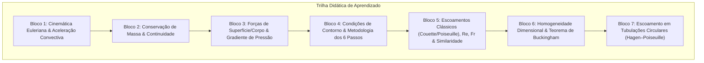

---

# Bloco 1: Cinemática Euleriana, Regime Permanente e Aceleração Convectiva

---

## 1.1. Definição Formal de Regime Permanente na Perspectiva Euleriana
*(Rastreabilidade: Questionário P1 — Pergunta 1)*

### A. Entenda a ideia
Imagine que você está de pé sobre uma ponte observando as águas de um rio que correm por baixo. Você escolhe olhar fixamente para uma estaca fincada no leito. A água passa veloz, moléculas diferentes entram e saem do seu campo visual a cada milésimo de segundo, mas o nível da água naquela estaca não sobe nem desce, e a velocidade com que a água cruza aquele ponto exato é sempre a mesma, segundo após segundo. 

Isso é o **regime permanente sob a ótica Euleriana**: não significa que a água esteja parada, mas sim que **as condições do escoamento em cada ponto fixo do espaço não mudam com o passar do tempo**.

### B. Visualize o fenômeno
Para caracterizar o regime permanente sob a perspectiva Euleriana sem ambiguidades de referencial, considere duas perspectivas físicas complementares:

1. **Observador Euleriano em Referencial Inercial Fixo (à Terra):**  
   Pense no sensor de um marégrafo ou em uma estaca de ponte fincada firmemente no fundo do leito. As coordenadas espaciais $(x, y, z)$ são rigorosamente estáticas em relação à Terra. Se a água escoa e as grandezas (velocidade, pressão, densidade) medidas nesse ponto geométrico mantêm-se constantes a cada instante de observação, o escoamento é classificado como permanente ($\frac{\partial \mathbf{V}}{\partial t} = \mathbf{0}$).  
   *(Atenção ao contraste:* se um navio avança pelo oceano, um sensor fixo no fundo do mar registrará inicialmente a água em repouso ao longe, depois acelerada na passagem da proa, e posteriormente agitada na esteira da popa. No referencial fixo à Terra, o escoamento gerado por um navio que passa é **transiente**, pois as propriedades variam com o tempo naquela coordenada terrestre fixa*).*

2. **A Analogia do Navio em Referencial Solidário ao Casco:**  
   Instrumentos de medição presos ao chapeamento do casco (na proa ou a meia-nau) acompanham o deslocamento da embarcação e, portanto, **não representam, por si sós, posições fixas no referencial espacial terrestre**.  
   No entanto, para uma embarcação que avança com velocidade constante $\mathbf{U}_0$ em mar calmo, podemos adotar um **referencial solidário ao navio** (com origem no próprio casco). Explicitando a transformação de coordenadas e definindo as velocidades relativas do fluido em relação ao casco ($\mathbf{V}_{\text{rel}} = \mathbf{V} - \mathbf{U}_0$), o escoamento ao redor do navio pode ser modelado como estacionário relativo: em cada posição fixa em relação ao casco, os velocímetros leem valores de velocidade relativa perfeitamente invariáveis no tempo ($\frac{\partial \mathbf{V}_{\text{rel}}}{\partial t} = \mathbf{0}$).

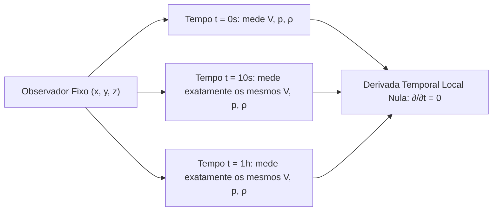

### C. Entenda o funcionamento
Na mecânica dos fluidos, há duas maneiras de observar o movimento:
1. **Ponto de vista Lagrangeano:** seguir uma partícula individual (como se colocássemos um micro-GPS em uma gota d'água e viajássemos com ela).
2. **Ponto de vista Euleriano:** fixar posições espaciais estáticas $(x, y, z)$ e registrar o que acontece ali enquanto diferentes partículas passam.

No ponto de vista Euleriano, as propriedades do fluido formam **campos**: campo de velocidades $\mathbf{V}(x, y, z, t)$, campo de pressões $p(x, y, z, t)$ e campo de massas específicas $\rho(x, y, z, t)$.

Se o escoamento for permanente, a dependência temporal explícita desaparece. Matematicamente, a derivada parcial em relação ao tempo, mantendo as coordenadas de posição $(x, y, z)$ congeladas, é identicamente nula:

$$\frac{\partial}{\partial t} = 0$$

Isso significa que o campo de velocidades passa a ser função **exclusiva das coordenadas espaciais**:

$$\mathbf{V} = \mathbf{V}(x, y, z)$$

### D. Conheça a definição técnica
> **Definição Técnica:**  
> Sob o ponto de vista matemático e de campo vetorial, um escoamento em regime permanente caracteriza-se pelo fato de que as propriedades do fluido (vetor velocidade, pressão, massa específica) em qualquer coordenada espacial fixa $(x, y, z)$ não variam com o tempo. A derivada temporal local é identicamente nula:
> $$\frac{\partial \mathbf{V}}{\partial t} = \mathbf{0}, \quad \frac{\partial p}{\partial t} = 0, \quad \frac{\partial \rho}{\partial t} = 0$$

#### Equações Fundamentais e Componentes Escalares
Em coordenadas cartesianas tridimensionais, onde $\mathbf{V} = u\hat{i} + v\hat{j} + w\hat{k}$:

$$\frac{\partial u}{\partial t} = 0, \quad \frac{\partial v}{\partial t} = 0, \quad \frac{\partial w}{\partial t} = 0$$

$$\frac{\partial \rho}{\partial t} = 0, \quad \frac{\partial p}{\partial t} = 0$$

#### Grandezas Físicas, Variáveis e Unidades
- $\mathbf{V}(x, y, z)$: Vetor velocidade no ponto fixo $(x, y, z)$ ($[L T^{-1}]$, no SI: $\text{m/s}$);
- $u, v, w$: Componentes de velocidade nas direções $x, y, z$ ($[L T^{-1}]$, no SI: $\text{m/s}$);
- $t$: Variável temporal independente ($[T]$, no SI: $\text{s}$);
- $\frac{\partial}{\partial t}$: Operador de derivada parcial temporal local com $(x, y, z)$ constantes ($[T^{-1}]$, no SI: $\text{s}^{-1}$);
- $\rho$: Massa específica local do fluido ($[M L^{-3}]$, no SI: $\text{kg/m}^3$);
- $p$: Campo de pressão hidrodinâmica local ($[M L^{-1} T^{-2}]$, no SI: $\text{Pa} = \text{N/m}^2$).

### E. O que precisa memorizar
- **Condição essencial:** $\frac{\partial (\text{propriedade})}{\partial t} = 0$ em qualquer ponto $(x, y, z)$ fixo.
- **Forma do campo:** $\mathbf{V} = \mathbf{V}(x, y, z)$ (dependência exclusivamente espacial).
- **Hipótese:** O regime permanente pode ocorrer tanto em fluidos compressíveis quanto incompressíveis, e o escoamento pode ser espacialmente uniforme ou não uniforme.

### F. Atenção para a prova
> [!WARNING]
> **Armadilhas Clássicas de Prova:**
> 1. **Confundir "regime permanente" com "velocidade da partícula constante":** Dizer que em regime permanente nenhuma partícula fluida acelera é um erro grave. A partícula **pode acelerar** se mudar de posição e encontrar velocidades diferentes no espaço (aceleração convectiva).
> 2. **Confundir "regime permanente" com "escoamento uniforme":**  
>    - *Regime Permanente:* invariância no tempo para um ponto fixo ($\frac{\partial \mathbf{V}}{\partial t} = \mathbf{0}$).  
>    - *Escoamento Uniforme:* invariância no espaço para um dado instante ($\frac{\partial \mathbf{V}}{\partial s} = \mathbf{0}$). Um bocal convergente pode operar em regime perfeitamente permanente, mas seu escoamento é não uniforme.

---

## 1.2. Aceleração Convectiva em Bocal Convergente com Fluxo Permanente
*(Rastreabilidade: Questionário P1 — Pergunta 2)*

### A. Entenda a ideia
Se você estiver em um toboágua que vai se estreitando, mesmo que a água esteja descendo com uma vazão perfeitamente constante (a torneira do parque não mudou nada no tempo), você sentirá que é arremessado para a frente com velocidade cada vez maior. 

A água que entra no trecho largo anda devagar; ao ser forçada a passar pela fresta estreita, ela precisa correr mais rápido para que o mesmo volume de água consiga passar no mesmo tempo. Uma boia que viaja com essa água **sofre aceleração física real**, mesmo que a vazão e o escoamento sejam 100% permanentes. Essa aceleração provocada puramente pela mudança de posição no espaço chama-se **aceleração convectiva**.

### B. Visualize o fenômeno
Pense na mangueira de jardim: quando você aperta a ponta com o polegar, a área de saída diminui e o jato sai em alta velocidade. No interior do duto convergente, a área diminui gradualmente ($A_2 < A_1$). Cada gota d'água que entra a $1\,\text{m/s}$ na entrada sai a $4\,\text{m/s}$ na garganta. Se ela mudou de velocidade, ela acelerou. Quem causou essa aceleração? O afunilamento espacial do duto.

```
Escoamento Permanente em Bocal Convergente:
==================================================
        Entrada Larga (A1)                   Garganta Estreita (A2)
        -----------------                          ------
          u1 (lento)    --->                     --->  u2 (rápido)
        -----------------                          ------
               Área A(x) decresce ao longo de x (dA/dx < 0)
        Velocidade u(x) cresce ao longo de x (du/dx > 0)
==================================================
Aceleração local: ∂u/∂t = 0 (bomba opera estável)
Aceleração convectiva: u · (∂u/∂x) > 0 (partícula é acelerada para a frente!)
```

### C. Entenda o funcionamento
Vamos acompanhar o mecanismo físico e matemático passo a passo:

1. **Conservação da Massa (Continuidade 1D Incompressível):**  
   Como a água é incompressível ($\rho = \text{constante}$) e o fluxo é permanente, o volume de água que entra por segundo deve ser rigorosamente igual ao que sai:
   $$Q = A(x) \cdot u(x) = \text{constante} \implies u(x) = \frac{Q}{A(x)}$$

2. **O Estreitamento Geométrico ($dA/dx < 0$):**  
   Ao avançar no sentido $+x$, a área diminui: $\frac{dA}{dx} < 0$. Derivando $u(x)$ pela regra da cadeia:
   $$\frac{\partial u}{\partial x} = \frac{d}{dx}\left[\frac{Q}{A(x)}\right] = -\frac{Q}{[A(x)]^2}\frac{dA}{dx}$$
   Como $\frac{dA}{dx}$ é negativo, o sinal negativo inverte a derivada:
   $$\frac{\partial u}{\partial x} > 0$$
   Isso prova matematicamente que a velocidade **aumenta** no sentido do escoamento.

3. **A Aceleração Total da Partícula (Derivada Material):**  
   Pela cinemática contínua, a aceleração total da partícula na direção $x$ é dada por:
   $$a_x = \frac{Du}{Dt} = \underbrace{\frac{\partial u}{\partial t}}_{\text{aceleração local}} + \underbrace{u \frac{\partial u}{\partial x}}_{\text{aceleração convectiva}}$$

4. **Resultado Físico no Regime Permanente:**  
   Como o regime é permanente, a taxa de variação no tempo em qualquer ponto é nula ($\frac{\partial u}{\partial t} = 0$). Logo:
   $$\frac{Du}{Dt} = u \frac{\partial u}{\partial x}$$
   Como a velocidade é para a frente ($u > 0$) e a velocidade cresce no espaço ($\frac{\partial u}{\partial x} > 0$):
   $$\frac{Du}{Dt} = (+) \cdot (+) > 0$$
   A partícula sofre uma **aceleração real e positiva**.

### D. Conheça a definição técnica
> **Definição Técnica:**  
> Em um bocal convergente operando em regime permanente e incompressível, a aceleração local é identicamente nula ($\frac{\partial u}{\partial t} = 0$). Entretanto, como a seção transversal diminui na direção do fluxo, a conservação da massa impõe um gradiente espacial positivo de velocidade ($\frac{\partial u}{\partial x} > 0$). Uma partícula fluida em trânsito experimenta uma taxa substantiva de variação de velocidade gerada exclusivamente pelo transporte espacial, denominada **aceleração convectiva**:
> $$a_{\text{conv}} = u \frac{\partial u}{\partial x} > 0$$

### E. O que precisa memorizar
- **Expressão da aceleração convectiva 1D:** $u \frac{\partial u}{\partial x}$.
- **Sinal no bocal convergente:** $\frac{\partial u}{\partial x} > 0 \implies u \frac{\partial u}{\partial x} > 0$ (aceleração física positiva).
- **Causa física:** Redução da área de escoamento ($dA/dx < 0$) com vazão constante ($Q = A \cdot u = \text{cte}$).

### F. Atenção para a prova
> [!TIP]
> **Como responder discursivamente na prova:**  
> "A boia ou elemento fluido acelera ao passar pela garganta porque a aceleração total de uma partícula fluida na mecânica dos meios contínuos é dada pela derivada material, que inclui a aceleração convectiva. Conforme a partícula avança no espaço, ela penetra em seções de área reduzida onde o campo de velocidade é mais intenso ($\frac{\partial u}{\partial x} > 0$), gerando aceleração pela parcela convectiva $u \frac{\partial u}{\partial x} > 0$, mesmo sendo a aceleração local nula ($\frac{\partial u}{\partial t} = 0$)."

---

## 1.3. A Expressão Unidimensional da Derivada Material e a Inércia Convectiva
*(Rastreabilidade: Questionário P1 — Pergunta 3)*

### A. Entenda a ideia
Se você estiver dirigindo um carro em uma rodovia cheia de placas com limites de velocidade diferentes, a sua velocidade pode mudar por dois motivos totalmente diferentes:
1. Você pisou no acelerador porque o relógio está correndo (mudança no tempo enquanto você está parado no mesmo lugar).
2. Você entrou em uma serra onde a pista exige andar mais devagar, ou entrou em uma reta onde é permitido acelerar (mudança causada pelo lugar onde você está no espaço).

Na mecânica dos fluidos, a **Derivada Material** é a ferramenta matemática que soma esses dois efeitos para dizer qual é a aceleração exata que uma partícula de fluido realmente sente no seu trajeto.

### B. Visualize o fenômeno
Imagine uma gota d'água navegando na linha de centro de um conduto. Conforme ela viaja, ela não só envelhece no tempo ($dt$), mas também muda de posição ($dx$). Se a água estiver fria na entrada do duto e quente na saída, a gota sente a temperatura mudar porque o tempo passa e porque ela viajou para um lugar mais quente. A Derivada Material calcula exatamente essa taxa combinada.

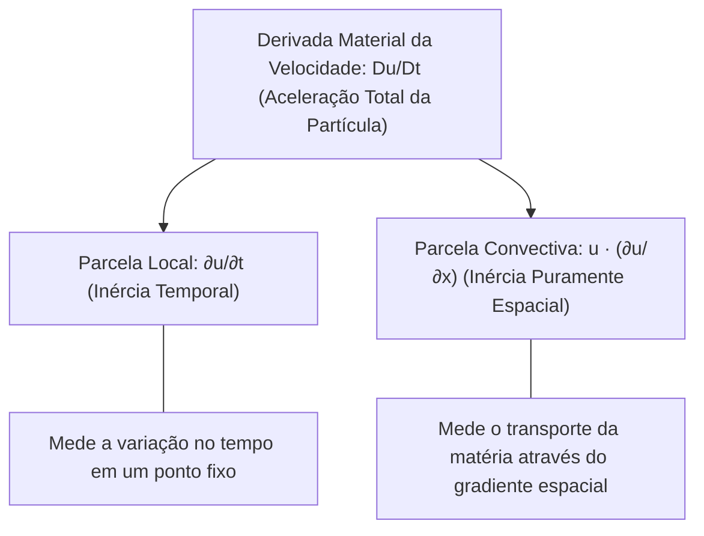

### C. Entenda o funcionamento (Dedução Passo a Passo)
Considere a velocidade longitudinal $u$ de uma partícula fluida. Como a partícula está em movimento, sua coordenada de posição $x$ depende do tempo: $x = x(t)$. Logo, a velocidade é descrita matematicamente como:

$$u = u(x(t), t)$$

Queremos saber a taxa total de variação de $u$ em relação ao tempo que um passageiro a bordo da partícula mediria ($\frac{du}{dt}$). Pela **Regra da Cadeia do Cálculo Diferencial**:

$$\frac{du}{dt} = \frac{\partial u}{\partial t}\frac{dt}{dt} + \frac{\partial u}{\partial x}\frac{dx}{dt}$$

Analisemos os termos:
1. $\frac{dt}{dt} = 1$;
2. $\frac{dx}{dt}$ é a taxa de variação da posição da partícula no tempo, que é a sua própria velocidade instantânea $u$:
   $$\frac{dx}{dt} = u$$

Substituindo esses valores, denotamos a derivada total por $\frac{D}{Dt}$ (operador da Derivada Material ou Substantiva):

$$\boxed{\frac{Du}{Dt} = \frac{\partial u}{\partial t} + u \frac{\partial u}{\partial x}}$$

### D. Conheça a definição técnica
> **Definição Técnica:**  
> A derivada material (ou substantiva) expressa a taxa temporal de variação de qualquer propriedade que acompanha o movimento real de uma partícula fluida individual. Em formulação unidimensional para a velocidade longitudinal $u(x, t)$, expande-se em:
> $$\frac{Du}{Dt} = \underbrace{\frac{\partial u}{\partial t}}_{\text{aceleração local}} + \underbrace{u \frac{\partial u}{\partial x}}_{\text{termo puramente espacial (inércia convectiva)}}$$

#### Análise Dimensional e de Unidades
Ambas as parcelas do lado direito possuem rigorosamente dimensão e unidade de aceleração:
- **Parcela Local:** $[\frac{\partial u}{\partial t}] = \frac{[L T^{-1}]}{[T]} = [L T^{-2}] \implies \text{m/s}^2$
- **Parcela Convectiva:** $[u \frac{\partial u}{\partial x}] = [L T^{-1}] \cdot \frac{[L T^{-1}]}{[L]} = [L T^{-2}] \implies \text{m/s}^2$

### E. O que precisa memorizar
- **Expressão completa:** $\frac{Du}{Dt} = \frac{\partial u}{\partial t} + u \frac{\partial u}{\partial x}$.
- **Termo puramente espacial:** $u \frac{\partial u}{\partial x}$ (representa a inércia convectiva).
- **Termo puramente temporal:** $\frac{\partial u}{\partial t}$ (representa a aceleração local).

### F. Atenção para a prova
> [!WARNING]
> **Armadilha Frequente:**  
> Se a questão pedir o "termo que representa a inércia puramente espacial", **NÃO responda apenas $\frac{\partial u}{\partial x}$**!  
> A derivada espacial $\frac{\partial u}{\partial x}$ é apenas um gradiente cinemático com dimensão $[T^{-1}]$ ($\text{s}^{-1}$). O termo de inércia e aceleração física exige a multiplicação pela velocidade de transporte $u$, resultando em $u \frac{\partial u}{\partial x}$ com dimensão de aceleração $[L T^{-2}]$ ($\text{m/s}^2$).

---

## 1.4. Comportamento da Aceleração Convectiva em Duto Divergente Permanente
*(Rastreabilidade: Questionário P1 — Pergunta 4)*

### A. Entenda a ideia
Agora imagine o oposto do bocal convergente: você entra em um difusor ou duto divergente, onde o tubo vai se abrindo e alargando. Para um fluxo de água permanente, quando o espaço alarga, a água se espalha e diminui a velocidade. 

Como a água está desacelerando enquanto viaja para a frente, a aceleração que a partícula experimenta tem o **sinal negativo**. Esse sinal negativo significa desaceleração mecânica (frenagem).

### B. Visualize o fenômeno
Pense na água de um rio estreito e veloz desembocando em uma lagoa calma e larga. A água que vinha rápida perde velocidade ao adentrar a seção espaçosa. Em um conduto divergente fechado (difusor de bomba, descarga de turbina hidráulica ou difusor de túnel de vento), a área da seção cresce ao longo de $x$ ($A_2 > A_1$).

```
Escoamento Permanente em Duto Divergente:
==================================================
        Entrada Estreita (A1)                Saída Larga (A2)
              ------                          -----------------
        --->  u1 (rápido)                     ---> u2 (lento)
              ------                          -----------------
               Área A(x) cresce ao longo de x (dA/dx > 0)
        Velocidade u(x) decresce ao longo de x (du/dx < 0)
==================================================
Gradiente espacial: ∂u/∂x < 0
Produto convectivo: u · (∂u/∂x) < 0 (a partícula freia fisicamente!)
```

### C. Entenda o funcionamento (Desenvolvimento Algébrico e Sinais)
1. **Comportamento da Geometria:**  
   Em duto divergente, a área transversal cresce no sentido do escoamento:
   $$\frac{dA}{dx} > 0$$

2. **Equação da Continuidade Incompressível:**  
   $$Q = A(x) u(x) = \text{constante} \implies u(x) = \frac{Q}{A(x)}$$
   Derivando em relação a $x$:
   $$\frac{\partial u}{\partial x} = -\frac{Q}{[A(x)]^2}\frac{dA}{dx}$$
   Como $\frac{dA}{dx} > 0$, o sinal de menos garante que:
   $$\frac{\partial u}{\partial x} < 0$$
   A velocidade diminui conforme a partícula avança.

3. **Cálculo do Produto Convectivo:**  
   A velocidade de avanço é positiva ($u > 0$). Multiplicando pelo gradiente negativo ($\frac{\partial u}{\partial x} < 0$):
   $$a_{\text{conv}} = u \frac{\partial u}{\partial x} = (+)\cdot(-) < 0$$

4. **Consequência Cinemática (Aceleração Convectiva Negativa):**  
   Sendo o regime permanente ($\frac{\partial u}{\partial t} = 0$), a aceleração material total reduz-se à parcela convectiva:
   $$\frac{Du}{Dt} = u \frac{\partial u}{\partial x} < 0$$
   O vetor aceleração aponta no sentido oposto ao movimento, configurando **desaceleração física cinemática real** ($a_{\text{conv}} < 0$) imposta pela expansão geométrica da área.

5. **Diferenciação Crítica entre Conclusão Cinemática e Análise Dinâmica:**  
   - **Conclusão Cinemática (da Continuidade):** A Equação da Continuidade incompressível unidimensional demonstra exclusivamente a relação cinemática de que a velocidade média decresce quando a área aumenta ($\frac{dA}{dx} > 0 \implies \frac{\partial u}{\partial x} < 0$). A continuidade, por si só, **não demonstra** a recuperação de pressão.
   - **Análise Dinâmica Complementar (Recuperação de Pressão):** A determinação do campo de pressões exige uma análise dinâmica adicional baseada na conservação da quantidade de movimento ou da energia. No caso idealizado de escoamento invíscido incompressível ao longo de uma linha de corrente, a Equação de Bernoulli ($p + \frac{1}{2}\rho u^2 = \text{constante} \implies dp = -\rho u\,du$) demonstra que a redução da energia cinética ($du < 0$) converte-se em acréscimo de pressão estática ($dp > 0$), configurando a recuperação de pressão.
   - **Ressalva para Dutos e Difusores Reais:** Não se deve assumir que todo duto divergente real recupera pressão de forma ideal. A presença de atrito viscoso nas paredes, a geometria e o ângulo de abertura do difusor, e sobretudo o risco iminente de descolamento/separação da camada limite sob o gradiente adverso de pressões ($\frac{\partial p}{\partial x} > 0$) geram perdas de carga significativas que limitam, degradam ou até anulam a recuperação efetiva de pressão a jusante.

### D. Conheça a definição técnica
> **Definição Técnica:**  
> Em um duto divergente horizontal operando em regime permanente e incompressível com velocidade longitudinal positiva ($u > 0$), como a área transversal cresce no sentido do escoamento ($\frac{dA}{dx} > 0$), a velocidade longitudinal diminui na direção axial ($\frac{\partial u}{\partial x} < 0$). Pela equação da continuidade, o produto convectivo $u \frac{\partial u}{\partial x}$ torna-se estritamente negativo, indicando desaceleração cinemática da partícula fluida ao se deslocar para a seção de maior área.

### E. O que precisa memorizar
- **Condições no divergente:** $u > 0$ e $\frac{\partial u}{\partial x} < 0$.
- **Produto convectivo:** $u \frac{\partial u}{\partial x} < 0$ (desaceleração cinemática).
- **Distinção conceitual:** A continuidade dita a frenagem cinemática; a recuperação de pressão depende de análise dinâmica adicional (ex.: Bernoulli), sujeita a perdas viscosas e separação em difusores reais.

### F. Atenção para a prova
> [!TIP]
> **Resumo de Contrastes para Prova:**
> - **Bocal Convergente:** Área diminui $\to \frac{\partial u}{\partial x} > 0 \to u \frac{\partial u}{\partial x} > 0$ (Aceleração positiva).
> - **Duto Divergente:** Área aumenta $\to \frac{\partial u}{\partial x} < 0 \to u \frac{\partial u}{\partial x} < 0$ (Desaceleração/Aceleração negativa).

---

## 1.5. O Erro Clássico da Cinemática: Aceleração Local Nula versus Aceleração Material
*(Rastreabilidade: Questionário P1 — Pergunta 5)*

### A. Entenda a ideia
Pense em um trem de montanha-russa passando por um looping. O operador do brinquedo sentou em um banquinho bem na entrada do looping e vê um carrinho passar por ali a cada minuto, sempre a $60\,\text{km/h}$. Ele diz: "Para mim, nada muda com o tempo; todo carrinho passa por aqui a $60\,\text{km/h}$". 

Mas pergunte para o passageiro que está dentro do carrinho se ele não acelerou! O passageiro sente o estômago subir à garganta e sofre uma força gigantesca enquanto faz o looping. 

O operador na cadeira é o **observador Euleriano estático** ($\frac{\partial \mathbf{V}}{\partial t} = \mathbf{0}$ na sua janela fixa). O passageiro no carrinho é a **partícula fluida em movimento** sofrendo a **aceleração material** ($\frac{D\mathbf{V}}{Dt} \neq \mathbf{0}$). Dizer que não há aceleração porque o operador vê sempre $60\,\text{km/h}$ na entrada é o erro mais clássico da física dos fluidos!

### B. Visualize o fenômeno (A Analogia da Bola na Rampa de Galileu/Newton)
Imagine uma rampa inclinada por onde esferas descem sob a ação da gravidade:
- **Abordagem Lagrangeana (câmera colada na bola):** A câmera viaja com a bola e mede sua velocidade crescendo segundo a segundo: $1\,\text{m/s} \to 2\,\text{m/s} \to 3\,\text{m/s}$. A aceleração é óbvia e evidente.
- **Abordagem Euleriana (sensor fixo no meio da rampa):** O sensor estático mede a velocidade de cada esfera que cruza aquela fenda exata. Todas as esferas passam por ali a exatamente $2\,\text{m/s}$. Se o observador euleriano olhar apenas para o sensor fixo, ele dirá: "A velocidade neste ponto não varia no tempo ($\partial u/\partial t = 0$)".
- **O Erro Fatal:** O observador concluir que a gravidade foi desligada e que a bola não está acelerando! A bola acelerou antes de chegar ao sensor e continuará acelerando depois dele através do gradiente espacial ($\partial u/\partial x$).

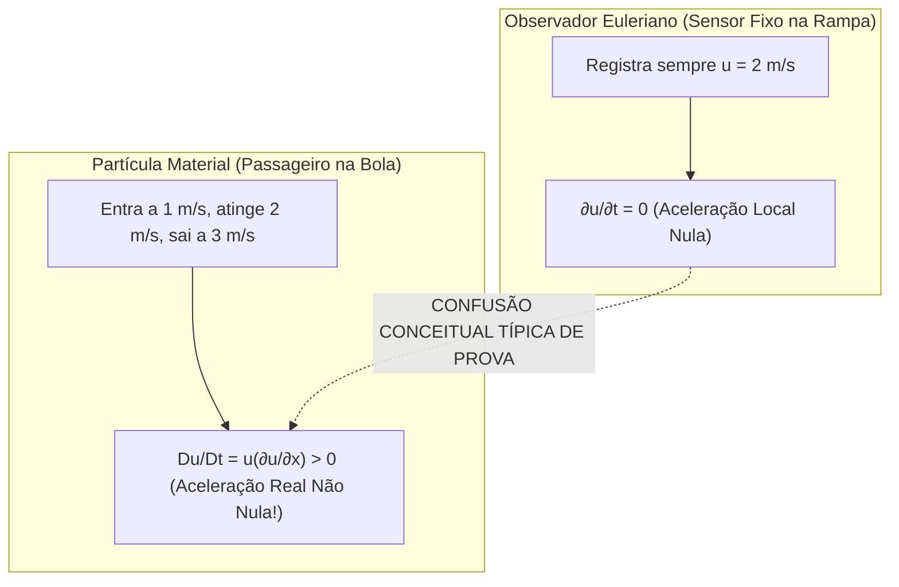

### C. Entenda o funcionamento (Confronto Matemático)
A Segunda Lei de Newton para uma porção de matéria de massa $m$ é rigorosamente:

$$\mathbf{F} = m \mathbf{a}_{\text{partícula}} = m \frac{D\mathbf{V}}{Dt}$$

Se o engenheiro confundir a derivada material da partícula com a derivada local do ponto fixo, ele escreveria erroneamente:

$$\mathbf{F} \stackrel{?}{=} m \frac{\partial \mathbf{V}}{\partial t}$$

Se essa fórmula errada fosse verdadeira, em qualquer escoamento permanente ($\frac{\partial \mathbf{V}}{\partial t} = \mathbf{0}$), a força líquida sobre qualquer partícula seria obrigatoriamente zero ($\mathbf{F} = \mathbf{0}$), o que significaria que a água nunca conseguiria contornar uma curva, passar por um bocal ou empurrar as pás de uma turbina hidrelétrica permanente.

A aceleração da matéria em coordenadas eulerianas é a soma:

$$\frac{D\mathbf{V}}{Dt} = \underbrace{\frac{\partial \mathbf{V}}{\partial t}}_{\text{zero no permanente}} + \underbrace{(\mathbf{V} \cdot \nabla)\mathbf{V}}_{\text{NÃO NULO se houver variação espacial}}$$

Portanto, em regime permanente com gradientes espaciais, $\frac{D\mathbf{V}}{Dt} \neq \mathbf{0}$.

### D. Conheça a definição técnica
> **Definição Técnica:**  
> O erro clássico consiste em confundir a derivada temporal local euleriana avaliada em um ponto estático do espaço ($\frac{\partial \mathbf{V}}{\partial t} = \mathbf{0}$) com a derivada substantiva (material) que acompanha o movimento da partícula individual no contínuo ($\frac{D\mathbf{V}}{Dt}$). Em regime permanente, embora a aceleração local seja identicamente nula em todos os pontos, a aceleração total da partícula pode ser não nula caso existam gradientes espaciais de velocidade, manifestando-se por meio dos termos de aceleração convectiva $(\mathbf{V}\cdot\nabla)\mathbf{V}$.

### E. O que precisa memorizar
- **O erro:** Dizer que "regime permanente implica que nenhuma partícula acelera" ou "regime permanente impõe $\frac{D\mathbf{V}}{Dt} = \mathbf{0}$ universalmente".
- **A correção conceitual:** Regime permanente impõe estritamente $\frac{\partial \mathbf{V}}{\partial t} = \mathbf{0}$. A aceleração da partícula é dada por $\frac{D\mathbf{V}}{Dt} = (\mathbf{V} \cdot \nabla)\mathbf{V}$, que é não nula se o campo for espacialmente heterogêneo.

### F. Atenção para a prova
> [!IMPORTANT]
> **Como refutar essa armadilha na prova:**  
> "A afirmativa é falsa. O erro reside em confundir a derivada local euleriana em uma coordenada estática ($\frac{\partial \mathbf{V}}{\partial t} = \mathbf{0}$) com a aceleração substantiva experimentada pela partícula móvel ($\frac{D\mathbf{V}}{Dt}$). Em regime permanente, uma partícula fluida pode sofrer aceleração convectiva não nula ao transitar por regiões com gradientes espaciais de velocidade ($\frac{D\mathbf{V}}{Dt} = (\mathbf{V}\cdot\nabla)\mathbf{V} \neq \mathbf{0}$)."

---

# Bloco 2: Conservação de Massa e Equação da Continuidade

---

## 2.1. Equação Diferencial Geral da Conservação de Massa (3D Compressível)
*(Rastreabilidade: Questionário P1 — Pergunta 6)*

### A. Entenda a ideia
Pense em uma caixa de sapatos aberta nas laterais onde entra e sai água. A lei da conservação da massa diz algo incrivelmente simples e inquestionável: **a matéria não pode surgir do nada nem sumir no ar**. 

Se entra mais massa na caixa do que a que sai pelos outros lados, a massa armazenada dentro da caixa é obrigada a aumentar (a água fica mais densa ou a caixa enche). Se sai mais massa do que entra, a massa lá dentro é obrigada a diminuir. A Equação da Continuidade é simplesmente a tradução dessa regra contábil da natureza para um tijolinho infinitesimal de fluido.

### B. Visualize o fenômeno
Imagine um minúsculo cubo transparente fixo no meio da água, com dimensões $\Delta x, \Delta y, \Delta z$. A água passa por ele como o vento passa por uma gaiola. A cada fração de segundo, medimos quanta massa de água entra pela face esquerda e quanta sai pela face direita (direção $x$), quanta entra por baixo e sai por cima (direção $y$), e quanta entra pela frente e sai pelo fundo (direção $z$). A diferença líquida entre o que entra e o que sai governa com precisão cirúrgica a variação da massa específica $\rho$ lá dentro.

```
Elemento de Volume de Controle Cúbico (Δx · Δy · Δz):
                  Face Superior (y + Δy)
                       ^ [ρv + ∂(ρv)/∂y · Δy] Δx Δz (efluxo)
                       |
Face Esquerda (x)   +------+   Face Direita (x + Δx)
------------------> |      | ------------------>
[ρu] Δy Δz (influxo)|      | [ρu + ∂(ρu)/∂x · Δx] Δy Δz (efluxo)
                    +------+
                       |
                       ^ Face Inferior (y): [ρv] Δx Δz (influxo)
```

### C. Entenda o funcionamento (Dedução Matemática Passo a Passo)
Vamos deduzir formalmente a equação geral sem pular nenhuma etapa:

1. **Princípio Contábil Fundamental de Reynolds:**
   $$\left[\begin{matrix} \text{Taxa líquida de influxo} \\ \text{de massa pelas faces} \end{matrix}\right] - \left[\begin{matrix} \text{Taxa líquida de efluxo} \\ \text{de massa pelas faces} \end{matrix}\right] = \left[\begin{matrix} \text{Taxa de acúmulo temporal} \\ \text{de massa no interior do cubo} \end{matrix}\right]$$

2. **Taxa de Acúmulo no Interior do Volume:**  
   A massa do volume cúbico $\Delta V = \Delta x\,\Delta y\,\Delta z$ é dada por $m = \rho\,\Delta x\,\Delta y\,\Delta z$. Sua taxa de variação no tempo é:
   $$\frac{\partial m}{\partial t} = \frac{\partial \rho}{\partial t} \Delta x\,\Delta y\,\Delta z$$

3. **Balanço na Direção Longitudinal ($x$):**
   - Na face de entrada em $x$, de área $A_x = \Delta y\,\Delta z$, a massa entra à taxa $(\rho u)\,\Delta y\,\Delta z$.
   - Na face oposta em $x + \Delta x$, a taxa de efluxo de massa varia ligeiramente no espaço. Expandindo em **Série de Taylor** de primeira ordem:
     $$\text{Efluxo}_x = \left[ \rho u + \frac{\partial (\rho u)}{\partial x}\Delta x \right]\Delta y\,\Delta z$$
   - Saldo líquido na direção $x$ ($\text{Entrada} - \text{Saída}$):
     $$\text{Saldo}_x = (\rho u)\Delta y\Delta z - \left[ \rho u + \frac{\partial (\rho u)}{\partial x}\Delta x \right]\Delta y\Delta z = -\frac{\partial (\rho u)}{\partial x}\Delta x\,\Delta y\,\Delta z$$

4. **Generalização para as Direções $y$ e $z$:**  
   Aplicando idêntico raciocínio para as faces normais a $y$ e a $z$:
   $$\text{Saldo}_y = -\frac{\partial (\rho v)}{\partial y}\Delta x\,\Delta y\,\Delta z$$
   $$\text{Saldo}_z = -\frac{\partial (\rho w)}{\partial z}\Delta x\,\Delta y\,\Delta z$$

5. **Fechamento do Balanço Geral:**  
   Somando os saldos das três direções espaciais e igualando à taxa de acúmulo temporal interna:
   $$-\left[ \frac{\partial (\rho u)}{\partial x} + \frac{\partial (\rho v)}{\partial y} + \frac{\partial (\rho w)}{\partial z} \right]\Delta x\,\Delta y\,\Delta z = \frac{\partial \rho}{\partial t}\Delta x\,\Delta y\,\Delta z$$

6. **Dividindo toda a equação pelo volume diferencial $\Delta x\,\Delta y\,\Delta z$ e rearranjando os termos:**
   $$\boxed{\frac{\partial \rho}{\partial t} + \frac{\partial (\rho u)}{\partial x} + \frac{\partial (\rho v)}{\partial y} + \frac{\partial (\rho w)}{\partial z} = 0}$$

### D. Conheça a definição técnica
> **Definição Técnica:**  
> A equação diferencial geral da conservação da massa para escoamentos tridimensionais compressíveis, expressa em coordenadas cartesianas, estabelece que a taxa de variação temporal da densidade somada à divergência do vetor densidade de fluxo de massa é identicamente nula:
> $$\frac{\partial \rho}{\partial t} + \frac{\partial (\rho u)}{\partial x} + \frac{\partial (\rho v)}{\partial y} + \frac{\partial (\rho w)}{\partial z} = 0$$
> ou, na forma vetorial compacta invariante:
> $$\boxed{\frac{\partial \rho}{\partial t} + \nabla \cdot (\rho \mathbf{V}) = 0}$$

#### Significado Físico das Variáveis, Dimensões e Unidades
- $\rho$: Massa específica instantânea do fluido ($[M L^{-3}]$, no SI: $\text{kg/m}^3$);
- $\mathbf{V} = u\hat{i} + v\hat{j} + w\hat{k}$: Vetor velocidade de escoamento ($[L T^{-1}]$, no SI: $\text{m/s}$);
- $\rho \mathbf{V}$: Vetor densidade de fluxo de massa ($[M L^{-2} T^{-1}]$, no SI: $\text{kg/(m}^2\cdot\text{s)}$);
- $\nabla \cdot (\rho \mathbf{V})$: Divergente do fluxo mássico, expressando a taxa líquida de efluxo de massa para fora do volume por unidade de volume ($[M L^{-3} T^{-1}]$, no SI: $\text{kg/(m}^3\cdot\text{s)}$);
- $\frac{\partial \rho}{\partial t}$: Taxa de variação temporal da massa específica no ponto fixo ($[M L^{-3} T^{-1}]$, no SI: $\text{kg/(m}^3\cdot\text{s)}$).

### E. O que precisa memorizar
- **Forma escalar:** $\frac{\partial \rho}{\partial t} + \frac{\partial (\rho u)}{\partial x} + \frac{\partial (\rho v)}{\partial y} + \frac{\partial (\rho w)}{\partial z} = 0$.
- **Forma vetorial compacta:** $\frac{\partial \rho}{\partial t} + \nabla \cdot (\rho \mathbf{V}) = 0$.
- **Significado físico:** O primeiro termo é a taxa de acúmulo de massa; o segundo termo é a taxa líquida de transferência de massa através das fronteiras de controle.

### F. Atenção para a prova
> [!TIP]
> **Dica de Avaliação:**  
> Note que esta é a equação **geral** para fluidos compressíveis (como gases ou ar em altas velocidades). Para a água em hidrodinâmica naval, ela se simplifica de maneira notável, como veremos no tópico a seguir.

---

## 2.2. Redução da Equação da Continuidade para Água Líquida ($\nabla \cdot \mathbf{V} = 0$)
*(Rastreabilidade: Questionário P1 — Pergunta 7)*

### A. Entenda a ideia
Tente apertar uma garrafa pet completamente cheia de água e sem nenhuma bolha de ar, bem fechada com a tampa. Você pode colocar o seu peso em cima dela: o volume da água praticamente não se altera. A água líquida é incrivelmente difícil de comprimir. 

Na hidrodinâmica naval e em dutos hidráulicos normais, as pressões em jogo são incapazes de comprimir a água de forma perceptível. Por isso, modelamos a água como **incompressível**: a sua densidade é tratada como um valor fixo, imutável e constante ($\rho \approx 1000\,\text{kg/m}^3$). Isso faz a equação da continuidade perder toda a complexidade e transformar-se na elegância de $\nabla \cdot \mathbf{V} = 0$.

### B. Visualize o fenômeno
Pense no casco de um submarino se deslocando na água. Conforme o submarino avança, ele empurra a água da proa. Como a água não pode ser comprimida nem adensada no espaço à frente da proa, cada gota empurrada obriga instantaneamente outra gota adjacente a se deslocar para os lados e contornar o casco. Não há "acúmulo" ou "amontoamento" de matéria: o fluxo precisa abrir caminho mantendo a densidade constante.

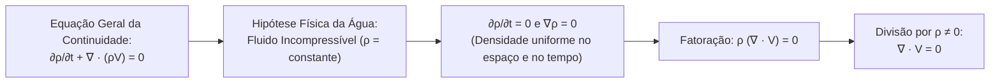

### C. Entenda o funcionamento (Dedução Algébrica Formal)
1. **Ponto de Partida (Forma Geral Vetorial):**
   $$\frac{\partial \rho}{\partial t} + \nabla \cdot (\rho \mathbf{V}) = 0$$

2. **Identidade Vetorial do Divergente de Escalar por Vetor:**  
   Pela regra do produto da análise vetorial:
   $$\nabla \cdot (\rho \mathbf{V}) = \rho (\nabla \cdot \mathbf{V}) + \mathbf{V} \cdot \nabla \rho$$
   Substituindo na equação geral:
   $$\frac{\partial \rho}{\partial t} + \mathbf{V} \cdot \nabla \rho + \rho (\nabla \cdot \mathbf{V}) = 0$$
   *(Observação analítica fundamental: os dois primeiros termos formam exatamente a derivada material da densidade: $\frac{D\rho}{Dt} + \rho(\nabla \cdot \mathbf{V}) = 0$)*.

3. **Aplicação da Hipótese de Incompressibilidade:**  
   Para a água líquida, a massa específica é constante em todo o domínio e não varia com o tempo:
   $$\rho = \text{constante} \implies \frac{\partial \rho}{\partial t} = 0 \quad \text{e} \quad \nabla \rho = \mathbf{0}$$
   Logo:
   $$\frac{D\rho}{Dt} = 0 + 0 = 0$$

4. **Simplificação e Cancelamento:**  
   A equação resume-se a:
   $$\rho (\nabla \cdot \mathbf{V}) = 0$$
   Como a densidade da água é estritamente não nula ($\rho \approx 1000\,\text{kg/m}^3 \neq 0$), podemos dividir ambos os membros por $\rho$:
   $$\boxed{\nabla \cdot \mathbf{V} = 0}$$
   Em coordenadas cartesianas escalares:
   $$\boxed{\frac{\partial u}{\partial x} + \frac{\partial v}{\partial y} + \frac{\partial w}{\partial z} = 0}$$

### D. Conheça a definição técnica
> **Definição Técnica:**  
> A redução da equação da continuidade para a forma de divergente nulo ($\nabla \cdot \mathbf{V} = 0$) ocorre porque a água líquida em condições operacionais convencionais comporta-se como um fluido incompressível, cuja massa específica é rigorosamente constante e uniforme no tempo e no espaço ($\rho = \text{constante}$, $\frac{\partial \rho}{\partial t} = 0$ e $\nabla \rho = \mathbf{0}$). A constante $\rho$ sai das derivadas espaciais e divide toda a equação, sendo eliminada e resultando na condição de divergente nulo do campo de velocidades.

### E. O que precisa memorizar
- **Forma vetorial incompressível:** $\nabla \cdot \mathbf{V} = 0$.
- **Forma cartesiana 3D:** $\frac{\partial u}{\partial x} + \frac{\partial v}{\partial y} + \frac{\partial w}{\partial z} = 0$.
- **Forma cartesiana 2D:** $\frac{\partial u}{\partial x} + \frac{\partial v}{\partial y} = 0$.
- **Motivo físico do cancelamento de $\rho$:** Massa específica constante e uniforme ($\rho = \text{cte} \neq 0$).

### F. Atenção para a prova
> [!WARNING]
> **Armadilha Crítica de Prova:**  
> É falsíssimo afirmar que $\nabla \cdot \mathbf{V} = 0$ exige que o escoamento esteja em regime permanente!  
> A incompressibilidade ($\rho = \text{constante}$) é a **única hipótese necessária** para obter $\nabla \cdot \mathbf{V} = 0$. Mesmo que o escoamento seja pulsante, turbulento, alternado ou altamente variável com o tempo, desde que o fluido seja incompressível, o divergente de sua velocidade será rigorosamente zero a cada instante!

---

## 2.3. Significado Físico da Condição de Divergente Nulo ($\nabla \cdot \mathbf{V} = 0$)
*(Rastreabilidade: Questionário P1 — Pergunta 8)*

### A. Entenda a ideia
Imagine que você tem um pedaço de massinha de modelar de $100\,\text{cm}^3$ na mão. Você pode amassar essa massinha, transformá-la em uma cobra comprida e fina, ou achatar como uma pizza redonda. O formato mudou completamente, mas o volume continua sendo rigorosamente $100\,\text{cm}^3$. 

Isso é exatamente o que a condição $\nabla \cdot \mathbf{V} = 0$ diz para uma gota de água: ela pode ser esticada, deformada, torcida ou girada pelo atrito da viscosidade, mas **o seu volume material não muda nem um milímetro cúbico sequer**.

### B. Visualize o fenômeno
Uma gota de água passa raspando pela quilha ou pelo bulbo de proa de um navio:
- Ela é submetida a tensões de cisalhamento brutais;
- Ela se deforma de um cubo para um losango achatado;
- Ela gira sobre si mesma.  
Contudo, se você pudesse calcular o volume daquela mesma porção de matéria em qualquer instante, o volume seria absolutamente invariável. A taxa de dilatação volumétrica é nula.

```
Deformação Incompressível (∇ · V = 0):
Elemento Inicial           Estirado em x             Cisalhado Angularmente
    +-----+                   +-----------+               /-----/
    |     |   Volume V0       |           | Volume V0    /     / Volume V0
    +-----+                   +-----------+             /-----/
Volume constante! (Se estica na direção x, é forçado a achatar na direção y)
```

### C. Entenda o funcionamento (Interpretação Cinemática e Geométrica)
No cálculo tensorial e na cinemática dos meios contínuos, demonstra-se formalmente que o divergente do campo de velocidades $\nabla \cdot \mathbf{V}$ representa a **taxa relativa de dilatação volumétrica por unidade de volume** de um elemento fluido em trânsito:

$$\nabla \cdot \mathbf{V} = \frac{1}{\delta V}\frac{D(\delta V)}{Dt}$$

onde $\delta V$ representa o volume material infinitesimal da partícula.

Integrando essa equação ao longo da trajetória:
1. Impor formalmente $\nabla \cdot \mathbf{V} = 0$ significa que:
   $$\frac{1}{\delta V}\frac{D(\delta V)}{Dt} = 0 \iff \frac{D(\delta V)}{Dt} = 0$$
2. Uma derivada material nula para o volume ($\frac{D(\delta V)}{Dt} = 0$) estabelece que:
   $$\delta V(t) = \text{constante}$$

Portanto, $\nabla \cdot \mathbf{V} = 0$ expressa a **conservação estrita do volume de cada porção material de fluido**.

### D. Conheça a definição técnica
> **Definição Técnica:**  
> O significado físico da condição de divergente nulo ($\nabla \cdot \mathbf{V} = 0$) é que a taxa de variação volumétrica por unidade de volume de cada partícula fluida é identicamente nula. O elemento de fluido pode sofrer deformação linear (estiramento), deformação angular (cisalhamento) e rotação espacial, mas o seu volume material permanece absolutamente constante ao longo de todo o escoamento.

### E. O que precisa memorizar
- **Conceito-chave:** Dilatação volumétrica unitária nula ($\frac{1}{\delta V}\frac{D(\delta V)}{Dt} = 0$).
- **Volume material constante:** $\delta V = \text{constante}$.
- **Distinção:** Deformação geométrica é permitida; alteração volumétrica é proibida.

### F. Atenção para a prova
> [!IMPORTANT]
> **Como responder em prova sem perder pontos:**  
> "A condição $\nabla \cdot \mathbf{V} = 0$ significa fisicamente que a taxa de variação volumétrica por unidade de volume é identicamente nula. O elemento de fluido incompressível pode deformar-se, estirar-se ou rotacionar, mas seu volume material permanece rigorosamente constante ao longo de todo o escoamento."

---

## 2.4. Resolução Analítica em Canal Bidimensional: Determinação de $\partial v/\partial y$
*(Rastreabilidade: Questionário P1 — Pergunta 9)*

### A. Entenda a ideia
Vamos aplicar o princípio de que o volume de um fluido incompressível não pode mudar. Se em um canal plano bidimensional a água está sendo acelerada para a frente na direção horizontal ($x$), a frente da gota corre mais rápido que a traseira, esticando a gota no sentido horizontal. 

Para que o volume total dessa gota continue rigorosamente constante, o que tem que acontecer na direção vertical ($y$)? A gota tem que ser "espremida" lateralmente! O cálculo diferencial calcula com exatidão matemática esse achatamento transversal.

### B. Visualize o fenômeno
Pense em puxar uma bexiga de borracha pelas duas pontas: quando você a estica no comprimento, a barriga dela afina no meio. Na água incompressível ocorre exatamente isso: se $\frac{\partial u}{\partial x} > 0$ (estiramento longitudinal), a continuidade exige que $\frac{\partial v}{\partial y} < 0$ (contração transversal).

```
Canal Bidimensional (Plano x, y):
Velocidade horizontal: u(x) = C1 + C2 · x (com C2 > 0)
Estiramento horizontal: ∂u/∂x = +C2 > 0  (partícula estica em x)
               y
               ^
               |   Layer superior desce: v(y) converge
               |   ======> u(x) aumenta para a direita
               |   Layer inferior sobe: v(y) converge
               +----------------------------> x
Pela continuidade incompressível: ∂v/∂y = -C2 < 0 (as camadas se aproximam!)
```

### C. Entenda o funcionamento (Resolução Analítica Passo a Passo)
1. **Configuração do Problema:**  
   Dado um escoamento bidimensional no plano $(x, y)$ incompressível, cuja velocidade longitudinal cresce linearmente com a distância:
   $$u(x) = C_1 + C_2 x \quad (\text{com constante } C_2 > 0)$$

2. **Equação Governante (Continuidade 2D Incompressível):**  
   Partindo da forma bidimensional de $\nabla \cdot \mathbf{V} = 0$:
   $$\frac{\partial u}{\partial x} + \frac{\partial v}{\partial y} = 0$$

3. **Derivando a Velocidade Horizontal $u(x)$ em Relação a $x$:**  
   $$\frac{\partial u}{\partial x} = \frac{d}{dx}(C_1 + C_2 x) = 0 + C_2 = C_2$$

4. **Substituindo na Equação da Continuidade:**  
   $$C_2 + \frac{\partial v}{\partial y} = 0$$

5. **Isolando a Derivada Parcial Transversal $\frac{\partial v}{\partial y}$:**  
   $$\boxed{\frac{\partial v}{\partial y} = -C_2}$$
   Como por premissa física $C_2 > 0$, conclui-se diretamente que:
   $$\boxed{\frac{\partial v}{\partial y} < 0}$$

### D. Conheça a definição técnica
> **Definição Técnica:**  
> Para um escoamento bidimensional incompressível governado pela equação da continuidade $\frac{\partial u}{\partial x} + \frac{\partial v}{\partial y} = 0$, onde a componente longitudinal é dada por $u(x) = C_1 + C_2 x$ com $C_2 > 0$, a taxa de deformação transversal é obtida derivando $u$ em relação a $x$ e isolando o gradiente vertical, resultando em:
> $$\frac{\partial v}{\partial y} = -C_2 < 0$$

### E. O que precisa memorizar
- **Equação de partida:** $\frac{\partial u}{\partial x} + \frac{\partial v}{\partial y} = 0$.
- **Derivada calculada:** $\frac{\partial u}{\partial x} = C_2$.
- **Resposta exata:** $\frac{\partial v}{\partial y} = -C_2$ (estritamente negativa).

### F. Atenção para a prova
> [!TIP]
> **Dica de Resolução de Prova:**  
> Este é o único cálculo analítico diferencial direto de continuidade cobrado no questionário oficial. Não esqueça do sinal de menos: a resposta correta é $-C_2$, jamais $+C_2$.

---

## 2.5. Interpretação Física da Convergência Transversal ($\partial v/\partial y = -C_2 < 0$)
*(Rastreabilidade: Questionário P1 — Pergunta 10)*

### A. Entenda a ideia
No tópico anterior calculamos que $\frac{\partial v}{\partial y} = -C_2 < 0$. Mas qual é o significado físico rigoroso desse sinal negativo?

Um gradiente transversal negativo $\frac{\partial v}{\partial y} < 0$ estabelece que a componente transversal de velocidade $v$ decresce à medida que a coordenada $y$ aumenta. Na cinemática das deformações contínuas, isso expressa uma **taxa de deformação linear negativa (contração transversal)**: o elemento fluido sofre encurtamento na direção $y$ para compensar exatamente o estiramento longitudinal sofrido na direção $x$ ($\frac{\partial u}{\partial x} > 0$), garantindo a invariância de volume do fluido incompressível.

### B. Visualize o fenômeno
Pense em uma barra de borracha incompressível ou em uma massa de modelar: quando você puxa e estica o material longitudinalmente no eixo $x$, o material é forçado a afinar e contrair transversalmente no eixo $y$. 

No escoamento bidimensional, a conservação da massa incompressível ($\frac{\partial u}{\partial x} + \frac{\partial v}{\partial y} = 0$) impõe essa mesma compensação contínua. Contudo, a direção real do movimento das camadas fluidas (os sinais algébricos de $v$) depende estritamente das **condições de contorno geométricas**:
- **Em um bocal convergente simétrico em relação ao plano central $y=0$:** a linha de centro tem $v(0)=0$; as camadas superiores descem em direção ao centro ($v < 0$ para $y > 0$) e as inferiores sobem ($v > 0$ para $y < 0$), caracterizando uma convergência transversal em direção ao eixo.
- **Se houver uma parede plana impermeável inferior em $y=0$:** a condição de contorno impõe $v(0)=0$. Integrando $\frac{\partial v}{\partial y} = -C_2$, obtém-se $v(y) = -C_2 y \le 0$ para todo $y \ge 0$, de modo que a componente vertical é negativa em todo o domínio acima da parede.

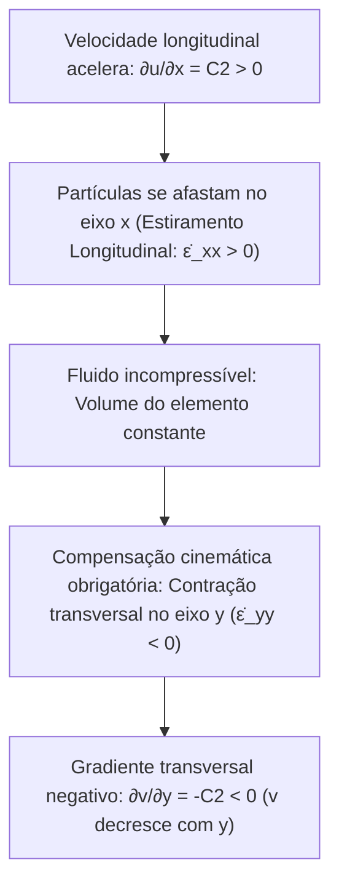

### C. Entenda o funcionamento (Mecanismo Físico de Compensação e Distinções Teóricas)
1. **O Estiramento no Eixo $x$:**  
   Como $\frac{\partial u}{\partial x} = C_2 > 0$, a extremidade dianteira de qualquer elemento diferencial avança a uma velocidade maior do que a sua face traseira. Em um intervalo de tempo $\Delta t$, o elemento sofre estiramento linear na direção horizontal:
   $$\Delta x_{\text{novo}} > \Delta x_{\text{original}}$$

2. **A Restrição Física Inegociável da Incompressibilidade:**  
   Como o fluido é incompressível ($\rho = \text{constante}$), a densidade não pode diminuir para preencher o comprimento esticado. O volume do elemento deve ser estritamente preservado:
   $$V = \Delta x \cdot \Delta y \cdot \Delta z = \text{constante} \iff \nabla \cdot \mathbf{V} = \frac{\partial u}{\partial x} + \frac{\partial v}{\partial y} = 0$$

3. **A Resposta Cinemática no Eixo $y$:**  
   Para que a área $\Delta x \cdot \Delta y$ permaneça invariável, o estiramento $\Delta x$ deve ser contraposto por uma redução equivalente na espessura transversal $\Delta y$:
   $$\Delta y_{\text{novo}} < \Delta y_{\text{original}} \iff \frac{\partial v}{\partial y} < 0$$

4. **Diferenciação Teórica Obrigatória entre Conceitos Cinemáticos:**  
   Para evitar armadilhas conceituais, é essencial distinguir com rigor:
   - **Gradiente de velocidade ($\frac{\partial v}{\partial y}$):** É a taxa espacial de variação da velocidade transversal com a posição. Representa a taxa de deformação linear transversal ($\dot{\epsilon}_{yy} = \frac{\partial v}{\partial y} = -C_2 < 0$).
   - **Componente de velocidade ($v$):** É o valor local da velocidade no eixo $y$, obtido pela integração do gradiente ($v(y) = \int \frac{\partial v}{\partial y} dy = -C_2 y + C_3$). Seus valores e sinais dependem exclusivamente da constante $C_3$ fixada pelas condições de contorno.
   - **Aceleração material ($\frac{Dv}{Dt}$):** É a taxa substantiva de variação da quantidade de movimento transversal sentida pela partícula fluida ($\frac{Dv}{Dt} = \frac{\partial v}{\partial t} + u\frac{\partial v}{\partial x} + v\frac{\partial v}{\partial y}$), não se confundindo com o mero gradiente estático $\frac{\partial v}{\partial y}$.
   - **Condições de contorno:** São os vínculos cinemáticos e dinâmicos impostos pelas fronteiras sólidas ou de simetria do domínio, os quais fixam os campos de velocidade e pressão.

### D. Conheça a definição técnica
> **Definição Técnica:**  
> O significado físico de $\frac{\partial v}{\partial y} = -C_2 < 0$ é a necessidade de compensação cinemática para a conservação da massa incompressível: para compensar o estiramento longitudinal e o afastamento relativo das partículas na direção horizontal ($\frac{\partial u}{\partial x} > 0$) sem alterar o volume nem a densidade do elemento fluido, o escoamento apresenta uma taxa de deformação linear negativa na direção transversal, expressa por um gradiente no qual a velocidade transversal decresce com o aumento de $y$ ($\frac{\partial v}{\partial y} < 0$), resultando na aproximação ou convergência relativa das camadas fluidas.

### E. O que precisa memorizar
- **Causa:** Estiramento longitudinal ($\frac{\partial u}{\partial x} > 0$).
- **Efeito:** Taxa de deformação linear transversal negativa ($\frac{\partial v}{\partial y} < 0$, decréscimo de $v$ com $y$).
- **Dependência de contorno:** Os sinais e sentidos de $v(y)$ dependem das fronteiras físicas (plano de simetria vs. parede impermeável).
- **Objetivo físico:** Preservação estrita do volume e da densidade do elemento incompressível.

### F. Atenção para a prova
> [!TIP]
> **Como responder na prova:**  
> "Para compensar o estiramento e o afastamento das partículas na direção horizontal ($x$) sem alterar o volume nem a densidade do fluido incompressível, as camadas fluidas precisam aproximar-se/convergir na direção transversal ($y$), correspondendo a uma taxa de deformação linear transversal negativa ($\frac{\partial v}{\partial y} < 0$)."

---

# Bloco 3: Balanço de Forças e Gradientes de Pressão

---

## 3.1. Cálculo da Força Líquida de Pressão em um Elemento Diferencial $dx\,dy\,dz$
*(Rastreabilidade: Questionário P1 — Pergunta 11)*

### A. Entenda a ideia
Pense em você no meio de uma multidão apertada: pessoas estão te empurrando pelas costas e outras pessoas estão te empurrando pelo peito. Se quem está atrás empurrar com a mesma força de quem está na frente, você fica parado no mesmo lugar. 

Mas se a pressão nas suas costas for maior do que a pressão no seu peito, você será empurrado para a frente! A força que faz a matéria se mover não é o valor absoluto da pressão em si, mas sim a **diferença líquida de pressão entre as faces opostas**. Em um minúsculo bloco de fluido, essa diferença líquida de pressão nas faces produz a força de gradiente $-\frac{\partial p}{\partial x} dx\,dy\,dz$.

### B. Visualize o fenômeno
Imagine uma pequena caixa cúbica de água de dimensões $dx, dy, dz$. A pressão é uma força de aperto (compressão) que atua perpendicularmente para dentro de cada uma das 6 faces da caixa. 

Na face da esquerda ($x$), a água de fora empurra a caixa para a direita com pressão $p$. Na face da direita ($x+dx$), a água empurra a caixa para a esquerda com pressão $p + \frac{\partial p}{\partial x}dx$. Se a pressão for caindo ao longo do caminho ($\frac{\partial p}{\partial x} < 0$), o empurrão da esquerda vence o empurrão da direita, e a caixinha acelera para a frente!

```
Balanço Diferencial de Forças de Pressão no Eixo x:
==================================================================
           Face Esquerda (x)                   Face Direita (x + dx)
              Área: dy · dz                        Área: dy · dz
                   |                                     |
  Força Positiva   |          Elemento Fluido            |   Força Negativa
  (empurra p/ dir) |             (dx·dy·dz)              |   (empurra p/ esq)
  +p · dy · dz  ----->                                 <----- -(p + ∂p/∂x · dx) · dy · dz
                   |                                     |
==================================================================
Saldo Líquido: dF_p,x = p·dy·dz - [p + ∂p/∂x · dx]·dy·dz = -∂p/∂x · (dx · dy · dz)
Por Unidade de Volume (dividindo por dx·dy·dz): f_p,x = -∂p/∂x
```

### C. Entenda o funcionamento (Dedução Matemática Passo a Passo)
1. **Configuração Geométrica e Definições:**  
   Considere um elemento paralelepipédico de fluido de arestas infinitesimais $dx, dy, dz$ e volume diferencial:
   $$dV = dx\,dy\,dz$$
   A pressão estática $p(x, y, z)$ é uma grandeza escalar isotrópica que se manifesta microscopicamente como uma **tensão normal de compressão pura**, atuando sempre orientada para o interior do volume (empurrando para dentro da matéria).

2. **Força Atuante na Face da Esquerda (Cota $x$):**  
   A face perpendicular ao eixo $x$ situada na posição $x$ possui área $dA = dy\,dz$.  
   Como a pressão empurra o elemento para dentro (sentido positivo do eixo $+x$), a força exercida sobre a face esquerda é:
   $$dF_{x,\text{esquerda}} = +p\,dy\,dz$$

3. **Força Atuante na Face da Direita (Cota $x + dx$):**  
   A face oposta situada na posição $x + dx$ possui exatamente a mesma área diferencial $dA = dy\,dz$.  
   A pressão nesta face é ligeiramente alterada devido à variação espacial contínua do campo de pressões. Pelo primeiro termo da **Série de Taylor**:
   $$p(x + dx) = p + \frac{\partial p}{\partial x}dx$$
   Como essa pressão atua empurrando para dentro da face direita (apontando no sentido negativo do eixo $-x$), a força gerada é:
   $$dF_{x,\text{direita}} = -\left( p + \frac{\partial p}{\partial x}dx \right) dy\,dz$$

4. **Soma Algébrica das Forças Opostas (Força Líquida Total $dF_{p,x}$):**  
   Somam-se as duas forças para obter a força resultante na direção $x$:
   $$dF_{p,x} = dF_{x,\text{esquerda}} + dF_{x,\text{direita}} = p\,dy\,dz - \left( p + \frac{\partial p}{\partial x}dx \right) dy\,dz$$
   $$dF_{p,x} = p\,dy\,dz - p\,dy\,dz - \frac{\partial p}{\partial x}dx\,dy\,dz$$
   $$\boxed{dF_{p,x} = -\frac{\partial p}{\partial x}dx\,dy\,dz}$$

5. **Força Resultante de Pressão por Unidade de Volume:**  
   Dividindo a força líquida resultante pelo volume diferencial $dV = dx\,dy\,dz$:
   $$f_{p,x} = \frac{dF_{p,x}}{dV} = \frac{-\frac{\partial p}{\partial x}dx\,dy\,dz}{dx\,dy\,dz} = -\frac{\partial p}{\partial x}$$

6. **Generalização Vetorial Tridimensional:**  
   Aplicando idêntico procedimento para as faces perpendiculares aos eixos $y$ e $z$:
   $$\mathbf{f}_p = -\left( \frac{\partial p}{\partial x}\hat{i} + \frac{\partial p}{\partial y}\hat{j} + \frac{\partial p}{\partial z}\hat{k} \right) = \boxed{-\nabla p}$$

### D. Conheça a definição técnica
> **Definição Técnica:**  
> A força líquida resultante devida à pressão sobre um elemento diferencial de volume $dx\,dy\,dz$ é dada pela soma vetorial das forças normais compressivas opostas nas faces em $x$ e $x+dx$:
> $$dF_{p,x} = p\,dy\,dz - \left(p + \frac{\partial p}{\partial x}dx\right)dy\,dz = -\frac{\partial p}{\partial x}dx\,dy\,dz$$
> Expressa por unidade de volume (dividindo por $dV = dx\,dy\,dz$), a força resultante de pressão é identicamente igual ao gradiente espacial negativo da pressão:
> $$f_{p,x} = -\frac{\partial p}{\partial x} \quad (\text{ou vetorialmente: } \mathbf{f}_p = -\nabla p)$$

#### Grandezas Envolvidas, Dimensões e Unidades
- $p$: Campo de pressão local ($[M L^{-1} T^{-2}]$, no SI: $\text{Pa} = \text{N/m}^2$);
- $\frac{\partial p}{\partial x}$: Gradiente espacial de pressão na direção $x$ ($[M L^{-2} T^{-2}]$, no SI: $\text{Pa/m} = \text{N/m}^3$);
- $dF_{p,x}$: Força resultante de pressão no elemento ($[M L T^{-2}]$, no SI: $\text{N}$);
- $f_{p,x} = -\frac{\partial p}{\partial x}$: Força de pressão por unidade de volume ($[M L^{-2} T^{-2}]$, no SI: $\text{N/m}^3$).

### E. O que precisa memorizar
- **Força líquida total no elemento $dx\,dy\,dz$:** $-\frac{\partial p}{\partial x}dx\,dy\,dz$.
- **Força por unidade de volume:** $-\frac{\partial p}{\partial x}$ (escalar 1D) ou $-\nabla p$ (vetorial 3D).
- **Origem matemática do termo:** Cancelamento do termo $p\,dy\,dz$ e sobra do termo de variação de Taylor $-\frac{\partial p}{\partial x}dx\,dy\,dz$.

### F. Atenção para a prova
> [!WARNING]
> **Cuidado com a Pergunta da Prova:**  
> - Se o enunciado pedir a **força total no elemento diferencial**, a resposta é: $-\frac{\partial p}{\partial x}dx\,dy\,dz$.
> - Se o enunciado pedir a **força por unidade de volume**, a resposta é: $-\frac{\partial p}{\partial x}$.  
> Não confunda as duas grandezas! A força por unidade de volume tem o volume diferencial $dx\,dy\,dz$ cancelado no denominador.

---

## 3.2. A Origem e o Significado do Sinal Negativo ($-\partial p/\partial x$) em Navier–Stokes
*(Rastreabilidade: Questionário P1 — Pergunta 12)*

### A. Entenda a ideia
Por que existe um sinal de menos na frente da pressão na Equação de Navier–Stokes ($\rho \frac{Du}{Dt} = -\frac{\partial p}{\partial x} + \dots$)? 

Pense em um tubo de pasta de dente: você aperta o fundo da embalagem (alta pressão) e a pasta sai pela ponta aberta (baixa pressão). As coisas na natureza são naturalmente empurradas de onde a pressão é **alta** para onde a pressão é **baixa**. 

Se você viaja para a frente (direção $+x$) e a pressão vai caindo ($p_1 > p_2$), a variação matemática da pressão é negativa ($\Delta p = p_2 - p_1 < 0$). O sinal de menos existe exatamente para transformar essa variação negativa em uma força **positiva para a frente**!

### B. Visualize o fenômeno
Pense em um submarino ou em uma tubulação de água:
- Montante (trás): $p_1 = 10\,\text{atm}$;
- Jusante (frente): $p_2 = 2\,\text{atm}$.  
O fluido acelera da esquerda para a direita ($+x$).  
A taxa de variação espacial é:
$$\frac{\partial p}{\partial x} \approx \frac{p_2 - p_1}{\Delta x} = \frac{2 - 10}{\Delta x} = -\frac{8}{\Delta x} < 0$$
O gradiente é negativo. Se não houvesse o sinal de menos na 2ª Lei de Newton, a equação diria que a força empurra para trás! O sinal de menos é quem garante:
$$\text{Força} = - \left( \frac{\partial p}{\partial x} \right) = -(-8) = +8 > 0 \quad (\text{empurra para a frente!})$$

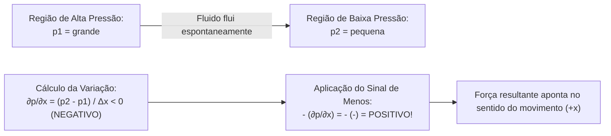

### C. Entenda o funcionamento (Fundamentação Mecânica e Tensorial)
1. **A Natureza Compressiva da Pressão:**  
   Diferente das tensões de tração em sólidos (que puxam), a pressão em fluidos atua estritamente como tensão normal compressiva (empurra contra a matéria).
2. **Condição de Aceleração para a Frente:**  
   Pela Segunda Lei de Newton ($F_{\text{líquida}} = m a_x$), para que haja aceleração no sentido positivo $+x$, a força atuante na face traseira ($x$) deve superar a força atuante na face dianteira ($x+dx$):
   $$F_{\text{traseira}} > F_{\text{dianteira}} \iff p_1 > p_2$$
3. **Comportamento Algébrico do Gradiente:**  
   Quando $p_1 > p_2$ ao longo de uma distância positiva $\Delta x > 0$, o gradiente é algebricamente negativo:
   $$\frac{\partial p}{\partial x} < 0$$
4. **Fechamento de Sinal:**  
   Multiplicando esse gradiente negativo pelo sinal de menos presente na formulação diferencial:
   $$f_{p,x} = -\frac{\partial p}{\partial x} = -(\text{valor negativo}) > 0$$
   obtemos uma força positiva orientada na direção do avanço $+x$. Em suma: o sinal negativo é a expressão matemática da causalidade física de que **o fluido acelera espontaneamente do ponto de maior pressão para o ponto de menor pressão**.

### D. Conheça a definição técnica
> **Definição Técnica:**  
> O sinal negativo no termo de pressão da equação de Navier–Stokes ($-\frac{\partial p}{\partial x}$) decorre da natureza termomecânica da pressão, que atua exclusivamente como uma tensão normal de compressão de fora para dentro contra as fronteiras do elemento fluido. Para produzir aceleração física para a frente (sentido positivo do eixo $+x$), a pressão na face posterior (montante) deve ser maior do que a pressão na face anterior (jusante). Isso configura um gradiente espacial longitudinal estritamente negativo ($\frac{\partial p}{\partial x} < 0$). O sinal de menos converte esse gradiente negativo em uma força volumétrica efetivamente positiva ($-\frac{\partial p}{\partial x} > 0$), garantindo que o fluido seja acelerado de regiões de maior pressão para regiões de menor pressão.

### E. O que precisa memorizar
- **Razão física:** A pressão é compressiva; para acelerar para a frente, a pressão de trás deve ser maior que a da frente ($p_1 > p_2$).
- **Sinal do gradiente:** $p_1 > p_2 \implies \frac{\partial p}{\partial x} < 0$.
- **Operação de sinal:** $-(\frac{\partial p}{\partial x}) = -(-) = +$ (força motora positiva).

### F. Atenção para a prova
> [!TIP]
> **Como responder discursivamente na prova:**  
> "Porque a pressão atua sempre como tensão normal de compressão de fora para dentro. Para que haja aceleração para a frente (sentido positivo), a pressão atrás deve ser maior que a pressão à frente ($\frac{\partial p}{\partial x} < 0$), empurrando o fluido de zonas de maior pressão para zonas de menor pressão. O sinal negativo é o que converte essa queda de pressão em uma força líquida positiva no sentido do movimento."

---

## 3.3. Comportamento Dinâmico de um Fluido Hipotético com Força $+\partial p/\partial x$
*(Rastreabilidade: Questionário P1 — Pergunta 13)*

### A. Entenda a ideia
O que aconteceria se a equação da quantidade de movimento fosse formulada erroneamente com o sinal positivo no termo de pressão, adotando $+\frac{\partial p}{\partial x}$ em vez do termo correto $-\frac{\partial p}{\partial x}$?

A inversão do sinal matemático representaria uma **direção física incorreta para a força volumétrica de pressão**. Em vez de a força resultante apontar da região de maior pressão para a de menor pressão (como decorre do empurrão compressivo das pressões nas faces do elemento), o modelo com sinal invertido calcularia uma força orientada no sentido em que a pressão aumenta, contrariando o balanço real de forças de superfície.

### B. Visualize o fenômeno através de um Gradiente Definido
Considere um duto horizontal reto ao longo do eixo $x$, com escoamento entre as seções $x_1$ e $x_2$ ($x_2 > x_1$), onde a pressão diminui linearmente:
- Seção $x_1$: $p_1 = 5\,\text{bar}$;
- Seção $x_2$: $p_2 = 2\,\text{bar}$;
- Gradiente espacial de pressão definido: $\frac{\partial p}{\partial x} \approx \frac{p_2 - p_1}{x_2 - x_1} = -C < 0$ (com $C > 0$).

Como a pressão é essencialmente compressiva, o fluido adjacente empurra a face esquerda em $x_1$ para a direita com força $+p_1 A$, e o fluido à frente empurra a face direita em $x_2$ para a esquerda com força $-p_2 A$. Como $p_1 > p_2$, a força líquida real aponta no sentido positivo $+x$ (em direção à menor pressão):
1. **Pela Formulação Correta ($-\frac{\partial p}{\partial x}$):**  
   $$f_{p,x} = -\frac{\partial p}{\partial x} = -(-C) = +C > 0$$  
   A força calculada aponta no sentido $+x$, em perfeita concordância com o empurrão líquido das faces compressivas.
2. **Pela Formulação Hipotética Invertida ($+\frac{\partial p}{\partial x}$):**  
   $$f_{p,x} = +\frac{\partial p}{\partial x} = -C < 0$$  
   A força calculada apontaria no sentido $-x$ (para trás), prevendo que o fluido seria acelerado na direção da região de maior pressão ($x_1$), invertendo a resultante real das forças de contato.

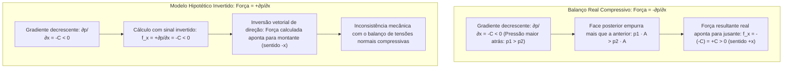

### C. Entenda o funcionamento (Balanço de Forças e Natureza Compressiva)
1. **Origem da Força de Pressão no Elemento Diferencial:**  
   Em qualquer meio fluido contínuo, a pressão atua perpendicularmente e de fora para dentro contra as faces do elemento de volume $dx\,dy\,dz$. O balanço de forças na direção $x$ fornece:
   $$dF_{p,x} = p\,dy\,dz - \left( p + \frac{\partial p}{\partial x}dx \right)dy\,dz = -\frac{\partial p}{\partial x}dx\,dy\,dz$$
   Dividindo pelo volume $dV = dx\,dy\,dz$, a força volumétrica fisicamente consistente é obrigatoriamente:
   $$f_{p,x} = -\frac{\partial p}{\partial x}$$

2. **A Inversão Vetorial no Modelo Hipotético:**  
   Ao postular a equação $\rho \frac{Du}{Dt} = +\frac{\partial p}{\partial x}$, introduz-se um erro vetorial de direção:
   - Se $\frac{\partial p}{\partial x} > 0$ (pressão aumentando à frente), a força real é contrária ao movimento ($-\frac{\partial p}{\partial x} < 0$, atuando como força resistente que freia o escoamento). O termo hipotético calcularia $+\frac{\partial p}{\partial x} > 0$, prevendo incorretamente uma força motora a favor do avanço.
   - Se $\frac{\partial p}{\partial x} < 0$ (pressão diminuindo à frente), a força real é motora ($-\frac{\partial p}{\partial x} > 0$). O termo hipotético calcularia $+\frac{\partial p}{\partial x} < 0$, prevendo uma força que frearia o fluido em vez de impulsioná-lo.

3. **Conclusão Mecânica:**  
   A formulação com sinal positivo viola o princípio fundamental do balanço de tensões normais de contato, atribuindo à força resultante de pressão uma orientação espacial diametralmente oposta àquela determinada pela ação compressiva das pressões nas fronteiras do elemento fluido.

### D. Conheça a definição técnica
> **Definição Técnica:**  
> Se a força volumétrica de pressão fosse expressa pelo termo hipotético com sinal positivo ($+\frac{\partial p}{\partial x}$), ocorreria uma inversão da direção vetorial da força calculada em relação ao balanço real de tensões normais compressivas. Para qualquer gradiente espacial de pressão definido, a força resultante calculada apontaria no sentido de pressão crescente (em direção a regiões de maior pressão), contrariando a ação mecânica natural em que maiores pressões exercem maior empurrão compressivo nas fronteiras do elemento fluido.

### E. O que precisa memorizar
- **Termo correto:** $-\frac{\partial p}{\partial x}$ (empurra de regiões de maior pressão para regiões de menor pressão).
- **Termo hipotético:** $+\frac{\partial p}{\partial x}$ (inverte a direção vetorial da força resultante).
- **Inconsistência mecânica:** Inverte a direção da força em relação ao empurrão compressivo real das faces do elemento diferencial.

### F. Atenção para a prova
> [!IMPORTANT]
> **Como responder em prova:**  
> "A inversão do sinal para $+\frac{\partial p}{\partial x}$ representa uma direção incorreta para a força volumétrica de pressão: diante de um gradiente de pressão, a força calculada apontaria na direção onde a pressão cresce (em direção à maior pressão), contrariando o balanço mecânico real das tensões normais compressivas exercidas sobre as faces do elemento fluido."

---

## 3.4. As Duas Grandes Classes de Forças no Balanço Dinâmico de Fluidos
*(Rastreabilidade: Questionário P1 — Pergunta 14)*

### A. Entenda a ideia
Quando você está nadando no mar, você sente a água te empurrando e esfregando na sua pele (contato direto na superfície do seu corpo). Ao mesmo tempo, você sente o seu peso te puxando para o fundo (a gravidade da Terra atuando em cada grama do seu corpo, mesmo sem encostar em nada visível). 

Na mecânica dos fluidos é exatamente igual: todas as forças que movem a água dividem-se rigorosamente em duas classes:
1. **Forças que precisam de contato físico na casca do elemento** (Forças de Superfície).
2. **Forças que atuam no volume inteiro à distância** (Forças de Corpo).

### B. Visualize o fenômeno
Pense no casco de um navio:
- A água encosta no chapeamento de aço: ali atuam a **pressão** da água (perpendicular ao casco) e o **atrito viscoso** (tangencial ao casco). Ambas dependem da área molhada $dA$. São **forças de superfície**.
- A Terra puxa toda a massa de água e o próprio navio para baixo através da gravidade $g$. Essa atração independe de encostar ou não, e atua proporcionalmente ao volume $dV$. É uma **força de corpo**.

```
Tijolo de Fluido sob as Duas Classes de Forças:
+-------------------------------------------------------------+
| FORÇAS DE SUPERFÍCIE (Atuam através das fronteiras dA):     |
|   1. Forças Normais: Pressão p (empurra 90° para dentro)    |
|   2. Forças Tangenciais: Tensão de Cisalhamento τ (atrito)  |
|                                                             |
| FORÇAS DE CORPO (Atuam à distância em todo o volume dV):    |
|   1. Peso Gravitacional: dF_g = ρ · g · dV                  |
|   2. Forças Inerciais de Referencial: Coriolis, Centrífuga  |
+-------------------------------------------------------------+
```

### C. Entenda o funcionamento (Integração na Equação de Navier–Stokes)
A Segunda Lei de Newton para um volume de controle infinitesimal estabelece:

$$\sum \mathbf{F}_{\text{externas}} = \mathbf{F}_{\text{superfície}} + \mathbf{F}_{\text{corpo}} = m \frac{D\mathbf{V}}{Dt}$$

Dividindo essa equação pelo volume diferencial $dV = dx\,dy\,dz$:

$$\rho \frac{D\mathbf{V}}{Dt} = \underbrace{-\nabla p + \mu \nabla^2 \mathbf{V}}_{\text{Forças de Superfície por unidade de volume}} + \underbrace{\rho \mathbf{g}}_{\text{Força de Corpo por unidade de volume}}$$

#### Quadro Comparativo Completo das Classes de Força

| Aspecto de Comparação | Forças de Superfície (ou de Contato) | Forças de Corpo (ou de Campo) |
| :--- | :--- | :--- |
| **Mecanismo Físico** | Contato mecânico direto entre elementos vizinhos | Ação volumétrica à distância por campos físicos |
| **Dependência Geométrica** | Proporcional à área da fronteira ($\propto dA = L^2$) | Proporcional ao volume do elemento ($\propto dV = L^3$) |
| **Componentes Principais** | **Normais:** Pressão hidrodinâmica ($p$).<br>**Tangenciais:** Tensões viscosas cisalhantes ($\tau$). | **Gravitacional:** Peso da massa fluida ($\rho \mathbf{g}$).<br>**Inerciais:** Força centrífuga e Coriolis. |
| **Forma na EDO de Navier–Stokes** | $-\nabla p + \mu \nabla^2 \mathbf{V}$ | $\rho \mathbf{g}$ |
| **Exemplo Prático Naval** | Empuxo de pressão e resistência de atrito no casco | Deslocamento em peso e ondas de gravidade (Froude) |

### D. Conheça a definição técnica
> **Definição Técnica:**  
> No balanço dinâmico de quantidade de movimento de um meio fluido contínuo, as forças externas classificam-se em:
> 1. **Forças de Superfície:** atuam por contato mecânico direto através das fronteiras que delimitam o volume de controle, desmembrando-se em tensões normais de compressão (pressão) e tensões tangenciais viscosas (cisalhamento);
> 2. **Forças de Corpo (ou de Campo):** atuam à distância uniformemente sobre toda a massa contida no interior do volume, sem necessidade de contato superficial, causadas por campos externos (como o campo gravitacional terrestre).

### E. O que precisa memorizar
- **Duas classes:** Forças de Superfície e Forças de Corpo.
- **Superfície:** dependem de contato direto e da área (pressão e cisalhamento).
- **Corpo:** atuam à distância sobre a massa e o volume (gravidade/peso).

### F. Atenção para a prova
> [!TIP]
> **Como responder na prova:**  
> "As forças externas dividem-se em forças de superfície (que dependem de contato direto através das fronteiras, como a pressão e as tensões viscosas de cisalhamento) e forças de corpo ou de campo (que atuam à distância sobre a massa inteira do elemento, como o peso devido à gravidade)."

---

# Bloco 4: Condições de Contorno e Hipóteses Hidrodinâmicas

---

## 4.0. Estrutura Metodológica: O Procedimento Geral dos 6 Passos
*(Fundamentação de Aula: Apostila U1, Cap. 5, pp. 22–24)*

### A. Entenda a ideia
Resolver um escoamento real de água a partir das equações diferenciais brutas de Navier–Stokes parece assustador porque são equações cheias de derivadas tridimensionais, termos no tempo e pressões interligadas. 

Para que qualquer estudante consiga resolver esses problemas de maneira lógica e sem se perder, o curso padronizou o **Procedimento Geral dos 6 Passos**. É uma receita infalível que transforma equações diferenciais complexas em equações simples de integrar.

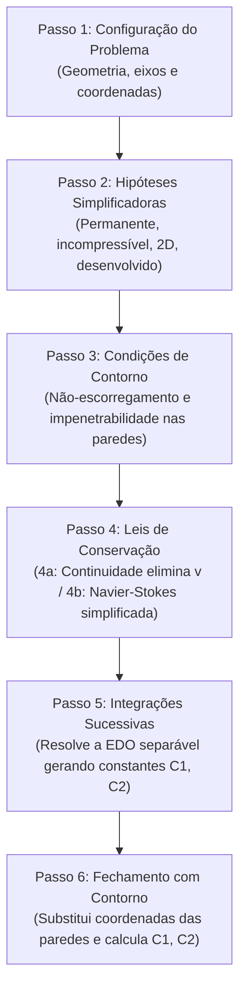

### B. O Roteiro dos 6 Passos Explicado Passo a Passo:
1. **Passo 1 — Configuração do Problema:** Desenhar o duto ou placas, definir a origem do sistema de coordenadas e orientar o eixo principal ($x$) na direção do fluxo.
2. **Passo 2 — Hipóteses Simplificadoras Básicas:**
   - Incompressibilidade: $\rho = \text{constante}$;
   - Regime permanente: $\frac{\partial}{\partial t} = 0$;
   - Escoamento totalmente desenvolvido: $\frac{\partial u}{\partial x} = 0$;
   - Bidimensionalidade planar: $w = 0$ e $\frac{\partial}{\partial z} = 0$;
   - Orientação da gravidade: $\mathbf{g} = -g\hat{j}$ ou desprezada na direção axial ($g_x = 0$).
3. **Passo 3 — Identificação das Condições de Contorno:** Listar o que acontece fisicamente nas paredes sólidas ($y=0$, $y=a$ ou $r=R$): aderência molecular (velocidade tangencial nula) e impenetrabilidade (velocidade normal nula).
4. **Passo 4 — Aplicação das Leis de Conservação:**
   - **4a (Continuidade):** $\frac{\partial u}{\partial x} + \frac{\partial v}{\partial y} = 0 \implies 0 + \frac{\partial v}{\partial y} = 0 \implies v = \text{constante}$. Pela impenetrabilidade na parede, $v = 0$ em todo o domínio!
   - **4b (Navier–Stokes axial):** Todos os termos inerciais se anulam ($\rho \frac{Du}{Dt} = 0$), restando apenas o equilíbrio entre o gradiente forçante de pressão e as tensões viscosas:
     $$\mu \frac{d^2 u}{dy^2} = \frac{\partial p}{\partial x}$$
5. **Passo 5 — Integrações Sucessivas:** Integrar a EDO duas vezes em relação a $y$, fazendo surgir as constantes de integração $C_1$ e $C_2$:
   $$u(y) = \frac{1}{2\mu}\frac{\partial p}{\partial x}y^2 + C_1 y + C_2$$
6. **Passo 6 — Aplicação das Condições de Contorno e Fechamento:** Substituir as coordenadas das paredes sólidas na função para determinar algebricamente os valores exatos de $C_1$ e $C_2$, fechando a equação analítica do perfil de velocidade.

---

## 4.1. Condição Cinemática de Não-Escorregamento (*No-Slip Condition*)
*(Rastreabilidade: Questionário P1 — Pergunta 15)*

### A. Entenda a ideia
Se você passar a mão em um móvel empoeirado, a poeira que está encostada na madeira não sai voando com facilidade; você precisa esfregar com um pano. Em fluidos viscosos reais, a camada de fluido em contato imediato com uma superfície sólida rígida adere à fronteira, não deslizando livremente sobre ela.

Essa é a **condição cinemática de não-escorregamento**: a velocidade tangencial relativa entre o fluido viscoso e a parede sólida é identicamente nula. O fluido acompanha rigorosamente o movimento da superfície sólida no ponto de contato!

### B. Visualize o fenômeno
Pense em um navio de carga avançando a $10\,\text{nós}$ pelo oceano:
- **No referencial fixo na Terra (água em repouso ao longe):** o chapeamento do casco avança a $10\,\text{nós}$. A película de fluido aderida à chapa move-se a exatamente $10\,\text{nós}$ junto com o casco!
- **No referencial fixo no navio (casco estacionário):** a velocidade da parede é nula ($u_{\text{parede}} = 0$). A camada de fluido em contato com o casco tem velocidade nula ($u(0) = 0$). Conforme nos afastamos lateralmente do casco para o seio do oceano, a velocidade cresce gradualmente de $0$ até alcançar a velocidade da corrente livre ($V_\infty$). Essa camada de transição com fortes gradientes viscosos é a **camada limite**.

```
Condição de Não-Escorregamento no Chapeamento do Casco:
============================================================
Distância y
    ^
    |          u(y) cresce progressivamente...
    |             ----------> Fluxo Livre (V_inf)
    |          --------->
    |       ------>
    |    ---->
    |  ->
y=0 +======================================================= (Casco Sólido)
    |  Fluido aderido: u_fluido,tan = u_parede,tan
    |  Velocidade tangencial relativa: u_tan,rel = 0
============================================================
```

### C. Entenda o funcionamento (Fundamentação Contínua e Formulação Cinemática)
1. **Natureza Física e Fundamentação:**  
   Em nível didático e microscópico, costuma-se ilustrar o fenômeno por forças de atração molecular e retenção por micro-rugosidades da superfície. Contudo, no escopo formal da mecânica dos fluidos contínua, a condição de não-escorregamento é um **postulado cinemático macroscópico**, amplamente consolidado por comprovação experimental para fluidos newtonianos convencionais (como a água e o ar) sob condições usuais de pressão e temperatura.
2. **Formulação Cinemática Geral (Paredes em Movimento):**  
   Para qualquer superfície sólida rígida em movimento arbitrário com velocidade $\mathbf{u}_{\text{parede}}$, a velocidade tangencial relativa do fluido em relação à parede é nula:
   $$\mathbf{u}_{\text{tan, rel}} = \mathbf{u}_{\text{fluido, tan}} - \mathbf{u}_{\text{parede, tan}} = \mathbf{0} \iff \mathbf{u}_{\text{fluido, tan}} = \mathbf{u}_{\text{parede, tan}}$$
3. **Caso Particular de Parede Estacionária:**  
   Quando o sistema de coordenadas é fixado na parede sólida rígida ($\mathbf{u}_{\text{parede}} = \mathbf{0}$), a condição reduz-se à anulação da velocidade tangencial absoluta do fluido na fronteira:
   $$\mathbf{u}_{\text{fluido, tan}}(\text{parede}) = \mathbf{0}$$

### D. Conheça a definição técnica
> **Definição Técnica:**  
> A **condição de não-escorregamento** (*no-slip condition*) é a condição cinemática de contorno fundamental dos fluidos viscosos que impõe que o fluido em contato direto com uma fronteira sólida rígida possui velocidade tangencial idêntica à da própria parede, resultando em velocidade tangencial relativa nula:
> $$\mathbf{u}_{\text{tan, rel}} = \mathbf{u}_{\text{fluido, tan}} - \mathbf{u}_{\text{parede, tan}} = \mathbf{0}$$
> No caso particular em que o referencial adotado é solidário à superfície sólida (parede estacionária, $u_{\text{parede}} = 0$), a velocidade tangencial do fluido na parede é identicamente nula ($u = 0$).

### E. O que precisa memorizar
- **Formulação geral:** $\mathbf{u}_{\text{tan, rel}} = \mathbf{0} \implies \mathbf{u}_{\text{fluido, tan}} = \mathbf{u}_{\text{parede, tan}}$.
- **Parede estacionária:** $u(y=0) = 0$ (velocidade tangencial nula).
- **Importância:** Estabelece o gradiente de velocidades junto à parede, originando a tensão cisalhante viscosa ($\tau_w$) e a camada limite.

### F. Atenção para a prova
> [!TIP]
> **Como responder na prova:**  
> "A condição de não-escorregamento impõe que o fluido em contato direto com uma superfície sólida adquire a mesma velocidade tangencial da parede sólida, resultando em velocidade tangencial relativa nula ($\mathbf{u}_{\text{tan, rel}} = \mathbf{0}$). Se o referencial adotar o casco em repouso, a velocidade tangencial do fluido na parede é identicamente nula."

---

## 4.2. Condição de Contorno de Impenetrabilidade
*(Rastreabilidade: Questionário P1 — Pergunta 16)*

### A. Entenda a ideia
Se a condição de não-escorregamento governa o movimento **ao longo da parede** (tangencial), a condição de impenetrabilidade governa o movimento **contra a parede** (perpendicular ou normal). 

A ideia física é direta: uma superfície sólida rígida e impermeável atua como uma barreira física absoluta que impede o fluxo de massa através de si. O fluido não pode atravessar a parede, nem a parede pode penetrar no fluido!

### B. Visualize o fenômeno
Pense no fundo plano de uma barcaça: a água pode se mover para a frente ou para trás ao longo do fundo plano (eixo $x$), mas ela não pode ter velocidade normal que a faça atravessar o casco de aço. A componente de velocidade normal relativa entre o fluido e o casco deve ser identicamente nula.

```
Condição de Impenetrabilidade na Parede Impermeável:
============================================================
              y (normal à parede n)
              ^
              |       Velocidade normal relativa: vn,rel = (V - V_parede) · n = 0
              |       (FLUIDO NÃO ATRAVESSA A PAREDE!)
              |             x (tangencial à parede t)
Casco Sólido  +------------------------------------->
Impermeável   =======================================
              O escoamento relativo é estritamente paralelo à chapa!
============================================================
```

### C. Entenda o funcionamento (Formulação Matemática Geral e Aplicação Algébrica)
1. **Definição Cinemática Vetorial Geral:**  
   Seja $\mathbf{n}$ o vetor normal unitário perpendicular à fronteira sólida, orientado para dentro do fluido. Para qualquer fronteira sólida rígida e impermeável em movimento com velocidade $\mathbf{V}_{\text{parede}}$, a velocidade normal relativa é identicamente nula:
   $$\boxed{v_{n, \text{rel}} = (\mathbf{V}_{\text{fluido}} - \mathbf{V}_{\text{parede}}) \cdot \mathbf{n} = 0 \iff V_{n, \text{fluido}} = V_{n, \text{parede}}}$$
2. **Caso de Parede Estacionária:**  
   Se a parede sólida estiver em repouso ($\mathbf{V}_{\text{parede}} = \mathbf{0}$):
   $$\boxed{v_n = \mathbf{V}_{\text{fluido}} \cdot \mathbf{n} = 0}$$
   A velocidade normal do fluido é identicamente nula na superfície sólida rígida.
3. **Papel Decisivo nos 6 Passos de Poiseuille e Couette:**  
   Ao resolver Navier–Stokes entre placas planas horizontais ($y=0$ e $y=a$):
   - A conservação da massa dita: $\frac{\partial v}{\partial y} = 0 \implies v(y) = \text{constante} = C_1$;
   - Como a placa inferior em $y=0$ é sólida e impermeável, aplica-se a impenetrabilidade: $v(0) = 0$;
   - Logo: $C_1 = 0 \implies v(y) = 0$ em **todos os pontos entre as placas!**
   - É a condição de impenetrabilidade que elimina a componente vertical de velocidade e torna o escoamento puramente unidimensional!

### D. Conheça a definição técnica
> **Definição Técnica:**  
> A condição de contorno de impenetrabilidade aplica-se a fronteiras sólidas rígidas e impermeáveis, estabelecendo que não há fluxo de massa através da fronteira. Em termos cinemáticos gerais, impõe que a componente da velocidade normal relativa entre o fluido e a parede seja identicamente nula:
> $$v_{n, \text{rel}} = (\mathbf{V} - \mathbf{V}_{\text{parede}}) \cdot \mathbf{n} = 0$$
> Para uma parede estacionária ($\mathbf{V}_{\text{parede}} = \mathbf{0}$), a velocidade normal do fluido na superfície anula-se rigorosamente:
> $$v_n = \mathbf{V} \cdot \mathbf{n} = 0$$

### E. O que precisa memorizar
- **Formulação geral:** $v_{n, \text{rel}} = (\mathbf{V} - \mathbf{V}_{\text{parede}}) \cdot \mathbf{n} = 0$.
- **Parede estacionária:** $v_n = \mathbf{V} \cdot \mathbf{n} = 0$.
- **Diferença de direção:**
  - *Não-escorregamento:* restringe a velocidade **tangencial** relativa ($\mathbf{u}_{\text{tan, rel}} = \mathbf{0}$);
  - *Impenetrabilidade:* restringe a velocidade **normal** relativa ($v_{n, \text{rel}} = 0$).

### F. Atenção para a prova
> [!TIP]
> **Como responder na prova:**  
> "A condição de impenetrabilidade impõe que o fluido não pode atravessar a parede nem a parede pode penetrar no fluido; logo, a componente normal da velocidade relativa perpendicular à superfície rígida impermeável deve ser identicamente nula ($v_{n, \text{rel}} = 0$, que para parede fixa resulta em $v_n = \mathbf{V}\cdot\mathbf{n} = 0$)."

---

## 4.3. Por que o Escoamento Exterior ao Casco não é "Totalmente Desenvolvido"
*(Rastreabilidade: Questionário P1 — Pergunta 17)*

### A. Entenda a ideia
Na hidráulica de encanamentos compridos, depois que a água percorre alguns metros dentro de um tubo reto, o perfil de velocidades atinge uma forma definitiva que não muda mais até o fim do cano. Chamamos isso de "escoamento totalmente desenvolvido" ($\frac{\partial u}{\partial x} = 0$). 

Por que isso **nunca** acontece ao redor de um navio no mar? Porque o casco de um navio é um corpo tridimensional de forma complexa (linhas de água curvas, variação contínua de seções transversais) e a camada de fluido retardada pela viscosidade (camada limite) cresce continuamente da proa em direção à popa, mantendo gradientes axiais de velocidade e pressão ativos ao longo de todo o avanço.

### B. Visualize o fenômeno
Pense no casco de um navio visto de cima: a água encontra a roda de proa e começa a ser retardada por atrito. No início do casco, a espessura da zona perturbada por atrito é ínfima. À medida que o fluido avança ao longo do chapeamento em direção à meia-nau e à popa, a camada limite torna-se progressivamente mais espessa. Além disso, as formas do casco curvam-se continuamente, acelerando e desacelerando o escoamento exterior. Como consequência, em nenhuma seção longitudinal o perfil transversal de velocidades torna-se invariável com a coordenada axial de avanço.

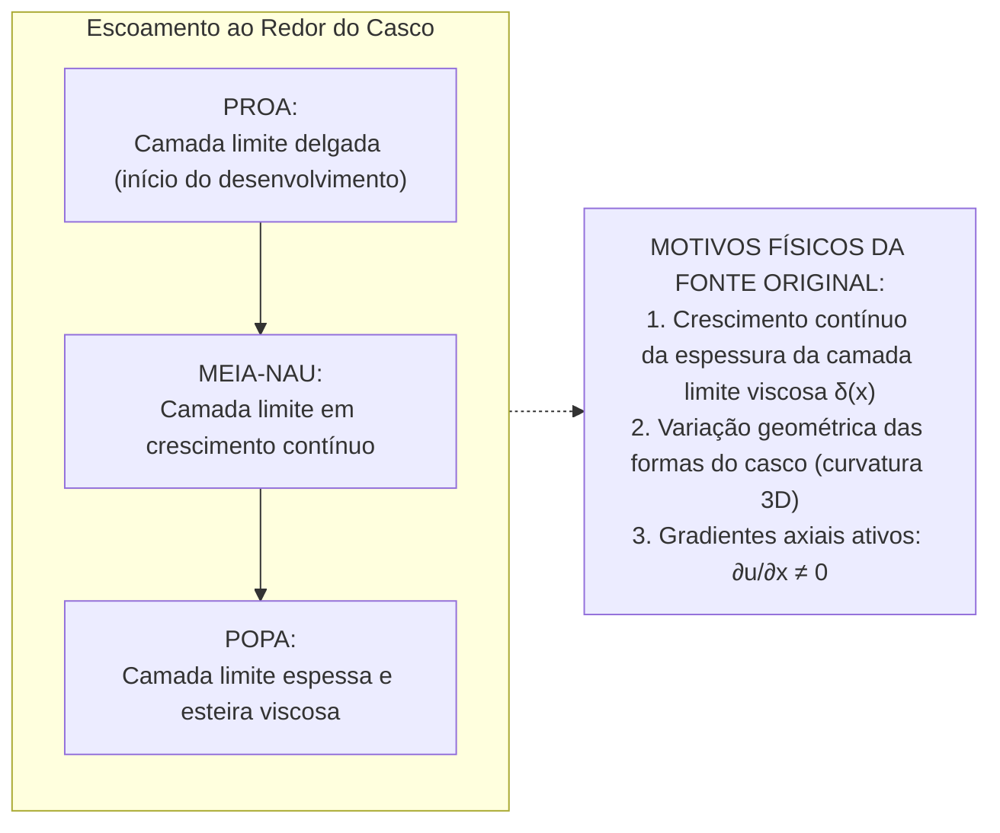

### C. Entenda o funcionamento (Confronto Físico de Hipóteses)
1. **Definição Estrita de Escoamento Totalmente Desenvolvido:**  
   Um escoamento é formalmente classificado como totalmente desenvolvido quando o perfil transversal de velocidades é independente da coordenada longitudinal de avanço ($x$):
   $$\frac{\partial u}{\partial x} = 0$$
2. **As Três Razões Físicas Fundamentais (Fonte: Questionário P1 / Resumo Oficial):**
   - **Razão 1 — Crescimento Contínuo da Espessura da Camada Limite:**  
     Desde o bordo de ataque na proa até o bordo de fuga na popa, a camada limite viscosa cresce continuamente com a distância longitudinal $x$ percorrida pelo escoamento ($\delta = \delta(x)$). *(Nota didática: embora em placas planas canônicas simples o crescimento teórico seja aproximado por $\delta \propto \sqrt{x}$ em laminar ou $\delta \propto x^{4/5}$ em turbulento, no casco de uma embarcação a taxa de crescimento é governada pelas complexas linhas de corrente tridimensionais e pelos gradientes locais de pressão, sem jamais estabilizar em uma espessura constante)*.
   - **Razão 2 — Variação Geométrica das Formas do Casco (Curvatura Tridimensional):**  
     O casco possui formas geométricas tridimensionais continuamente variáveis (entradas de proa, corpo paralelo médio e formas de popa). O escoamento exterior sofre contínuas acelerações e desacelerações nas proximidades das balizas e linhas d'água, impondo gradientes de pressão axiais favoráveis e adversos ($\frac{\partial p}{\partial x} \neq 0$).
   - **Razão 3 — Gradientes Longitudinais Ativos:**  
     Como consequência direta do crescimento da camada limite e da curvatura contínua das formas, a velocidade longitudinal $u$ varia permanentemente ao longo da coordenada axial de avanço:
     $$\frac{\partial u}{\partial x} \neq 0$$

### D. Conheça a definição técnica
> **Definição Técnica:**  
> O escoamento exterior ao casco de uma embarcação em movimento não pode ser considerado totalmente desenvolvido porque a camada limite viscosa cresce continuamente em espessura desde a proa até a popa ($\delta = \delta(x)$), as linhas de forma do casco variam geometricamente em três dimensões ao longo do comprimento, e existem gradientes de velocidade e de pressão não nulos na direção longitudinal de avanço ($\frac{\partial u}{\partial x} \neq 0$).

### E. O que precisa memorizar
- **Os 3 motivos obrigatórios de resposta:**
  1. Crescimento contínuo da camada limite viscosa da proa à popa;
  2. Variação geométrica contínua das linhas de forma do casco;
  3. Existência de gradientes longitudinais ativos na direção do avanço ($\frac{\partial u}{\partial x} \neq 0$).

### F. Atenção para a prova
> [!TIP]
> **Como responder na prova:**  
> "Porque a camada limite viscosa cresce continuamente desde a proa até a popa, as linhas de forma do casco variam geometricamente e existem gradientes de velocidade na direção longitudinal do avanço ($\frac{\partial u}{\partial x} \neq 0$)."

---

## 4.4. A Incapacidade do Fluido Ideal Invíscido em Calcular o Atrito Superficial
*(Rastreabilidade: Questionário P1 — Pergunta 18)*

### A. Entenda a ideia
Na formulação de fluido ideal invíscido (governado pelas Equações de Euler), considera-se por hipótese simplificadora que a viscosidade dinâmica é nula ($\mu = 0$). Essa hipótese reduz a ordem espacial das equações diferenciais do movimento e desconsidera as tensões de cisalhamento.

Se tentarmos usar exclusivamente esse modelo invíscido para calcular a resistência de atrito superficial (friccional) de uma embarcação, o resultado será identicamente **nulo ($R_F = 0$)**. O modelo de fluido invíscido desliza perfeitamente sobre a parede sem exercer nenhuma força tangencial viscosa.

### B. Visualize o fenômeno
Pense no contraste de modelos:
- **Modelo de fluido real viscoso ($\mu > 0$):** O escoamento obedece à condição de não-escorregamento ($u_{\text{rel}} = 0$). Desenvolve-se uma camada limite com forte gradiente transversal $\frac{\partial u}{\partial y}$, gerando uma tensão tangencial de cisalhamento viscosa na parede $\tau_w = \mu \left(\frac{\partial u}{\partial y}\right)_{y=0}$, cuja integração resulta na resistência de atrito $R_F$.
- **Modelo de fluido ideal invíscido ($\mu = 0$):** O modelo matemático não impõe a condição de não-escorregamento (retém apenas a condição de impermeabilidade normal). O fluido escorrega tangencialmente livre sobre a superfície ($u_{\text{parede}} \neq 0$). Como o coeficiente de viscosidade é nulo, a tensão cisalhante é identicamente zero em todos os pontos.

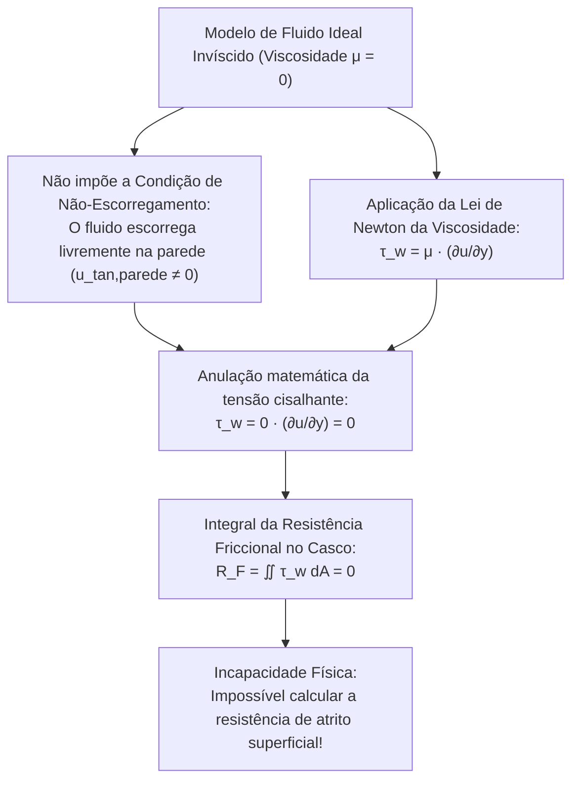

### C. Entenda o funcionamento (Dedução Matemática e Qualificação do Paradoxo)
1. **Lei da Viscosidade de Newton na Parede:**  
   Em um escoamento cisalhante junto a uma superfície sólida, a tensão tangencial de atrito exercida pelo fluido sobre a chapa ($y=0$) é expressa por:
   $$\tau_w = \mu \left( \frac{\partial u}{\partial y} \right)_{y=0}$$
2. **A Premissa Invíscida:**  
   No modelo de fluido ideal invíscido, adota-se:
   $$\mu = 0$$
3. **Anulação Idêntica da Tensão Cisalhante:**  
   Substituindo $\mu = 0$:
   $$\tau_w = 0 \cdot \left( \frac{\partial u}{\partial y} \right)_{y=0} \equiv 0$$
   A tensão viscosa na parede é identicamente nula em qualquer ponto da área molhada.
4. **Anulação da Resistência Friccional ($R_F$):**  
   A resistência friccional (de atrito superficial) ao avanço é obtida integrando a componente longitudinal da tensão tangencial sobre toda a superfície molhada $S$:
   $$R_F = \iint_S \tau_w \, dA = \iint_S 0 \, dA = 0$$
5. **Ressalva Conceitual Rigorosa sobre o Paradoxo de d'Alembert:**  
   - O modelo invíscido anula estritamente a **resistência de atrito superficial** ($R_F = 0$).
   - Não se deve afirmar genericamente que a resistência *total* de um navio no modelo invíscido é zero: em superfície livre, o modelo potencial invíscido gera ondas, prevendo corretamente a **resistência de ondas** ($R_W \neq 0$).
   - O célebre **Paradoxo de d'Alembert** (resistência total rigorosamente nula, $R = 0$) aplica-se especificamente ao caso de um corpo completamente submerso em escoamento potencial permanente e irrotacional de fluido infinito sem superfície livre, onde a ausência de viscosidade anula $R_F$ e a simetria de pressões anula a resistência de forma ($R_{PV} = 0$).

### D. Conheça a definição técnica
> **Definição Técnica:**  
> A hipótese de fluido ideal invíscido ($\mu = 0$) é incapaz de calcular o atrito superficial no casco porque o modelo matemático invíscido não impõe a condição cinemática de não-escorregamento, permitindo que as partículas fluidas escorreguem livremente sobre a superfície sólida com velocidade tangencial não nula na parede. Adicionalmente, pela lei da viscosidade de Newton ($\tau_w = \mu \frac{\partial u}{\partial y}$), a hipótese de viscosidade nula ($\mu = 0$) impõe que a tensão viscosa tangencial na parede seja identicamente zero ($\tau_w = 0$), resultando em uma resistência friccional nula ($R_F = 0$).

### E. O que precisa memorizar
- **Duas razões fundamentais:**
  1. O modelo invíscido não impõe a condição de não-escorregamento (permite escorregamento tangencial na parede sólida);
  2. Anula a tensão tangencial pela Lei de Newton: $\tau_w = \mu \frac{\partial u}{\partial y} = 0 \cdot \frac{\partial u}{\partial y} = 0$.
- **Consequência direta:** Resistência de atrito superficial rigorosamente nula ($R_F = 0$).

### F. Atenção para a prova
> [!TIP]
> **Como responder na prova:**  
> "Porque fluidos invíscidos violam/não impõem a condição de não-escorregamento, permitindo que o fluido deslize livremente sobre a chapa com velocidade não nula na parede, o que matematicamente anula a tensão viscosa tangencial ($\tau_w = \mu \frac{\partial u}{\partial y} = 0$), resultando em resistência friccional nula."

---

# Bloco 5: Conceitos Fundamentais, Couette, Poiseuille, Reynolds, Froude e Similaridade

---

## 5.1. Os Três Princípios Clássicos de Conservação
*(Rastreabilidade: Questionário P1 — Pergunta 19)*

### A. Entenda a ideia
A termofluídica e a hidrodinâmica inteiras apoiam-se sobre **três pilares sagrados da física clássica**. Qualquer escoamento de água no universo — desde a gota que pinga da torneira até o oceano ao redor de um porta-aviões de 100.000 toneladas — precisa obedecer obrigatoriamente a essas três regras sem violar nenhuma delas:
1. **A matéria não desaparece** (Conservação da Massa).
2. **A matéria acelera quando empurrada por forças** (Conservação da Quantidade de Movimento / 2ª Lei de Newton).
3. **A energia não se cria do nada, apenas se transforma** (Conservação da Energia / 1ª Lei da Termodinâmica).

### B. Visualize o fenômeno
Pense na água passando pelo propulsor (hélice) de um navio:
- Toda a água que entra pelo disco da hélice precisa sair do outro lado (Massa conservada);
- As pás da hélice empurram a água para trás; por reação, a água empurra o navio para a frente com a força de empuxo propulsor (Quantidade de movimento conservada);
- A queima de combustível no motor diesel gera torque que gira o eixo da hélice, e esse trabalho mecânico é transferido para a energia cinética do jato de esteira e dissipado em calor pelo atrito viscoso da água (Energia conservada).

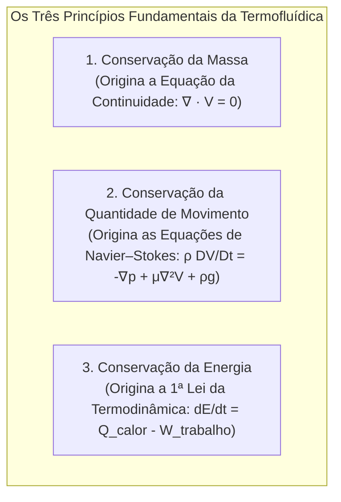

### C. Entenda o funcionamento (Estrutura Matemática e Fórmulas Associadas)
1. **Princípio 1 — Conservação da Massa:**  
   A massa de um sistema fechado é invariável no tempo. Na descrição euleriana de campo contínuo, origina a Equação da Continuidade:
   $$\frac{\partial \rho}{\partial t} + \nabla \cdot (\rho \mathbf{V}) = 0$$
   Para escoamento incompressível ($\rho = \text{constante}$), reduz-se à divergência nula da velocidade: $\nabla \cdot \mathbf{V} = 0$.

2. **Princípio 2 — Conservação da Quantidade de Movimento (Momento Linear):**  
   A taxa de variação temporal da quantidade de movimento do elemento fluido equilibra o somatório das forças de superfície e de corpo aplicadas (Segunda Lei de Newton). Em sua formulação diferencial para fluidos contínuos:
   $$\rho \frac{D\mathbf{V}}{Dt} = \nabla \cdot \boldsymbol{\sigma} + \rho \mathbf{g}$$
   Sob as hipóteses específicas de **fluido incompressível, newtoniano e com viscosidade dinâmica constante ($\mu = \text{constante}$)**, o tensor de tensões decompõe-se no campo de pressão e tensões viscosas laplacianas, resultando na consagrada Equação de Navier–Stokes vetorial:
   $$\rho \frac{D\mathbf{V}}{Dt} = -\nabla p + \mu \nabla^2 \mathbf{V} + \rho \mathbf{g}$$

3. **Princípio 3 — Conservação da Energia:**  
   Em nível termodinâmico global de taxas (Primeira Lei da Termodinâmica para um sistema fechado ou balanço simplificado de taxas), a taxa de variação da energia total acumulada $E$ equilibra a taxa líquida de transferência de calor $\dot{Q}$ menos a taxa de realização de trabalho mecânico $\dot{W}$:
   $$\frac{dE}{dt} = \dot{Q} - \dot{W}$$
   *(Nota didática: em volumes de controle abertos da termofluídica geral, esta relação expande-se incorporando os fluxos convectivos de entalpia, energia cinética e potencial através das superfícies de controle)*.

### D. Conheça a definição técnica
> **Definição Técnica:**  
> Os três princípios clássicos de conservação que formam a base axiomática e matemática da termofluídica e da hidrodinâmica são:
> 1. A conservação da massa;
> 2. A conservação da quantidade de movimento (momento linear);
> 3. A conservação da energia.

### E. O que precisa memorizar
- Os três nomes exatos: **Massa**, **Quantidade de Movimento (Momento Linear)** e **Energia**.

### F. Atenção para a prova
> [!TIP]
> **Como responder na prova:**  
> "Os três princípios clássicos de conservação são: 1. A conservação da massa; 2. A conservação da quantidade de movimento (momento linear); 3. A conservação da energia."

---

## 5.2. Descrição Cinemática: Lagrangeana versus Euleriana
*(Rastreabilidade: Questionário P1 — Pergunta 20)*

### A. Entenda a ideia
Existem duas formas de contar a história de uma maratona na televisão:
1. **O cinegrafista em uma moto que acompanha o atleta líder o tempo todo:** ele vê a história daquela pessoa específica, para onde ela corre, quando se cansa e quando bebe água. Essa é a **visão Lagrangeana**.
2. **A câmera fixa instalada na linha de chegada:** ela fica parada no mesmo lugar e registra quem passa por ali a cada segundo. Ela não segue ninguém; ela monitora o ponto fixo. Essa é a **visão Euleriana**.

### B. Visualize o fenômeno
Pense no fluxo de tráfego de navios no Canal de Suez:
- **Abordagem Lagrangeana:** O comandante ou o armador que monitora o cargueiro *Ever Given* desde o momento em que ele sai da China até chegar a Roterdã. A atenção acompanha a matéria que se move.
- **Abordagem Euleriana:** O prático da autoridade do canal sentado na torre de controle do canal em Ismailia. A torre não se move; ela registra a vazão de navios, o calado e a velocidade da água naquele trecho geográfico fixo.

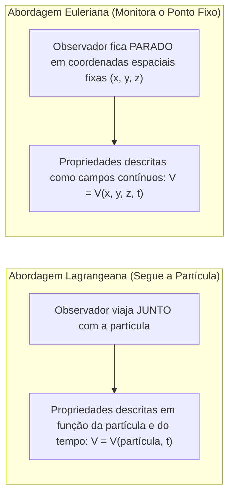

### C. Entenda o funcionamento (Quadro Comparativo de Referenciais)

| Característica | Abordagem Lagrangeana | Abordagem Euleriana |
| :--- | :--- | :--- |
| **Foco do Observador** | Acompanha a partícula material individual em sua trajetória | Monitora posições espaciais estáticas fixas $(x, y, z)$ |
| **Variáveis Independentes** | Identidade da partícula material ($a, b, c$) e o tempo ($t$) | Coordenadas geométricas espaciais ($x, y, z$) e o tempo ($t$) |
| **Forma Matemática da Velocidade** | $\mathbf{V}_{\text{partícula}} = \frac{d\mathbf{x}_p}{dt} = \mathbf{V}(t)$ | $\mathbf{V} = \mathbf{V}(x, y, z, t)$ (campo vetorial) |
| **Aceleração da Matéria** | Derivada simples no tempo: $\mathbf{a} = \frac{d\mathbf{V}}{dt}$ | Derivada Material combinada: $\frac{D\mathbf{V}}{Dt} = \frac{\partial \mathbf{V}}{\partial t} + (\mathbf{V}\cdot\nabla)\mathbf{V}$ |
| **Aplicação Típica** | Dinâmica dos sólidos rígidos e trajetórias balísticas | Mecânica dos fluidos, aerodinâmica e hidrodinâmica naval |

### D. Conheça a definição técnica
> **Definição Técnica:**  
> A abordagem Lagrangeana persegue a história e a trajetória individual de partículas materiais identificadas ao longo do tempo. A abordagem Euleriana fixa o referencial em posições geométricas estáticas do espaço $(x, y, z)$, observando a evolução das propriedades do fluido à medida que diferentes porções de matéria cruzam essas janelas de controle.

### E. O que precisa memorizar
- **Lagrangeano:** segue a partícula individual no tempo.
- **Euleriano:** observa coordenadas fixas no espaço por onde diferentes partículas passam.

### F. Atenção para a prova
> [!TIP]
> **Como responder na prova:**  
> "A abordagem Lagrangeana persegue a história e o trajeto de partículas fluidas individuais identificadas no tempo. A abordagem Euleriana observa o que acontece em posições fixas do espaço por onde diferentes partículas passam."

---

## 5.3. As Duas Parcelas da Derivada Material Euleriana
*(Rastreabilidade: Questionário P1 — Pergunta 21)*

### A. Entenda a ideia
Na formulação euleriana, para calcular como qualquer grandeza (temperatura, pressão ou velocidade) muda para quem está viajando junto com a água, precisamos somar duas parcelas:
1. **O relógio correu naquele lugar fixo** (Parcela Local: $\frac{\partial}{\partial t}$).
2. **A partícula viajou para outro lugar com valores diferentes** (Parcela Convectiva: $(\mathbf{V}\cdot\nabla)$).

### B. Visualize o fenômeno
Pense na temperatura da água sentida por um peixe nadando em direção a uma foz de rio com água morna ao entardecer:
- O sol está se pondo, então a água de todo o rio está esfriando lentamente com o passar das horas ($\frac{\partial T}{\partial t} < 0$, variação local).
- Mas o peixe está nadando em direção à foz morna ($\mathbf{V}\cdot\nabla T > 0$, variação convectiva pelo transporte espacial).  
A temperatura total sentida pelas guelras do peixe ($\frac{DT}{Dt}$) é a soma algébrica dessas duas parcelas.

```
Operador Substantivo da Derivada Material:
D/Dt = [ ∂/∂t ] + [ (V · ∇) ]
         |              |
         |              +---> Parcela Convectiva: Variação por deslocamento espacial
         +------------------> Parcela Local: Variação temporal na coordenada fixa
```

### C. Entenda o funcionamento (Estrutura Operatorial)
O operador da derivada material aplicado a qualquer grandeza escalar ou vetorial $\phi$ é definido por:

$$\frac{D\phi}{Dt} = \underbrace{\frac{\partial \phi}{\partial t}}_{\text{Parcela Local}} + \underbrace{(\mathbf{V} \cdot \nabla)\phi}_{\text{Parcela Convectiva}}$$

Em coordenadas cartesianas tridimensionais, para o vetor velocidade $\mathbf{V}$:
- **Parcela Local:** $\frac{\partial \mathbf{V}}{\partial t} = \frac{\partial u}{\partial t}\hat{i} + \frac{\partial v}{\partial t}\hat{j} + \frac{\partial w}{\partial t}\hat{k}$;
- **Parcela Convectiva:** $(\mathbf{V} \cdot \nabla)\mathbf{V} = \left( u \frac{\partial}{\partial x} + v \frac{\partial}{\partial y} + w \frac{\partial}{\partial z} \right)\mathbf{V}$.

### D. Conheça a definição técnica
> **Definição Técnica:**  
> A derivada material euleriana subdivide a taxa total de variação de qualquer propriedade do fluido em duas parcelas fundamentais:
> 1. **Derivada ou Aceleração Local ($\frac{\partial}{\partial t}$):** taxa de variação puramente temporal avaliada em uma coordenada espacial estritamente estática;
> 2. **Derivada ou Aceleração Convectiva ($(\mathbf{V} \cdot \nabla)$):** taxa de variação espacial decorrente da mudança de posição do fluido no espaço através de gradientes heterogêneos de campo.

### E. O que precisa memorizar
- Os dois nomes exatos: **Parcela Local** (ou aceleração local) e **Parcela Convectiva** (ou aceleração convectiva).
- Operadores: $\frac{\partial}{\partial t}$ e $(\mathbf{V}\cdot\nabla)$.

### F. Atenção para a prova
> [!TIP]
> **Como responder na prova:**  
> "A derivada material euleriana subdivide a taxa de variação de qualquer grandeza em duas parcelas: 1. Na derivada/aceleração local: variação estritamente temporal no ponto fixo ($\frac{\partial}{\partial t}$); 2. Na derivada/aceleração convectiva: variação decorrente da mudança de posição do fluido no espaço através de gradientes espaciais ($(\mathbf{V} \cdot \nabla)$)."

---

## 5.4. Classificação das Forças por Mecanismo de Interação
*(Rastreabilidade: Questionário P1 — Pergunta 22)*

### A. Entenda a ideia
Como revisamos no Bloco 3, a classificação mecânica de todas as forças que movem os fluidos baseia-se na resposta a uma única pergunta: **é preciso haver contato físico nas paredes do volume para a força existir?**
- Se sim $\to$ **Força de Superfície**.
- Se não $\to$ **Força de Corpo**.

### B. Visualize o fenômeno
Pense em uma gota de chuva caindo no ar:
- A gravidade puxa cada molécula da gota para baixo (Força de Corpo).
- O atrito com o ar e a pressão na frente da gota seguram a gota (Forças de Superfície).

### C. Entenda o funcionamento (Tabela Didática de Consolidação)

| Classe de Força | Definição Mecânica | Mecanismo de Interação | Exemplos Típicos |
| :--- | :--- | :--- | :--- |
| **Forças de Superfície** | Atuam nas fronteiras que delimitam o volume | Exigem contato físico direto; proporcionais à área ($dA$) | Pressão hidrodinâmica normal ($p$), tensões de atrito viscoso tangencial ($\tau$). |
| **Forças de Corpo** | Atuam sobre toda a massa no interior do volume | Ação à distância por campos físicos; proporcionais ao volume ($dV$) | Peso gravitacional ($\rho \mathbf{g}$), forças centrífugas e de Coriolis em referenciais girantes. |

### D. Conheça a definição técnica
> **Definição Técnica:**  
> As forças mecânicas atuantes em fluidos classificam-se em:
> 1. **Forças de superfície:** atuantes por contato mecânico através das fronteiras do volume de controle (pressões normais e tensões viscosas de cisalhamento);
> 2. **Forças de corpo:** atuantes em cada partícula por campos gravitacionais ou inerciais à distância sobre toda a massa contida no volume, sem necessidade de contato superficial.

### E. O que precisa memorizar
- Os dois grupos: **Forças de Superfície** (contato) e **Forças de Corpo** (à distância).

### F. Atenção para a prova
> [!TIP]
> **Como responder na prova:**  
> "Classificam-se em: 1. Forças de superfície: atuantes por contato mecânico através das fronteiras do volume de controle (pressões e tensões viscosas de cisalhamento); 2. Forças de corpo: atuantes em cada partícula por campos gravitacionais ou inerciais à distância, sem necessidade de contato superficial."

---

## 5.5. Distinção entre Condições de Aderência e de Impermeabilidade
*(Rastreabilidade: Questionário P1 — Pergunta 23)*

### A. Entenda a ideia
Não confunda as duas condições de contorno de fronteira sólida! Uma cuida da direção paralela à parede; a outra cuida da direção perpendicular à parede:
- **Aderência (Não-escorregamento):** governa o movimento **deitado/paralelo** à chapa. A velocidade tangencial relativa entre fluido e parede é nula ($\mathbf{u}_{\text{tan, rel}} = \mathbf{0}$).
- **Impermeabilidade:** governa o movimento **em pé/perpendicular** à chapa. A velocidade normal relativa entre fluido e parede é nula ($v_{n, \text{rel}} = 0$); o fluido não atravessa a parede e a parede não penetra no fluido.

### B. Visualize o fenômeno
Pense em tentar andar de skate em uma lixa com supercola:
- Seus pés não conseguem escorregar para a frente nem para trás na prancha (não-escorregamento: velocidade tangencial relativa nula).
- Seus pés não conseguem afundar e atravessar a madeira maciça do skate para o chão (impenetrabilidade: velocidade normal relativa nula).

```
Diferenciação Geométrica das Condições de Contorno:
=============================================================
         ^  Direção Normal (n):
         |  IMPENETRABILIDADE: vn,rel = (V - V_parede) · n = 0
         |  (Para parede fixa: vn = V · n = 0 — Não atravessa a chapa!)
         |
Parede   +-------------------------------------> Direção Tangencial (t):
Sólida   ======================================= NÃO-ESCORREGAMENTO:
                                                 u_tan,rel = 0 (Não desliza na chapa!)
=============================================================
```

### C. Entenda o funcionamento (Quadro Comparativo de Contorno)

| Critério | Condição de Não-Escorregamento (Aderência) | Condição de Impenetrabilidade |
| :--- | :--- | :--- |
| **Direção Vetorial** | Tangencial à superfície sólida ($\mathbf{t}$) | Perpendicular / Normal à superfície sólida ($\mathbf{n}$) |
| **Expressão Matemática Geral** | $\mathbf{u}_{\text{tan, rel}} = \mathbf{V}_{\text{fluido, tan}} - \mathbf{V}_{\text{parede, tan}} = \mathbf{0}$ | $v_{n, \text{rel}} = (\mathbf{V}_{\text{fluido}} - \mathbf{V}_{\text{parede}}) \cdot \mathbf{n} = 0$ |
| **Parede Estacionária ($\mathbf{V}_p = \mathbf{0}$)** | $\mathbf{u}_{\text{fluido, tan}} = \mathbf{0}$ | $v_n = \mathbf{V}_{\text{fluido}} \cdot \mathbf{n} = 0$ |
| **Origem Física** | Viscosidade do fluido e interação cinemática com a fronteira rígida | Impermeabilidade física e rigidez mecânica da barreira sólida |
| **Efeito Hidrodinâmico** | Gera o gradiente $\frac{\partial u}{\partial y}$, o atrito viscoso e a camada limite | Impede o fluxo convectivo de massa através da fronteira e orienta as linhas de corrente paralelamente à parede |

### D. Conheça a definição técnica
> **Definição Técnica:**  
> A distinção cinemática fundamental é: a condição de aderência (não-escorregamento) anula a velocidade tangencial relativa do fluido em relação à superfície rígida ($\mathbf{u}_{\text{tan, rel}} = \mathbf{0}$), sendo característica dos escoamentos viscosos; enquanto a condição de impermeabilidade anula a velocidade e o fluxo relativo na direção perpendicular (normal) à fronteira rígida ($v_{n, \text{rel}} = (\mathbf{V} - \mathbf{V}_{\text{parede}})\cdot\mathbf{n} = 0$), sendo imposta pela impermeabilidade da barreira física (o que, para fronteiras estacionárias, impõe $v_n = \mathbf{V}\cdot\mathbf{n} = 0$).

### E. O que precisa memorizar
- **Aderência:** restringe a velocidade **tangencial** relativa ($\mathbf{u}_{\text{tan, rel}} = \mathbf{0}$).
- **Impermeabilidade:** restringe a velocidade **normal** relativa ($v_{n, \text{rel}} = 0$, ou $v_n = 0$ em parede estática).

### F. Atenção para a prova
> [!TIP]
> **Como responder na prova:**  
> "A condição de não-escorregamento anula a velocidade tangencial relativa à superfície sólida ($\mathbf{u}_{\text{tan, rel}} = \mathbf{0}$), enquanto a condição de impenetrabilidade anula o fluxo e a velocidade relativa perpendicular (normal) à superfície ($v_{n, \text{rel}} = 0$, ou $v_n = 0$ para parede estática)."

---

## 5.6. Escoamento Plano de Poiseuille: Placas Fixas e Gradiente de Pressão
*(Rastreabilidade: Questionário P1 — Pergunta 24)*

### A. Entenda a ideia
Imagine duas placas de vidro paralelas e estáticas separadas por uma distância $a$. O espaço entre elas está cheio de glicerina ou óleo. Nenhuma das placas se move. Como fazer esse fluido andar? 

Você precisa criar uma **diferença de pressão**: colocar uma bomba ou pressão alta na entrada e deixar a saída aberta. Como o fluido está preso entre duas paredes paradas, as moléculas coladas no chão e no teto ficam em repouso ($u=0$). O fluido que está bem no meio corre o mais rápido possível. O desenho desse perfil de velocidades entre duas placas fixas empurrado pela pressão é uma **parábola perfeita** chamada **escoamento plano de Poiseuille**.

### B. Visualize o fenômeno
Pense na fresta entre duas comportas de uma eclusa ou no escoamento entre placas paralelas fixas:
- Paredes paradas em $y=0$ e $y=a$;
- Pressão empurrando com $\frac{\partial p}{\partial x} < 0$;
- A velocidade no chão ($y=0$) é zero;
- A velocidade no teto ($y=a$) é zero;
- A velocidade cresce suavemente até atingir o ápice exatamente na linha média ($y=a/2$).

```
Perfil Parabólico do Escoamento Plano de Poiseuille:
y = a +==================================== (Placa Superior FIXA: u = 0)
      |    ---> u(y)
      |         -------->
      |              ============> u_max (no meio: y = a/2)
      |         -------->
      |    ---> u(y)
y = 0 +==================================== (Placa Inferior FIXA: u = 0)
      <- p1 (Alta Pressão)          p2 (Baixa Pressão) ->
```

### C. Entenda o funcionamento (Dedução Analítica Completa Passo a Passo)
Vamos aplicar o Método dos 6 Passos de aula para deduzir a equação completa:

1. **Hipóteses Simplificadoras:**  
   Regime permanente ($\frac{\partial}{\partial t} = 0$), incompressível ($\rho = \text{cte}$), totalmente desenvolvido ($\frac{\partial u}{\partial x} = 0$), bidimensional ($w=0, \frac{\partial}{\partial z}=0$), gravidade desprezada na direção axial ($g_x = 0$). Pela continuidade e impenetrabilidade: $v = 0$.

2. **Equação Diferencial de Navier–Stokes Reduzida:**  
   Substituindo as hipóteses na componente longitudinal $x$:
   $$\rho \left( \underbrace{\frac{\partial u}{\partial t}}_{0} + \underbrace{u \frac{\partial u}{\partial x}}_{0} + \underbrace{v \frac{\partial u}{\partial y}}_{0} + \underbrace{w \frac{\partial u}{\partial z}}_{0} \right) = -\frac{\partial p}{\partial x} + \mu \left( \underbrace{\frac{\partial^2 u}{\partial x^2}}_{0} + \frac{\partial^2 u}{\partial y^2} + \underbrace{\frac{\partial^2 u}{\partial z^2}}_{0} \right) + \underbrace{\rho g_x}_{0}$$
   A equação resume-se ao equilíbrio entre o gradiente de pressão e as forças viscosas:
   $$\mu \frac{d^2 u}{dy^2} = \frac{\partial p}{\partial x} \implies \frac{d^2 u}{dy^2} = \frac{1}{\mu}\frac{\partial p}{\partial x}$$
   Como o perfil de pressão varia linearmente, $\frac{\partial p}{\partial x} = \text{constante}$.

3. **Primeira Integração em $y$:**  
   $$\frac{du}{dy} = \frac{1}{\mu}\frac{\partial p}{\partial x} y + C_1$$

4. **Segunda Integração em $y$:**  
   $$u(y) = \frac{1}{2\mu}\frac{\partial p}{\partial x} y^2 + C_1 y + C_2$$

5. **Aplicação das Condições de Contorno de Não-Escorregamento:**
   - **Na parede inferior ($y = 0$):**  
     $$u(0) = 0 \implies \frac{1}{2\mu}\frac{\partial p}{\partial x}(0)^2 + C_1(0) + C_2 = 0 \implies \boxed{C_2 = 0}$$
   - **Na parede superior ($y = a$):**  
     $$u(a) = 0 \implies \frac{1}{2\mu}\frac{\partial p}{\partial x} a^2 + C_1 a = 0$$
     Dividindo por $a \neq 0$ e isolando $C_1$:
     $$\boxed{C_1 = -\frac{1}{2\mu}\frac{\partial p}{\partial x} a}$$

6. **Perfil Parabólico de Velocidades:**  
   Substituindo as constantes $C_1$ e $C_2$:
   $$u(y) = \frac{1}{2\mu}\frac{\partial p}{\partial x} y^2 - \frac{1}{2\mu}\frac{\partial p}{\partial x} a y = \frac{1}{2\mu}\frac{\partial p}{\partial x} (y^2 - ay)$$
   Colocando o gradiente negativo favorável $-\frac{\partial p}{\partial x} > 0$ em evidência:
   $$\boxed{u(y) = \frac{1}{2\mu}\left(-\frac{\partial p}{\partial x}\right)(ay - y^2)}$$

7. **Velocidade Máxima na Linha de Centro ($y = a/2$):**  
   Substituindo $y = \frac{a}{2}$:
   $$u_{\max} = u\left(\frac{a}{2}\right) = \frac{1}{2\mu}\left(-\frac{\partial p}{\partial x}\right)\left[ a\left(\frac{a}{2}\right) - \left(\frac{a}{2}\right)^2 \right] = \frac{1}{2\mu}\left(-\frac{\partial p}{\partial x}\right)\left( \frac{a^2}{2} - \frac{a^2}{4} \right)$$
   $$\boxed{u_{\max} = \frac{a^2}{8\mu}\left(-\frac{\partial p}{\partial x}\right)}$$

8. **Relação entre Velocidade Máxima e Velocidade Média ($u_{\max}$ vs. $U$):**  
   Integrando a velocidade ao longo da altura para obter a velocidade média $U = \frac{1}{a}\int_0^a u(y)\,dy$:
   $$U = \frac{1}{a} \int_0^a \frac{1}{2\mu}\left(-\frac{\partial p}{\partial x}\right)(ay - y^2)\,dy = \frac{1}{2\mu a}\left(-\frac{\partial p}{\partial x}\right) \left[ \frac{a y^2}{2} - \frac{y^3}{3} \right]_0^a = \frac{1}{2\mu a}\left(-\frac{\partial p}{\partial x}\right) \left( \frac{a^3}{6} \right) = \frac{a^2}{12\mu}\left(-\frac{\partial p}{\partial x}\right)$$
   Comparando com $u_{\max} = \frac{a^2}{8\mu}(-\frac{\partial p}{\partial x})$:
   $$\frac{U}{u_{\max}} = \frac{\frac{a^2}{12\mu}}{\frac{a^2}{8\mu}} = \frac{8}{12} = \frac{2}{3} \implies \boxed{u_{\max} = 1,5\,U} \quad \text{ou} \quad U = \frac{2}{3}u_{\max}$$

### D. Conheça a definição técnica
> **Definição Técnica:**  
> O **escoamento plano de Poiseuille** é o escoamento laminar, permanente e incompressível de um fluido newtoniano confinado entre duas placas planas paralelas fixas e estacionárias, induzido exclusivamente por um gradiente longitudinal de pressão ($\frac{\partial p}{\partial x} \neq 0$). O perfil transversal de velocidades resultante é uma parábola simétrica com velocidade nula em ambas as paredes sólidas e máxima no plano médio ($y = a/2$), onde a velocidade na linha de centro vale exatamente $1,5$ vezes a velocidade média ($u_{\max} = 1,5U$).

### E. O que precisa memorizar
- **Condições:** Duas placas **fixas** impulsionadas por **gradiente de pressão** ($\frac{\partial p}{\partial x} \neq 0$).
- **Formato do perfil:** **Parabólico** ($u(y) \propto ay - y^2$).
- **Relação de velocidades:** $u_{\max} = 1,5\,U$ (em placas planas!).

### F. Atenção para a prova
> [!WARNING]
> **Cuidado com a Geometria na Prova:**  
> - Em **placas planas paralelas fixas** (Poiseuille plano), a relação é: $u_{\max} = 1,5\,U$.  
> - Em **tubo cilíndrico circular** (Hagen–Poiseuille em duto circular), a relação é: $u_{\max} = 2\,U$.  
> Não misture os fatores! 1,5 é para placas planas; 2 é para tubos redondos!

---

## 5.7. Escoamento Plano de Couette: Arraste Mecânico e Perfil Linear
*(Rastreabilidade: Questionário P1 — Pergunta 25)*

### A. Entenda a ideia
Agora retire completamente a bomba de pressão ($\frac{\partial p}{\partial x} = 0$). O fluido ficaria parado, certo? 

Mas e se você segurar a placa superior e começar a puxá-la com a mão a uma velocidade constante $V_0$? A primeira camada de água gruda na placa móvel pelo não-escorregamento e anda a $V_0$. Essa camada arrasta a camada de baixo por atrito viscoso, que arrasta a próxima, até chegar no chão fixo onde a água está parada ($u=0$). 

O resultado desse arrasto mecânico por cisalhamento puro é uma rampa inclinada reta: um **perfil de velocidade perfeitamente linear** chamado **escoamento de Couette**.

### B. Visualize o fenômeno
Pense no lubrificante entre o eixo girante de um propulsor e a sua bucha de apoio (mancal de deslizamento):
- Bucha externa: parada ($u=0$);
- Eixo interno: girando a velocidade tangencial $V_0$;
- Óleo no meio: arrastado por cisalhamento puro. A tensão viscosa de atrito é perfeitamente uniforme e constante em toda a fresta!

```
Perfil Linear do Escoamento Plano de Couette:
y = a +==================================== (Placa Superior MÓVEL: u = V0)
      |    -------------> V0
      |         -------->
      |              --->
      |                 >
y = 0 +==================================== (Placa Inferior FIXA: u = 0)
      Gradiente de Pressão NULO: ∂p/∂x = 0 (Movimento conduzido por ARRASTE)
      Perfil de Velocidade RIGOROSAMENTE LINEAR: u(y) = (V0 / a) · y
      Tensão de Cisalhamento CONSTANTE: τ = μ · (V0 / a)
```

### C. Entenda o funcionamento (Dedução Analítica Completa Passo a Passo)
1. **Hipóteses Físicas:**  
   Regime permanente ($\frac{\partial}{\partial t} = 0$), incompressível ($\rho = \text{cte}$), totalmente desenvolvido ($\frac{\partial u}{\partial x} = 0$), sem forças de corpo axiais ($g_x = 0$) e, fundamentalmente, **gradiente longitudinal de pressão nulo**:
   $$\frac{\partial p}{\partial x} = 0$$

2. **Equação Diferencial de Navier–Stokes Reduzida:**  
   $$\mu \frac{d^2 u}{dy^2} = \frac{\partial p}{\partial x} = 0 \implies \boxed{\frac{d^2 u}{dy^2} = 0}$$
   A derivada segunda nula significa que a curvatura da função é zero (uma reta!).

3. **Primeira Integração em $y$:**  
   $$\frac{du}{dy} = C_1 = \text{constante}$$

4. **Segunda Integração em $y$:**  
   $$u(y) = C_1 y + C_2$$

5. **Aplicação das Condições de Contorno:**
   - **Na placa inferior fixa ($y = 0$):**  
     $$u(0) = 0 \implies C_1(0) + C_2 = 0 \implies \boxed{C_2 = 0}$$
   - **Na placa superior móvel ($y = a$ com velocidade $V_0$):**  
     $$u(a) = V_0 \implies C_1 a = V_0 \implies \boxed{C_1 = \frac{V_0}{a}}$$

6. **Perfil Linear de Velocidades:**  
   Substituindo $C_1$ e $C_2$:
   $$\boxed{u(y) = \frac{V_0}{a}y}$$

7. **Tensão de Cisalhamento Constante:**  
   Pela Lei da Viscosidade de Newton:
   $$\tau = \mu \frac{du}{dy} = \mu \frac{d}{dy}\left(\frac{V_0}{a}y\right) = \boxed{\mu \frac{V_0}{a} = \text{constante}}$$
   Em Couette plano, a tensão de cisalhamento não varia com a altura $y$: ela é rigorosamente idêntica no fundo, no meio e no topo da fresta!

### D. Conheça a definição técnica
> **Definição Técnica:**  
> O **escoamento plano de Couette** é o escoamento laminar viscoso incompressível confinado entre duas placas planas paralelas em que o movimento é impulsionado exclusivamente pelo deslocamento mecânico de uma das fronteiras sólidas a uma velocidade constante $V_0$, com gradiente de pressão nulo ($\frac{\partial p}{\partial x} = 0$). O perfil transversal de velocidades é rigorosamente linear ($u(y) = \frac{V_0}{a}y$), e a tensão de cisalhamento viscosa é homogênea e constante em toda a seção ($\tau = \mu \frac{V_0}{a} = \text{constante}$).

### E. O que precisa memorizar
- **Condições:** Placas paralelas com **uma placa móvel** e **gradiente de pressão nulo** ($\frac{\partial p}{\partial x} = 0$).
- **Perfil de velocidades:** **Linear** ($u(y) = \frac{V_0}{a}y$).
- **Tensão cisalhante:** **Constante** ($\tau = \mu \frac{V_0}{a}$).

### F. Atenção para a prova
> [!TIP]
> **Quadro de Contraste Essencial para Prova (Poiseuille vs. Couette):**
> - **Poiseuille:** Placas fixas + Gradiente de pressão presente ($\frac{\partial p}{\partial x} \neq 0$) $\to$ Perfil **Parabólico** ($u_{\max} = 1,5U$).
> - **Couette:** Placa móvel ($V_0$) + Gradiente de pressão nulo ($\frac{\partial p}{\partial x} = 0$) $\to$ Perfil **Linear** ($\tau = \text{constante}$).

---

## 5.8. Número de Reynolds ($Re$): Inércia versus Forças Viscosas
*(Rastreabilidade: Questionário P1 — Pergunta 26)*

### A. Entenda a ideia
Quando um fluido se move, há uma batalha contínua entre dois efeitos mecânicos:
1. **As forças de inércia:** associadas à velocidade e à massa do fluido, impulsionando as partículas a manter seu movimento e desestabilizando o fluxo em vórtices e flutuações quando elevadas.
2. **As forças viscosas:** associadas à viscosidade molecular ($\mu$), dissipando perturbações e atuando como um mecanismo amortecedor que mantém as lâminas de fluido ordenadas e paralelas.

O **Número de Reynolds ($Re$)** é o parâmetro adimensional que quantifica a razão entre esses dois efeitos:
- Se $Re$ for suficientemente baixo: as forças viscosas predominam, amortecendo distúrbios e mantendo o escoamento calmo, liso e ordenado (**laminar**).
- Se $Re$ for suficientemente alto: as forças inerciais superam a capacidade de amortecimento viscoso, amplificando instabilidades infinitesimais até o regime caótico e tridimensional (**turbulento**).

### B. Visualize o fenômeno
Pense em abrir a torneira devagar: a água desce como um cilindro de vidro liso e transparente (regime laminar). Ao abrir a torneira completamente, a inércia vence o atrito viscoso e o jato torna-se opaco, ruidoso e turbulento.

A transição de regime não ocorre em um único valor universal para toda a mecânica dos fluidos; **o limiar numérico de transição depende fundamentalmente da geometria do escoamento e das condições de contorno**:
- **Em tubulações circulares internas:** adota-se o diâmetro ($D$) e a velocidade média ($U$), ocorrendo transição em $Re_D \approx 2300$ (conforme padronizado no Questionário P1).
- **Sobre placa plana com escoamento exterior:** o comprimento de referência é a distância ao bordo de ataque ($x$), e a transição ocorre tipicamente em $Re_x \approx 5 \times 10^5$.
- **No casco de uma grande embarcação:** com comprimento de dezenas ou centenas de metros navegando no mar, o número de Reynolds global atinge ordens colossais ($Re_L \sim 10^8$ a $10^9$), tornando a quase totalidade da camada limite plenamente turbulenta.

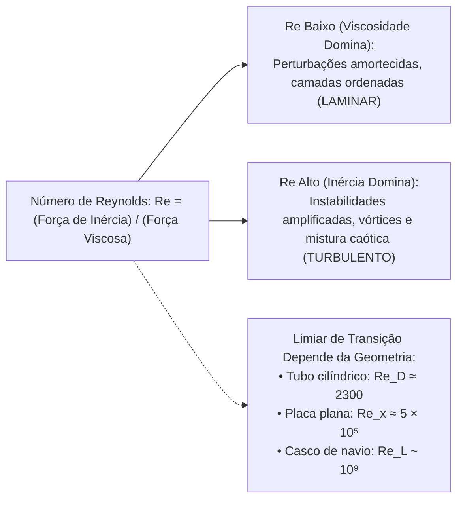

### C. Entenda o funcionamento (Balanço de Ordens de Grandeza)
Vamos quantificar as ordens de grandeza das forças dinâmicas em um escoamento com velocidade característica $U$, comprimento $L$, densidade $\rho$ e viscosidade $\mu$:
1. **Força de Inércia por Unidade de Volume:**  
   $$\text{Inércia} \sim \rho u \frac{\partial u}{\partial x} \sim \rho U \frac{U}{L} \sim \frac{\rho U^2}{L}$$
2. **Força Viscosa por Unidade de Volume:**  
   $$\text{Viscosidade} \sim \mu \frac{\partial^2 u}{\partial y^2} \sim \mu \frac{U}{L^2}$$
3. **Razão Adimensional de Forças:**  
   Dividindo a inércia pela viscosidade:
   $$\frac{\text{Força de Inércia}}{\text{Força Viscosa}} = \frac{\frac{\rho U^2}{L}}{\frac{\mu U}{L^2}} = \frac{\rho U^2}{L} \cdot \frac{L^2}{\mu U} = \boxed{\frac{\rho U L}{\mu} \equiv Re}$$

### D. Conheça a definição técnica
> **Definição Técnica:**  
> O **Número de Reynolds ($Re$)** é o parâmetro adimensional fundamental da mecânica dos fluidos definido como a razão entre as forças inerciais e as forças viscosas atuantes no escoamento:
> $$Re = \frac{\rho U L}{\mu} = \frac{U L}{\nu}$$
> Ele indica o regime predominante de forças e governa a estabilidade dinâmica do escoamento, comandando a transição do regime laminar para o regime turbulento (cujo valor crítico específico depende da geometria e das condições de contorno do sistema).

#### Grandezas Físicas, Dimensões e Unidades
- $\rho$: Massa específica do fluido ($[M L^{-3}]$, no SI: $\text{kg/m}^3$);
- $U$: Velocidade característica do escoamento ($[L T^{-1}]$, no SI: $\text{m/s}$);
- $L$: Comprimento característico linear ($[L]$, no SI: $\text{m}$);
- $\mu$: Viscosidade dinâmica ($[M L^{-1} T^{-1}]$, no SI: $\text{Pa}\cdot\text{s} = \text{kg/(m}\cdot\text{s)}$);
- $\nu = \mu/\rho$: Viscosidade cinemática ($[L^2 T^{-1}]$, no SI: $\text{m}^2/\text{s}$);
- $Re$: Grandeza puramente adimensional ($[M^0 L^0 T^0]$).

### E. O que precisa memorizar
- **Fórmula:** $Re = \frac{\rho U L}{\mu} = \frac{U L}{\nu}$.
- **Significado físico:** Razão $\frac{\text{Forças de Inércia}}{\text{Forças Viscosas}}$.
- **Função principal:** Indicar o predomínio relativo entre forças e comandar a transição laminar-turbulenta (conforme a geometria aplicável).

### F. Atenção para a prova
> [!TIP]
> **Como responder na prova:**  
> "O número de Reynolds ($Re = \frac{\rho U L}{\mu}$). É o número adimensional que indica o predomínio entre forças de inércia e forças viscosas, ditando a transição laminar-turbulenta."

---

## 5.9. Número de Froude ($Fr$): Inércia versus Gravidade e Ondas de Proa
*(Rastreabilidade: Questionário P1 — Pergunta 27)*

### A. Entenda a ideia
Quando um navio avança no mar, o casco empurra e deforma a água na proa. Como o líquido é incompressível, ele se eleva acima do nível de repouso, formando ondas. A força que tenta restaurar essa deformação de volta à superfície plana horizontal é a **força da gravidade**.

O **Número de Froude ($Fr$)** quantifica a razão entre a inércia do escoamento e as forças gravitacionais que atuam na superfície livre. É o parâmetro adimensional governante de todos os fenômenos de **ondas de superfície livre** e da resistência de ondas gerada pelo avanço do casco!

### B. Visualize o fenômeno
Pense em um navio de deslocamento acelerando no mar aberto:
- Em baixas velocidades ($Fr \sim 0,1$), as ondas geradas na proa e na popa são pequenas e de baixa amplitude.
- À medida que a velocidade de avanço cresce para a faixa operacional típica de embarcações de deslocamento ($Fr \approx 0,2$ a $0,4$), o comprimento das ondas geradas cresce proporcionalmente ao quadrado da velocidade ($U^2/g$). As cristas e cavas das ondas interferem entre si ao longo do casco, e a energia requerida para formar esse trem de ondas cresce dramaticamente, constituindo a **resistência de ondas**. Embarcações de deslocamento, portanto, geram sistemas expressivos de ondas em números de Froude muito inferiores a $1$.

> [!NOTE]
> **Esclarecimento Técnico: Froude de Comprimento ($Fr$), Froude de Águas Rasas ($Fr_h$) e o Regime de Planeio:**  
> 1. **Definição Naval Clássica ($Fr$):** Definido pelo comprimento de linha d'água ($L$):  
>    $$Fr = \frac{U}{\sqrt{gL}}$$  
>    Governa o padrão de dispersão de ondas gerado pelo casco.  
> 2. **Definição em Águas Rasas ($Fr_h$):** Definido pela profundidade local da lâmina d'água ($h$):  
>    $$Fr_h = \frac{U}{\sqrt{gh}}$$  
>    A condição $Fr_h = 1$ caracteriza rigorosamente a **condição crítica em águas rasas** (ou em canais abertos), momento em que a velocidade de avanço da embarcação iguala a celeridade natural de propagação de ondas gravitacionais rasas ($c = \sqrt{gh}$).  
> 3. **Independência do Regime de Planeio:** A condição $Fr = 1$ (ou $Fr_h = 1$) **não representa um limiar universal de transição para embarcações de planeio**. O desenvolvimento do planeio hidrodinâmico (regime em que a sustentação dinâmica sobrepuja o empuxo hidrostático) depende de um conjunto multifatorial complexo: geometria do casco (diedro de fundo, arestas vivas/*chines*, curvatura de seções), relação de deslocamento-comprimento, ângulo de trim, posição do centro de gravidade e velocidade operacional (frequentemente analisada pelo Froude volumétrico $F_{n\nabla} = U/\sqrt{g\nabla^{1/3}}$), não podendo ser determinado unicamente pela igualdade $Fr = 1$.

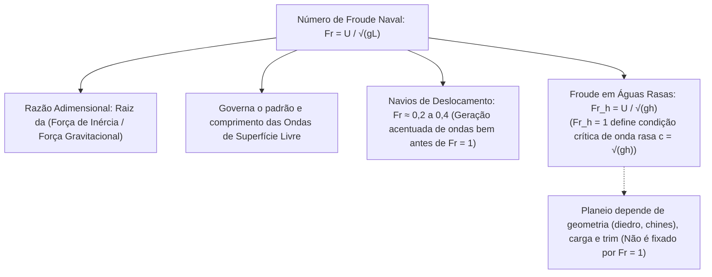

### C. Entenda o funcionamento (Balanço de Ordens de Grandeza)
1. **Força de Inércia e Força Gravitacional:**
   - Força de Inércia: $F_{\text{inércia}} \sim \rho U^2 L^2$;
   - Força de Gravidade (Peso do volume característico): $F_{\text{gravidade}} \sim \rho g L^3$.
2. **Razão Adimensional de Forças:**
   $$\frac{\text{Força de Inércia}}{\text{Força de Gravidade}} = \frac{\rho U^2 L^2}{\rho g L^3} = \frac{U^2}{g L}$$
3. **Padronização Naval da Raiz Quadrada:**  
   Como a velocidade de propagação de ondas gravitacionais de superfície rasa é proporcional à raiz de $gL$, a hidrodinâmica padronizou o parâmetro linear extraindo a raiz quadrada:
   $$\boxed{Fr = \sqrt{\frac{U^2}{g L}} = \frac{U}{\sqrt{g L}}}$$

### D. Conheça a definição técnica
> **Definição Técnica:**  
> O **Número de Froude ($Fr$)** é o parâmetro adimensional hidrodinâmico que expressa a razão entre as forças inerciais e as forças gravitacionais que atuam sobre um escoamento com superfície livre:
> $$Fr = \frac{U}{\sqrt{g L}}$$
> Na engenharia naval, governa a formação do trem de ondas gerado pelo avanço do casco, ditando a resistência de ondas e o padrão de escoamento em superfície livre.

#### Grandezas Físicas, Dimensões e Unidades
- $U$: Velocidade de avanço da embarcação ($[L T^{-1}]$, no SI: $\text{m/s}$);
- $g$: Aceleração da gravidade local ($[L T^{-2}]$, no SI: $\text{m/s}^2$);
- $L$: Comprimento característico de linha d'água do navio ($[L]$, no SI: $\text{m}$);
- $Fr$: Grandeza puramente adimensional ($[M^0 L^0 T^0]$).

### E. O que precisa memorizar
- **Fórmula:** $Fr = \frac{U}{\sqrt{g L}}$.
- **Significado físico:** Razão $\sqrt{\frac{\text{Forças de Inércia}}{\text{Forças de Gravidade}}}$.
- **Aplicação essencial:** Governa o sistema de ondas de superfície livre e a resistência de ondas na proa do navio.

### F. Atenção para a prova
> [!TIP]
> **Como responder na prova:**  
> "O número de Froude ($Fr = \frac{U}{\sqrt{gL}}$). É o parâmetro adimensional que compara a inércia do escoamento com o efeito da aceleração gravitacional, comandando o sistema de ondas gerado pela proa do navio."

---

## 5.10. As Três Similaridades Físicas para Ensaios de Modelos em Tanque
*(Rastreabilidade: Questionário P1 — Pergunta 28)*

### A. Entenda a ideia
Construir um navio de verdade custa centenas de milhões de reais. Antes de construir, os engenheiros constroem uma miniatura perfeita (um modelo de $4\,\text{metros}$) e colocam para rebocar em um tanque de provas cheio de água. 

Para que as medições feitas no barquinho de brinquedo sirvam com rigor científico para prever o que vai acontecer com o navio real de $200\,\text{metros}$ no oceano, é preciso garantir **três similaridades físicas cumulativas**:
1. O formato tem que ser idêntico (Geométrica).
2. As linhas de corrente da água têm que ser idênticas (Cinemática).
3. As forças de atrito, pressão e ondas têm que estar na mesma proporção (Dinâmica).

### B. Visualize o fenômeno
Imagine um tanque de provas naval:
- O modelo reduzido de madeira ou poliuretano é uma cópia proporcional perfeita do casco real.
- Conforme o carro dinamométrico reboca o modelo, as ondas geradas e os redemoinhos na popa guardam proporcionalidade com as do navio real.
- As forças medidas no dinamômetro são convertidas pelas leis de escala para prever a potência em escala real.

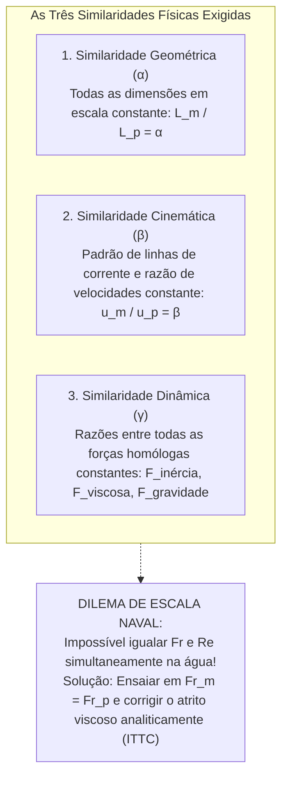

### C. Entenda o funcionamento (Quadro Comparativo e o Dilema de Escala)

| Similaridade | O que Exige | Fator de Escala Físico | Significado Prático |
| :--- | :--- | :--- | :--- |
| **1. Similaridade Geométrica** | Proporcionalidade estrita em todas as dimensões lineares espaciais | $\alpha = \frac{L_m}{L_p} = \frac{B_m}{B_p} = \frac{T_m}{T_p}$ | O modelo é um clone em escala reduzida; todos os ângulos homólogos são idênticos. |
| **2. Similaridade Cinemática** | Proporcionalidade nos vetores velocidade e padrões de fluxo idênticos | $\beta = \frac{V_m}{V_p} = \text{constante}$ | As linhas de corrente têm exatamente a mesma geometria e os tempos de trânsito guardam proporção fixa. |
| **3. Similaridade Dinâmica** | Razão constante entre todas as forças homólogas de mesma natureza | $\frac{(F_{\text{inércia}})_m}{(F_{\text{inércia}})_p} = \frac{(F_{\text{viscosa}})_m}{(F_{\text{viscosa}})_p} = \frac{(F_{\text{gravidade}})_m}{(F_{\text{gravidade}})_p}$ | Exigiria que todos os números adimensionais governantes fossem simultaneamente iguais: $Fr_m = Fr_p$ e $Re_m = Re_p$. |

#### O "Dilema de Escala" dos Tanques de Prova (*Scale Dilemma*)
Por que é impossível atingir Similaridade Dinâmica estrita e simultânea em ensaios de modelos de navios na água?
1. **Igualdade do Número de Froude ($Fr_m = Fr_p$):**  
   Para preservar o padrão de ondas gravitacionais:
   $$\frac{U_m}{\sqrt{g L_m}} = \frac{U_p}{\sqrt{g L_p}} \implies U_m = U_p \sqrt{\frac{L_m}{L_p}} = U_p \sqrt{\alpha} \quad (\text{com } \alpha < 1)$$
   Como $\alpha < 1$, o modelo precisa ser rebocado a uma velocidade **menor** que o navio real.
2. **Igualdade do Número de Reynolds ($Re_m = Re_p$):**  
   Para preservar o atrito viscoso na camada limite com o mesmo fluido ($\nu_m = \nu_p$):
   $$\frac{U_m L_m}{\nu} = \frac{U_p L_p}{\nu} \implies U_m = U_p \left( \frac{L_p}{L_m} \right) = \frac{U_p}{\alpha}$$
   O modelo precisaria ser rebocado a uma velocidade **muito maior** que o navio real!
3. **Incompatibilidade Física e Solução Prática Naval (Método de Froude / ITTC):**  
   As duas condições são mutuamente excludentes com água sob gravidade terrestre: exigiriam $\alpha^{3/2} = 1 \implies \alpha = 1$ (ou seja, o modelo teria que ser do mesmo tamanho do navio real!).  
   Na engenharia naval prática, resolve-se o dilema fixando a **similaridade de Froude** no tanque de provas ($Fr_m = Fr_p$) para medir com exatidão a resistência de ondas, e corrigindo a distorção da resistência viscosa de Reynolds analiticamente por meio de linhas de atrito consagradas da ITTC ($C_F = f(Re)$).

### D. Conheça a definição técnica
> **Definição Técnica:**  
> As três similaridades físicas necessárias e suficientes para assegurar a equivalência hidrodinâmica integral entre um modelo reduzido de testes em tanque e um navio em escala real (*full scale*) são:
> 1. **Similaridade Geométrica:** todas as dimensões homólogas lineares guardam uma razão geométrica constante ($\alpha = L_m / L_p$);
> 2. **Similaridade Cinemática:** os campos de velocidades e as linhas de corrente são geometricamente semelhantes, guardando uma razão de velocidades constante ($\beta = V_m / V_p$);
> 3. **Similaridade Dinâmica:** as razões entre todas as forças homólogas de mesma natureza mecânica (inerciais, viscosas, gravitacionais e de pressão) são rigorosamente constantes.

### E. O que precisa memorizar
- Os 3 nomes exatos: **Geométrica**, **Cinemática** e **Dinâmica**.
- Requisitos:
  - Geométrica: formas e dimensões em proporção constante ($\alpha$);
  - Cinemática: direções e razões de velocidades constantes ($\beta$);
  - Dinâmica: razões entre todas as forças homólogas constantes.
- O dilema prático: Froude e Reynolds não podem ser igualados simultaneamente na água, exigindo extrapolação analítica viscosa.

### F. Atenção para a prova
> [!TIP]
> **Como responder na prova:**  
> "As três similaridades físicas necessárias para garantir equivalência integral de escoamento entre um modelo de testes em tanque e um navio em escala real são: 1. Similaridade geométrica: formas e dimensões em proporção constante ($\alpha$); 2. Similaridade cinemática: direções e razões de velocidades constantes ($\beta$); 3. Similaridade dinâmica: razões entre todas as forças homólogas constantes."

---

# Bloco 6: Homogeneidade Dimensional e Teorema de Buckingham

---

## 6.1. A Regra da Homogeneidade Dimensional
*(Rastreabilidade: Questionário P1 — Pergunta 29)*

### A. Entenda a ideia
Na vida cotidiana, todo mundo sabe que você não pode somar 3 laranjas com 4 melancias e dizer que tem 7 laranjas. Da mesma forma, na física e na engenharia, você **nunca pode somar metros com segundos, ou quilogramas com Newtons**. 

A **Regra da Homogeneidade Dimensional** estabelece que, se uma equação física diz que $A = B + C$, então os blocos $A$, $B$ e $C$ são obrigados a ter rigorosamente a mesma unidade e as mesmas dimensões fundamentais. É o filtro mais poderoso que existe para checar se uma fórmula inventada na prova faz sentido ou é um disparate completo!

### B. Visualize o fenômeno
Pense na célebre Equação de Bernoulli:
$$p + \frac{1}{2}\rho V^2 + \rho g z = \text{constante}$$
Cada um dos três membros somados possui a mesma dimensão e unidade:
- $p$ tem dimensão de pressão ($[M L^{-1} T^{-2}]$, ou $\text{N/m}^2$);
- $\frac{1}{2}\rho V^2$ tem dimensão de pressão ($[\text{kg/m}^3] \cdot [\text{m/s}]^2 = \text{N/m}^2$);
- $\rho g z$ tem dimensão de pressão ($[\text{kg/m}^3] \cdot [\text{m/s}^2] \cdot [\text{m}] = \text{N/m}^2$).  
Como todos os termos falam a "mesma língua dimensional", a equação é dimensionalmente homogênea.

> [!IMPORTANT]
> **Condição Necessária versus Suficiente:**  
> A homogeneidade dimensional é uma **condição necessária, mas não suficiente**, para a validade física de uma equação.  
> - **Necessária:** Se uma equação violar a homogeneidade dimensional, ela é categoricamente falsa e fisicamente sem sentido.  
> - **Não suficiente:** Uma equação pode ser dimensionalmente homogênea e, ainda assim, fisicamente incorreta (por exemplo, ao omitir forças fundamentais, errar coeficientes empíricos ou escrever $E = 5 m c^2$, que é homogênea mas incorreta).

```mermaid
flowchart TD
    E["Equação Proposta: A = B + C - D"] --> H["Teste de Homogeneidade Dimensional"]
    H -->|Se dimensões divergirem| F["CATEGORICAMENTE FALSA<br>(Inconsistência dimensional)"]
    H -->|Se dimensões forem idênticas: [A] ≡ [B] ≡ [C] ≡ [D]| N["CONDIÇÃO NECESSÁRIA ATENDIDA<br>(Pode ser fisicamente válida, mas requer validação física/experimental)"]
```

### C. Entenda o funcionamento (O Sistema de Dimensões Primárias $MLT$)
Na mecânica clássica, todas as grandezas físicas derivam de três dimensões fundamentais primárias independentes:
1. **Massa ($M$):** quilograma ($\text{kg}$);
2. **Comprimento ($L$):** metro ($\text{m}$);
3. **Tempo ($T$):** segundo ($\text{s}$).

Se uma lei física é descrita por uma relação de soma de termos:

$$y = x_1 + x_2 + x_3 + \dots + x_n$$

A regra de homogeneidade impõe o sistema de equivalências dimensionais estritas:

$$[y] = [x_1] = [x_2] = [x_3] = \dots = [x_n]$$

Se qualquer termo apresentar um expoente diferente em $M, L$ ou $T$, a equação é matematicamente inconsistente e fisicamente impossível no mundo real.

### D. Conheça a definição técnica
> **Definição Técnica:**  
> A **Regra da Homogeneidade Dimensional** estabelece que uma equação que descreve um fenômeno físico real só é matematicamente válida e dimensionalmente coerente se todos os seus membros aditivos possuírem rigorosamente a mesma dimensão fundamental primária ($M, L, T$).

### E. O que precisa memorizar
- **Conceito:** Todos os termos somados em uma equação física devem ter a **mesma dimensão primária ($M, L, T$)**.
- **Utilidade:** Verificar se deduções matemáticas estão corretas e permitir a adimensionalização de equações.

### F. Atenção para a prova
> [!TIP]
> **Como responder na prova:**  
> "A Regra da Homogeneidade Dimensional estabelece que uma equação só é fisicamente significativa e dimensionalmente coerente se todos os seus membros aditivos possuírem rigorosamente a mesma dimensão primária ($M, L, T$)."

---

## 6.2. Procedimento de Adimensionalização e Normalização
*(Rastreabilidade: Questionário P1 — Pergunta 30)*

### A. Entenda a ideia
Por que os engenheiros adoram trabalhar com equações adimensionais (sem metros, sem segundos, sem quilogramas)? 

Porque se você fizer um teste de navio medindo a força em Newtons, o resultado só serve para aquele navio específico com aquele tamanho e naquela água. Mas se você **dividir** a força por uma combinação de variáveis que também tenha dimensão de força, o resultado vira um número puro (adimensional, como $0,0035$). Esse número puro vale tanto para o barquinho de 4 metros no laboratório quanto para o navio real de 200 metros no oceano!

### B. Visualize o fenômeno
Pense na inclinação de uma rampa:
- Em vez de dizer "esta rampa sobe 2 metros a cada 10 metros de chão", você diz que a inclinação é de $20\%$ ou $0,2$. 
- Você dividiu metros por metros ($[L]/[L]$) e obteve um número puro adimensional. 
- Na hidrodinâmica, adimensionalizamos equações inteiras de Navier–Stokes dividindo cada termo por uma combinação de $\rho, U, L$.

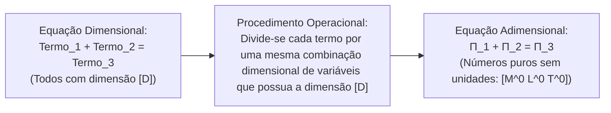

### C. Entenda o funcionamento (Procedimento Operacional)
1. **Identificação da Dimensão Base:**  
   Pela regra da homogeneidade dimensional, todos os termos aditivos da equação possuem a mesma dimensão fundamental $[D]$.
2. **Seleção de Variáveis Escalares de Referência:**  
   Escolhem-se parâmetros de referência representativos do escoamento (uma massa específica característica $\rho_0$, uma velocidade de corrente livre $U_0$ e um comprimento de referência $L_0$).
3. **Divisão Termo a Termo:**  
   Divide-se cada um dos membros da equação original pela mesma combinação algébrica dos parâmetros de referência que apresente a dimensão $[D]$.
4. **Resultado Adimensional:**  
   As grandezas dimensionais são transformadas em variáveis normalizadas de ordem de grandeza unitária ($u^* = u/U_0$, $x^* = x/L_0$), e surgem naturalmente os coeficientes e parâmetros adimensionais clássicos da hidrodinâmica ($Re, Fr, Eu$).

### D. Conheça a definição técnica
> **Definição Técnica:**  
> O procedimento operacional de adimensionalização e normalização de uma equação diferencial ou algébrica consiste em dividir cada um dos seus termos aditivos por uma mesma combinação algébrica de variáveis características do problema que possua essa mesma dimensão fundamental.

### E. O que precisa memorizar
- **Como fazer:** Dividir cada termo da equação por uma mesma combinação algébrica de variáveis do problema com a mesma dimensão fundamental.

### F. Atenção para a prova
> [!TIP]
> **Como responder na prova:**  
> "Dividindo cada um dos seus termos por uma mesma combinação algébrica de variáveis do problema que possua essa mesma dimensão fundamental."

---

## 6.3. O Teorema $\Pi$ de Buckingham e o Número de Monômios Independentes
*(Rastreabilidade: Questionário P1 — Pergunta 31)*

### A. Entenda a ideia
Imagine que você precisa fazer um experimento no laboratório para descobrir como a força de resistência de um navio depende de 6 variáveis diferentes: velocidade, comprimento, densidade da água, viscosidade, gravidade e tensão superficial. Se você fosse testar 10 valores para cada variável, você teria que fazer $10^6 = 1.000.000$ de testes! O laboratório faliria antes de terminar.

É aqui que entra o **Teorema $\Pi$ de Buckingham**: ele prova matematicamente que você não precisa variar as 6 variáveis uma por uma. Você pode agrupá-las em um número muito menor de grupos adimensionais. O teorema dá uma fórmula mágica e exata para saber quantos grupos vão surgir:
$$k = n - m$$

### B. Visualize o fenômeno
Pense em compactar um arquivo de computador:
- Você tinha $n = 7$ variáveis soltas ($R, \rho, U, L, \mu, g, \sigma$).
- A natureza impõe $m = 3$ restrições dimensionais básicas ($M, L, T$).
- O Teorema de Buckingham "compacta" o problema em apenas $k = 7 - 3 = 4$ grupos adimensionais independentes ($\Pi_1, \Pi_2, \Pi_3, \Pi_4$). Em vez de um milhão de testes, algumas dezenas de ensaios em tanque de provas resolvem o problema perfeitamente!

```
Fórmula Fundamental de Buckingham:
+-------------------------------------------------------------+
|                     k = n - m                               |
|                                                             |
|  k: Número de grupos adimensionais independentes (monômios) |
|  n: Número total de variáveis físicas envolvidas            |
|  m: Número de dimensões fundamentais independentes (MLT)    |
+-------------------------------------------------------------+
```

### C. Entenda o funcionamento (O Teorema Algébrico)
Seja um fenômeno físico governado por uma relação de dependência funcional entre $n$ grandezas físicas dimensionais:

$$f(q_1, q_2, q_3, \dots, q_n) = 0$$

Se essas $n$ grandezas puderem ser completamente expressas em termos de $m$ dimensões fundamentais primárias independentes (no sistema mecânico usual: Massa $M$, Comprimento $L$ e Tempo $T$, logo $m = 3$):

O **Teorema $\Pi$ de Buckingham** estabelece que a equação original é estritamente equivalente a uma relação entre um número reduzido $k$ de monômios adimensionais independentes:

$$\phi(\Pi_1, \Pi_2, \dots, \Pi_k) = 0$$

onde a quantidade de grupos adimensionais independentes é dada exatamente por:

$$\boxed{k = n - m}$$

### D. Conheça a definição técnica
> **Definição Técnica:**  
> Pelo **Teorema $\Pi$ de Buckingham**, se um determinado fenômeno físico é governado por uma relação funcional que envolve $n$ grandezas físicas dimensionais, e essas grandezas podem ser expressas em termos de $m$ dimensões primárias fundamentais independentes (tipicamente $m=3$ no sistema $MLT$), o fenômeno pode ser inteiramente reformulado em função de exatamente:
> $$k = n - m$$
> grupos ou monômios adimensionais independentes ($\Pi_1, \Pi_2, \dots, \Pi_k$).

### E. O que precisa memorizar
- **A fórmula fundamental:** $k = n - m$.
- $n$: total de grandezas físicas.
- $m$: número de dimensões fundamentais ($MLT \implies m=3$).
- $k$: total de números adimensionais $\Pi$.

### F. Atenção para a prova
> [!TIP]
> **Como responder na prova:**  
> "Em termos do Teorema $\Pi$ de Buckingham, se um fenômeno hidrodinâmico é função de $n$ grandezas físicas e há $m$ dimensões fundamentais que as definem, serão obtidos exatamente:
> $$k = n - m$$
> monômios adimensionais independentes."

---

## 6.4. Critério de Independência das Variáveis Repetidas
*(Rastreabilidade: Questionário P1 — Pergunta 32)*

### A. Entenda a ideia
No método de Buckingham, você escolhe uma "equipe" de variáveis que vai se repetir em todos os grupos adimensionais (as chamadas **variáveis repetidas**). Mas tem uma regra de ouro: **essa equipe não pode ser redundante entre si**. 

Se você escolher como variáveis repetidas a velocidade de avanço do navio ($U$, em $\text{m/s}$) e a velocidade da onda ($c$, em $\text{m/s}$), você cometeu um erro grave! As duas variáveis já têm a mesma dimensão e sozinhas formam o número adimensional $U/c$. É como tentar construir um triângulo usando duas linhas que estão em cima da mesma reta: você perde uma dimensão de liberdade!

### B. Visualize o fenômeno
Pense em um sistema de coordenadas espaciais 3D:
- Para definir qualquer ponto no espaço, você precisa de 3 eixos ortogonais: $X, Y, Z$.
- Se você escolhesse dois eixos $X$ paralelos e nenhum eixo $Z$, você ficaria preso em um plano e nunca conseguiria medir a altura!
- As variáveis repetidas funcionam como esses eixos: elas **precisam ser dimensionalmente independentes**. Juntas, elas precisam cobrir massa, comprimento e tempo sem formar nenhum grupo adimensional entre si.

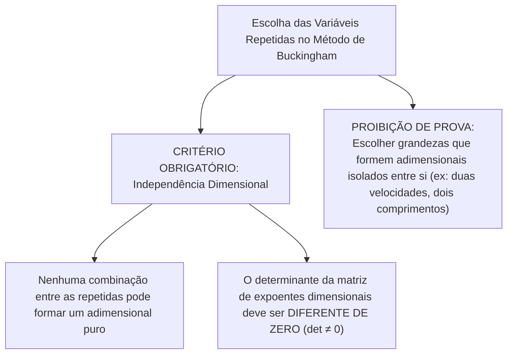

### C. Entenda o funcionamento (O Critério Algébrico do Determinante)
Para verificar matematicamente se $m$ variáveis repetidas $\{q_1, q_2, \dots, q_m\}$ são dimensionalmente independentes:
1. Monta-se a **matriz dos expoentes dimensionais** das variáveis repetidas em relação às dimensões primárias $(M, L, T)$.
2. Por exemplo, para a tríade clássica $\{\rho, U, L\}$:
   - $[\rho] = M^1 L^{-3} T^0$
   - $[U] = M^0 L^1 T^{-1}$
   - $[L] = M^0 L^1 T^0$
3. A matriz dimensional $3 \times 3$ é:
   $$\mathbf{A} = \begin{pmatrix} 1 & -3 & 0 \\ 0 & 1 & -1 \\ 0 & 1 & 0 \end{pmatrix}$$
4. Calcula-se o determinante:
   $$\det(\mathbf{A}) = 1 \cdot (1 \cdot 0 - (-1) \cdot 1) = 1 \neq 0$$
   Como $\det(\mathbf{A}) \neq 0$, os vetores dimensionais são linearmente independentes, comprovando formalmente que **é impossível formar qualquer número adimensional combinando apenas $\rho, U$ e $L$**.

### D. Conheça a definição técnica
> **Definição Técnica:**  
> As variáveis repetidas selecionadas no método de Buckingham devem ser estritamente independentes do ponto de vista dimensional. É terminantemente proibido que qualquer combinação algébrica entre as variáveis repetidas forme, isoladamente, um parâmetro ou número adimensional (o determinante da matriz de expoentes dimensionais das grandezas repetidas deve ser diferente de zero).

### E. O que precisa memorizar
- **Critério:** As variáveis repetidas devem ser **dimensionalmente independentes**.
- **Regra:** Nenhuma combinação entre elas pode formar um número adimensional isolado.
- **Teste algébrico:** Determinante da matriz dimensional diferente de zero ($\det \neq 0$).

### F. Atenção para a prova
> [!IMPORTANT]
> **Como responder na prova:**  
> "Não. As variáveis repetidas devem ser dimensionalmente independentes, sendo proibido que qualquer combinação entre elas forme um número adimensional isolado."

---

## 6.5. Quantidade e Requisito Cumulativo das Grandezas Repetidas
*(Rastreabilidade: Questionário P1 — Pergunta 33)*

### A. Entenda a ideia
Quantas variáveis repetidas você deve escolher na prova? A resposta é exata: **exatamente $m$ variáveis** (onde $m$ é a quantidade de dimensões fundamentais, quase sempre 3 no sistema de mecânica $MLT$). 

E qual é o requisito cumulativo delas? Elas formam uma equipe de trabalho: uma pode trazer a massa, a outra traz o comprimento e a outra traz o tempo. **Juntas, elas precisam conter todas as dimensões básicas do problema**. Se nenhuma variável repetida tiver a dimensão de tempo, como você vai cancelar os segundos da velocidade? Impossível!

### B. Visualize o fenômeno
Pense na tríade naval clássica: $\{\rho, U, L\}$
- Quem traz a Massa ($M$)? A densidade da água $\rho$ ($[\text{kg/m}^3]$).
- Quem traz o Tempo ($T$)? A velocidade de avanço $U$ ($[\text{m/s}]$).
- Quem traz o Comprimento ($L$)? O comprimento do navio $L$ ($[\text{m}]$).  
A equipe está completa! Juntas, elas contêm $M, L$ e $T$.

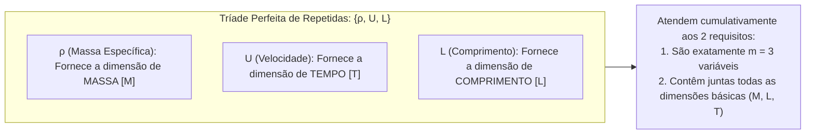

### C. Entenda o funcionamento (As Duas Regras Mandatórias de Seleção)
Na formulação canônica do Teorema $\Pi$:
1. **Regra Quantitativa:**  
   O número de variáveis repetidas a serem selecionadas é **exatamente igual a $m$** (o número de dimensões fundamentais independentes que estruturam o problema, onde $m = 3$ para a base $MLT$).
2. **Regra Qualitativa Cumulativa:**  
   As $m$ variáveis repetidas devem, **obrigatoriamente e cumulativamente, conter entre si todas as dimensões fundamentais do problema**.  
   - Se o conjunto de variáveis envolver massa ($M$), comprimento ($L$) e tempo ($T$), a união das dimensões das repetidas deve cobrir $M, L$ e $T$.
3. **Recomendação Prática Consagrada:**  
   Escolher sempre uma grandeza que represente a **geometria** (como $L$ ou $D$), uma que represente a **cinemática** (como a velocidade $U$ ou $u$) e uma que represente a **propriedade inercial do fluido** (como a densidade $\rho$).

### D. Conheça a definição técnica
> **Definição Técnica:**  
> No procedimento de Buckingham, devem ser selecionadas exatamente $m$ grandezas físicas como variáveis repetidas (onde $m$ é o número de dimensões fundamentais da base, sendo tipicamente $m=3$ para o sistema $MLT$). O requisito cumulativo obrigatório é que essas $m$ grandezas devem, reunidas em conjunto, conter todas as dimensões primárias básicas que participam do fenômeno físico.

### E. O que precisa memorizar
- **Quantidade:** Exatamente $m$ variáveis (geralmente $3$).
- **Requisito cumulativo:** Devem, juntas, conter todas as dimensões básicas do problema ($M, L, T$).

### F. Atenção para a prova
> [!TIP]
> **Como responder na prova:**  
> "Devem ser selecionadas exatamente $m$ variáveis (onde $m$ é o número de dimensões fundamentais, tipicamente 3 para o sistema $MLT$), e elas devem, juntas, conter todas as dimensões básicas do problema."

---

## 6.6. Grupos Adimensionais na Resistência de Avanço do Casco ($R, \rho, U, L, \mu, g, \sigma$)
*(Rastreabilidade: Questionário P1 — Pergunta 34)*

### A. Entenda a ideia
Chegamos ao problema mais célebre e importante de toda a arquitetura naval: **como calcular a força que a água faz contra um navio em movimento?** 

A resistência de avanço do casco $R$ depende de 7 grandezas físicas ao mesmo tempo: o tamanho do navio ($L$), a sua velocidade ($U$), a densidade da água ($\rho$), a viscosidade que gera o atrito ($\mu$), a gravidade que comanda as ondas ($g$) e a tensão superficial na espuma da proa ($\sigma$). 

Aplicando o método dos 6 passos de Buckingham, essas 7 variáveis se transformam com elegância matemática nos 4 grandes números da hidrodinâmica naval: o Coeficiente de Resistência Total ($C_T$), o Número de Reynolds ($Re$), o Número de Froude ($Fr$) e o Número de Weber ($We$).

### B. Visualize o fenômeno
Pense em um navio de guerra singrando o mar em alta velocidade:
- O casco empurra a água para a frente: gera a **força de resistência $R$** ($\Pi_1 \to C_T$);
- A água raspa e esfrega em toda a área molhada de aço: gera a camada limite governada pela **viscosidade $\mu$** ($\Pi_2 \to Re$);
- A proa levanta montanhas de água que caem sob a ação da **gravidade $g$**: gera as ondas governadas pelo número de **Froude** ($\Pi_3 \to Fr$);
- Os borrifos e gotículas que se quebram no bico da proa são mantidos juntos pela **tensão superficial $\sigma$**: governados pelo número de **Weber** ($\Pi_4 \to We$).

```mermaid
flowchart TD
    subgraph Problema_Naval["Problema da Resistência do Casco (n = 7, m = 3 => k = 4)"]
        P1["Π1 = R / (ρ U² L²)  ===>  Normalizado para C_T = (2/c_s) Π1 (Coef. de Resistência Total)"]
        P2["Π2 = μ / (ρ U L)    ===>  Invertido para Re = ρ U L / μ (Número de Reynolds)"]
        P3["Π3 = g L / U²       ===>  Invertido e Raiz para Fr = U / √(g L) (Número de Froude)"]
        P4["Π4 = σ / (ρ U² L)   ===>  Invertido para We = ρ U² L / σ (Número de Weber)"]
    end
```

### C. Entenda o funcionamento (Dedução Matemática Completa Passo a Passo)

#### 1. Identificação das Variáveis e Dimensões ($n=7, m=3, k=4$)
- **As $n=7$ grandezas físicas:**
  1. Resistência total de avanço $R$: dimensão de força $[M L T^{-2}]$;
  2. Massa específica da água do mar $\rho$: dimensão $[M L^{-3}]$;
  3. Velocidade de avanço da embarcação $U$: dimensão $[L T^{-1}]$;
  4. Comprimento de linha d'água do casco $L$: dimensão $[L]$;
  5. Viscosidade dinâmica da água $\mu$: dimensão $[M L^{-1} T^{-1}]$;
  6. Aceleração da gravidade $g$: dimensão $[L T^{-2}]$;
  7. Tensão superficial da água $\sigma$: dimensão de força por comprimento $[M T^{-2}]$ ($[\text{N/m}]$).
- **Dimensões fundamentais ($m=3$):** Massa ($M$), Comprimento ($L$) e Tempo ($T$).
- **Contagem de Monômios Adimensionais:**
  $$k = n - m = 7 - 3 = 4 \text{ grupos independentes } (\Pi_1, \Pi_2, \Pi_3, \Pi_4)$$
- **Seleção da Tríade de Repetidas ($m=3$):** $\{\rho, U, L\}$ (já verificada como dimensionalmente independente com $\det \neq 0$).

---

#### 2. Dedução do Grupo $\Pi_1$ — Força de Resistência ($R$)
Escreve-se o monômio genérico:
$$\Pi_1 = R \cdot \rho^a L^b U^c$$
Substituindo as dimensões:
$$[M^0 L^0 T^0] = [M L T^{-2}] \cdot [M L^{-3}]^a \cdot [L]^b \cdot [L T^{-1}]^c = M^{1+a} \cdot L^{1 - 3a + b + c} \cdot T^{-2 - c}$$
Monta-se o sistema linear de equações para os expoentes das dimensões fundamentais:
- **Equação em $M$:** $1 + a = 0 \implies \boxed{a = -1}$
- **Equação em $T$:** $-2 - c = 0 \implies \boxed{c = -2}$
- **Equação em $L$:** $1 - 3a + b + c = 0 \implies 1 - 3(-1) + b + (-2) = 0 \implies 1 + 3 + b - 2 = 0 \implies b + 2 = 0 \implies \boxed{b = -2}$

Substituindo os expoentes obtidos:
$$\Pi_1 = R \cdot \rho^{-1} L^{-2} U^{-2} = \boxed{\frac{R}{\rho U^2 L^2}}$$

##### Aprofundamento Crítico: A Normalização de $\Pi_1$ para o Coeficiente Naval da ITTC ($C_T$)
> [!IMPORTANT]
> **Relação entre o Monômio Bruto de Buckingham ($\Pi_1$) e o Coeficiente Oficial Naval ($C_T$):**  
> 1. **Origem pelo Teorema de Buckingham:** A análise dimensional direta fornece $\Pi_1 = \frac{R}{\rho U^2 L^2}$. Ela normaliza a força por uma área de referência puramente linear $L^2$ e pela inércia $\rho U^2$. O método puramente dimensional não introduz fatores numéricos convencionais (como $1/2$) nem incorpora a geometria detalhada do corpo.
> 2. **Definição Convencional da ITTC:** Na hidrodinâmica naval prática e de tanques de prova (ITTC), o Coeficiente de Resistência Total é convencionado em função da **pressão dinâmica** ($\frac{1}{2}\rho U^2$) e da **área da superfície molhada real** do casco ($S$):
>    $$C_T \equiv \frac{R}{\frac{1}{2}\rho S U^2}$$
> 3. **A Relação Geométrica de Escala $S = c_s L^2$:** Por similaridade geométrica estrita, qualquer área de superfície é proporcional ao quadrado do comprimento característico: $S = c_s L^2$, onde o coeficiente adimensional de área molhada é $c_s = S/L^2$.
> 4. **Dedução da Relação Exata entre $C_T$ e $\Pi_1$:**
>    Substituindo $S = c_s L^2$ na definição oficial de $C_T$:
>    $$C_T = \frac{R}{\frac{1}{2}\rho (c_s L^2) U^2} = \frac{1}{\frac{1}{2}c_s} \left( \frac{R}{\rho U^2 L^2} \right) = \boxed{\left( \frac{2}{c_s} \right)\Pi_1} \iff \boxed{\Pi_1 = \left(\frac{c_s}{2}\right)C_T}$$
>    Essa relação é, portanto, estritamente dependente da convenção de $C_T$, da escolha da área molhada $S$ e da definição geométrica de $c_s$.
> 5. **Natureza Representativa de $c_s$ e Disparidade Numérica:**  
>    - O fator $c_s = S/L^2$ **não é uma constante física universal**, mas sim um parâmetro de forma que depende da geometria específica do casco (coeficiente de bloco $C_B$, boca, calado).  
>    - Para navios mercantes de deslocamento típicos, adota-se ilustrativamente a faixa representativa $c_s \in [0,10; 0,30]$. Nessas geometrias, o multiplicador $\frac{2}{c_s}$ situa-se entre $6,7$ e $20$.
>    - Logo, embora $C_T$ e $\Pi_1$ compartilhem a mesma natureza adimensional ($[M^0 L^0 T^0]$), **eles NÃO são numericamente iguais**. Afirmar que $C_T \equiv \Pi_1$ sem explicitar o fator de forma $2/c_s$ e a área molhada é uma imprecisão técnica.
> 6. **Nota de Auditoria Documental:** Na Apostila de U2 (p. 10), o professor deduz $\Pi_1 = \frac{R_{\text{forma}}}{\rho L^2 U^2}$ denominando-o coeficiente de arrasto de forma ($R_{\text{forma}}$). No Questionário P1 (Pergunta 34), o professor adotou o termo "Coeficiente de Resistência Total ($C_T$)". Registra-se que a análise de Buckingham fornece diretamente $\Pi_1$, enquanto o coeficiente convencional $C_T$ incorpora o fator $\frac{2}{c_s}$.

---

#### 3. Dedução do Grupo $\Pi_2$ — Efeito Viscoso ($\mu$)
Escreve-se o monômio:
$$\Pi_2 = \mu \cdot \rho^a L^b U^c$$
Substituindo as dimensões:
$$[M^0 L^0 T^0] = [M L^{-1} T^{-1}] \cdot [M L^{-3}]^a \cdot [L]^b \cdot [L T^{-1}]^c = M^{1+a} \cdot L^{-1 - 3a + b + c} \cdot T^{-1 - c}$$
Sistema linear:
- **Equação em $M$:** $1 + a = 0 \implies \boxed{a = -1}$
- **Equação em $T$:** $-1 - c = 0 \implies \boxed{c = -1}$
- **Equação em $L$:** $-1 - 3a + b + c = 0 \implies -1 - 3(-1) + b + (-1) = 0 \implies -1 + 3 + b - 1 = 0 \implies b + 1 = 0 \implies \boxed{b = -1}$

Substituindo os expoentes:
$$\Pi_2 = \mu \cdot \rho^{-1} L^{-1} U^{-1} = \boxed{\frac{\mu}{\rho U L}}$$
Como o monômio obtido diretamente representa $\frac{\text{Viscosidade}}{\text{Inércia}}$, toma-se o inverso para seguir a convenção de colocar a inércia motora no numerador:
$$\boxed{\Pi_2^{-1} = \frac{\rho U L}{\mu} \equiv Re \quad (\text{ou } Rn \text{ na apostila de U2})}$$

---

#### 4. Dedução do Grupo $\Pi_3$ — Efeito Gravitacional e Ondas ($g$)
Escreve-se o monômio:
$$\Pi_3 = g \cdot \rho^a L^b U^c$$
Substituindo as dimensões:
$$[M^0 L^0 T^0] = [L T^{-2}] \cdot [M L^{-3}]^a \cdot [L]^b \cdot [L T^{-1}]^c = M^a \cdot L^{1 - 3a + b + c} \cdot T^{-2 - c}$$
*(Nota de errata histórica: na Apostila U2 p. 11, o professor cometeu um lapso tipográfico intermediário escrevendo $T^{-1-c}$, corrigindo imediatamente na linha seguinte para $c = -2$)*.
Sistema linear:
- **Equação em $M$:** $\boxed{a = 0}$ (a gravidade independe da massa específica do fluido!)
- **Equação em $T$:** $-2 - c = 0 \implies \boxed{c = -2}$
- **Equação em $L$:** $1 - 3(0) + b + (-2) = 0 \implies 1 + b - 2 = 0 \implies b - 1 = 0 \implies \boxed{b = 1}$

Substituindo os expoentes:
$$\Pi_3 = g \cdot \rho^0 L^1 U^{-2} = \boxed{\frac{g L}{U^2}}$$
Como esse monômio representa $\frac{1}{Fr^2}$, a hidrodinâmica naval padronizou a raiz quadrada do inverso:
$$\boxed{\Pi_3^{-1/2} = \sqrt{\frac{U^2}{g L}} = \frac{U}{\sqrt{g L}} \equiv Fr \quad (\text{ou } Fn \text{ na apostila de U2})}$$

---

#### 5. Dedução do Grupo $\Pi_4$ — Efeito de Tensão Superficial e Borrifos ($\sigma$)
Escreve-se o monômio:
$$\Pi_4 = \sigma \cdot \rho^a L^b U^c$$
Lembrando que a tensão superficial $\sigma$ tem unidade de $\text{N/m} = (\text{kg}\cdot\text{m/s}^2)/\text{m} = \text{kg/s}^2$, logo sua dimensão é $[M T^{-2}]$:
$$[M^0 L^0 T^0] = [M T^{-2}] \cdot [M L^{-3}]^a \cdot [L]^b \cdot [L T^{-1}]^c = M^{1+a} \cdot L^{-3a + b + c} \cdot T^{-2 - c}$$
Sistema linear:
- **Equação em $M$:** $1 + a = 0 \implies \boxed{a = -1}$
- **Equação em $T$:** $-2 - c = 0 \implies \boxed{c = -2}$
- **Equação em $L$:** $-3a + b + c = 0 \implies -3(-1) + b + (-2) = 0 \implies 3 + b - 2 = 0 \implies b + 1 = 0 \implies \boxed{b = -1}$

Substituindo os expoentes:
$$\Pi_4 = \sigma \cdot \rho^{-1} L^{-1} U^{-2} = \boxed{\frac{\sigma}{\rho U^2 L}}$$
Tomando o inverso multiplicativo para expressar $(\text{Inércia})/(\text{Tensão Superficial})$:
$$\boxed{\Pi_4^{-1} = \frac{\rho U^2 L}{\sigma} \equiv We \quad (\text{ou } Wn \text{ na apostila de U2})}$$

---

### Exemplo Comparativo: Dedução Alternativa de Reynolds em Duto Circular
*(Fontes: Apostila U2 p. 8 e `Resolução Q.5 - Passo 6.md`)*

Para ilustrar a versatilidade do Teorema de Buckingham, considere o escoamento em tubo com $n=4$ variáveis: velocidade $u$ ($[L T^{-1}]$), diâmetro $D$ ($[L]$), viscosidade $\mu$ ($[M L^{-1} T^{-1}]$) e massa específica $\rho$ ($[M L^{-3}]$). Com $m=3$ dimensões ($MLT$), forma-se $k = 4 - 3 = 1$ grupo.

- **Variáveis repetidas selecionadas:** $\{\rho, \mu, u\}$.
- **Variável que não se repete:** $D$.
- **Montagem do monômio:**
  $$\Pi_1 = D \cdot \rho^a \mu^b u^c$$
  $$[M^0 L^0 T^0] = [L] \cdot [M L^{-3}]^a \cdot [M L^{-1} T^{-1}]^b \cdot [L T^{-1}]^c = M^{a+b} \cdot L^{1 - 3a - b + c} \cdot T^{-b - c}$$
- **Sistema Linear de Expoentes:**
  1. $M: a + b = 0 \implies a = -b$
  2. $T: -b - c = 0 \implies c = -b$
  3. $L: 1 - 3a - b + c = 0 \implies 1 - 3(-b) - b + (-b) = 0 \implies 1 + 3b - 2b = 0 \implies 1 + b = 0 \implies \boxed{b = -1}$
  Logo: $a = -(-1) = \boxed{1}$ e $c = -(-1) = \boxed{1}$.
- **Resultado Direto:**
  $$\Pi_1 = D^1 \cdot \rho^1 \cdot \mu^{-1} \cdot u^1 = \boxed{\frac{\rho u D}{\mu} \equiv Re_D}$$
Nesta formulação alternativa, o Número de Reynolds surge diretamente com expoentes positivos sem necessidade de inversão posterior, provando a robustez dimensional do método!

---

### D. Conheça a definição técnica
> **Definição Técnica:**  
> A aplicação do Teorema $\Pi$ de Buckingham ao problema da resistência de avanço do casco de uma embarcação envolve $n = 7$ variáveis físicas ($R, \rho, U, L, \mu, g, \sigma$) e $m = 3$ dimensões fundamentais ($MLT$), gerando $k = 7 - 3 = 4$ grupos adimensionais clássicos e independentes:
> 1. **Coeficiente de Resistência Total:** obtido diretamente como $\Pi_1 = \frac{R}{\rho U^2 L^2}$ e normalizado pela área molhada ($S = c_s L^2$) e pressão dinâmica como $C_T = \left(\frac{2}{c_s}\right)\Pi_1$;
> 2. **Número de Reynolds ($Re = \frac{\rho U L}{\mu}$):** obtido pela inversão de $\Pi_2 = \frac{\mu}{\rho U L}$, governando o atrito viscoso na camada limite;
> 3. **Número de Froude ($Fr = \frac{U}{\sqrt{g L}}$):** obtido pela raiz do inverso de $\Pi_3 = \frac{g L}{U^2}$, governando o sistema de ondas de superfície livre;
> 4. **Número de Weber ($We = \frac{\rho U^2 L}{\sigma}$):** obtido pela inversão de $\Pi_4 = \frac{\sigma}{\rho U^2 L}$, governando a quebra de ondas e formação de borrifos na proa.  
> *(Nota: na notação das notas de aula de U2, esses grupos são expressos como $R_{\text{forma}}/(\rho L^2 U^2), Rn, Fn, Wn$)*.

### E. O que precisa memorizar
- **Total de variáveis:** $n = 7$.
- **Total de dimensões:** $m = 3$.
- **Total de grupos:** $k = 7 - 3 = 4$.
- **Os 4 grupos clássicos:** $C_T$ (ou $\Pi_1$), $Re$ (ou $Rn$), $Fr$ (ou $Fn$) e $We$ (ou $Wn$).
- **A relação de normalização:** $C_T = \left(\frac{2}{c_s}\right)\Pi_1$.

### F. Atenção para a prova
> [!TIP]
> **Como responder na prova:**  
> "Como temos $n = 7$ variáveis físicas e $m = 3$ dimensões fundamentais ($MLT$), formam-se $k = 7 - 3 = 4$ grupos adimensionais clássicos independentes:
> 1. **Coeficiente de Resistência Total ($C_T = \frac{R}{\rho U^2 L^2}$ ou $C_T = \frac{2}{c_s}\Pi_1$)**: relaciona a força resistente com a inércia do escoamento;
> 2. **Número de Reynolds ($Re = \frac{\rho U L}{\mu}$)**: governa a razão entre forças de inércia e forças viscosas na camada limite;
> 3. **Número de Froude ($Fr = \frac{U}{\sqrt{g L}}$)**: governa a razão entre forças inerciais e gravitacionais, comandando o sistema de ondas de proa;
> 4. **Número de Weber ($We = \frac{\rho U^2 L}{\sigma}$)**: quantifica a inércia em relação à tensão superficial na interface livre.  
> *(Nota: na notação da apostila de aula, esses grupos são grafados como $R_{\text{forma}}/(\rho L^2 U^2), Rn, Fn, Wn$)*."

---

# Bloco 7: Escoamento em Dutos Circulares (Hagen–Poiseuille)

> [!IMPORTANT]
> **Nota Metodológica de Fundamentação Documental:**  
> O escoamento em dutos cilíndricos circulares (Hagen–Poiseuille) é abordado diretamente no `Questionário P1.pdf` (Perguntas 35 a 40), com fórmulas e gabaritos oficiais do professor. Contudo, sua dedução matemática formal em coordenadas cilíndricas axissimétricas $(r, \theta, x)$ não constava nas apostilas teóricas de U1 (que deduziram passo a passo exclusivamente o caso cartesiano 2D de placas planas). A dedução detalhada desenvolvida nas seções a seguir reconstrói com rigor canônico a mecânica dos fluidos em coordenadas radiais, fornecendo a sustentação analítica completa para as respostas oficiais do curso.

---

## 7.1. Definição do Número de Reynolds em Duto e Faixas Críticas de Transição
*(Rastreabilidade: Questionário P1 — Pergunta 35)*

### A. Entenda a ideia
Quando a água escoa dentro de um cano redondo de esgoto ou de água potável, a dimensão geométrica que comanda o comportamento do fluxo não é o comprimento do cano, mas sim a sua **largura interna: o diâmetro $D$**. E a velocidade representativa não é a velocidade de uma gota isolada, mas sim a **velocidade média $U$** de toda a água que cruza a seção. 

Conforme a água corre mais rápido, o Número de Reynolds interno ($Re_D$) sobe. Existem dois números mágicos e sagrados na hidráulica: **2300** e **4000**. Abaixo de 2300, a água é mansa e previsível (laminar). Acima de 4000, ela ferve em redemoinhos caóticos (turbulenta). Entre 2300 e 4000, ela vive uma crise de identidade (regime de transição).

### B. Visualize o fenômeno
Pense no experimento histórico de Osborne Reynolds (1883): ele injetou um filete de tinta colorida no centro de um tubo de vidro transparente com água:
- **Para $Re_D < 2300$:** O filete de tinta permanece como uma linha reta fina, perfeitamente nítida do início ao fim do tubo, sem se misturar com a água ao redor (**Regime Laminar**).
- **Para $2300 \le Re_D \le 4000$:** O filete de tinta começa a oscilar como uma serpente; em alguns momentos ele anda reto, em outros ele se desfaz em rajadas repentinas de turbulência (**Regime de Transição**).
- **Para $Re_D > 4000$:** O filete de tinta se desfaz violentamente em uma fração de segundo após a entrada, tingindo toda a água do tubo de maneira homogênea e caótica (**Regime Turbulento**).

```
As Três Faixas de Reynolds em Dutos Circulares:
======================================================================
  0 --------- 2300 ----------------------- 4000 -------------> Re_D
   [ LAMINAR ]       [ TRANSIÇÃO ]              [ TURBULENTO ]
   Linhas retas      Instabilidades intermitentes Flutuações caóticas
   e ordenadas       (bolsas laminares/turbulentas) e mistura intensa
======================================================================
```

### C. Entenda o funcionamento (Definição Matemática e Faixas Críticas)
1. **Definição Analítica do Número de Reynolds no Duto ($Re_D$):**  
   Adotando o diâmetro interno $D$ como comprimento característico linear e a velocidade média volumétrica $U = Q/A$ como velocidade característica:
   $$\boxed{Re_D = \frac{\rho U D}{\mu} = \frac{U D}{\nu}}$$

2. **As Três Faixas Críticas Consagradas (Gabarito Oficial do Questionário P1):**
   - **Regime Laminar:**  
     $$Re_D < 2300$$
     As forças viscosas moleculares dominam amplamente as forças inerciais. Qualquer pequena perturbação gerada na entrada é amortecida rapidamente pela viscosidade do fluido.
   - **Regime de Transição:**  
     $$2300 \le Re_D \le 4000$$
     O escoamento torna-se instável. Ocorrem rajadas turbulentas (*turbulent spots*) alternadas com bolsões de fluxo laminar.
   - **Regime Turbulento:**  
     $$Re_D > 4000$$
     As forças inerciais vencem as forças viscosas. O escoamento é dominado por vórtices tridimensionais caóticos e altas taxas de transferência de quantidade de movimento por flutuações de velocidade (tensões de Reynolds, $-\rho \overline{u'v'}$).

3. **Nota de Divergência Documental (Apostila U2 vs. Questionário P1):**  
   Na Apostila de U2 (p. 4), o professor cita apenas o limite crítico inferior: $(Re_D)_{cr} \cong 2,3 \times 10^3$. Já no Questionário P1 (Pergunta 35), o professor exige expressamente a classificação tripartida com os dois limites ($2300$ e $4000$). Adota-se o critério completo do questionário.

### D. Conheça a definição técnica
> **Definição Técnica:**  
> O Número de Reynolds para escoamento interno em tubulações circulares é definido pela razão entre as forças inerciais e as forças viscosas, utilizando a velocidade média volumétrica $U$ e o diâmetro interno do conduto $D$:
> $$Re_D = \frac{\rho U D}{\mu} = \frac{U D}{\nu}$$
> O escoamento classifica-se formalmente em três regimes hidrodinâmicos:
> 1. **Laminar:** para $Re_D < 2300$;
> 2. **De transição:** para $2300 \le Re_D \le 4000$;
> 3. **Turbulento:** para $Re_D > 4000$.

### E. O que precisa memorizar
- **Fórmula:** $Re_D = \frac{\rho U D}{\mu} = \frac{U D}{\nu}$.
- **Três faixas numéricas exatas:**
  - Laminar: $< 2300$;
  - Transição: $2300 \le Re_D \le 4000$;
  - Turbulento: $> 4000$.

### F. Atenção para a prova
> [!TIP]
> **Como responder na prova:**  
> "Define-se como $Re_D = \frac{\rho U D}{\mu}$. O escoamento em duto circular é:
> - Laminar: para $Re_D < 2300$;
> - De transição: para $2300 \le Re_D \le 4000$;
> - Turbulento: para $Re_D > 4000$."

---

## 7.2. Balanço Diferencial e Obtenção do Perfil Radial Parabólico $u(r)$
*(Rastreabilidade: Questionário P1 — Pergunta 36)*

### A. Entenda a ideia
Se você pudesse enxergar a água correndo dentro de um cano redondo liso em regime laminar, você veria a água se movendo como se fosse um conjunto infinito de canudinhos ou cascas de cebola concêntricas deslizando umas dentro das outras. 

A casca de água colada no tubo de aço fica completamente parada ($u=0$). A casca vizinha anda devagarzinho. E o miolo bem no centro do tubo corre livre e solto, atingindo a velocidade máxima. O formato matemático tridimensional dessa frente de água é um **parabolóide de revolução**: no centro é o bico da bala (máximo), e na borda encosta em zero.

### B. Visualize o fenômeno
Pense em empurrar um cilindro de água de raio $r$ e comprimento $L$ dentro do cano:
- A bomba empurra a base do cilindro com pressão: força motora $\Delta p \cdot (\pi r^2)$.
- A água que está em volta desse cilindro esfrega na lateral dele tentando segurá-lo: força viscosa resistente $\tau(r) \cdot (2\pi r L)$.
- Como o escoamento é constante e não tem aceleração, o empurrão da pressão empata exatamente com o atrito da casca! É esse empate simples que gera o perfil parabólico.

```
Balanço de Forças em Cilindro Coaxial de Raio r e Comprimento L:
========================================================================
             p1 · (π r²) --->  [Cilindro Fluido]  ---> p2 · (π r²)
                               Superfície Lateral: Área = 2π r L
                               Força de Atrito: <--- τ(r) · (2π r L)
========================================================================
Balanço de Forças Axiais (Aceleração Nula): Δp · (π r²) = τ(r) · (2π r L)
Tensão Cisalhante Linear: τ(r) = (r / 2) · (Δp / L)
Substituindo a Lei de Newton [τ = -μ (du/dr)]:
Perfil Radial Parabólico: u(r) = u_max · [ 1 - (r / R)² ]
```

### C. Entenda o funcionamento (Dedução Matemática Completa Passo a Passo)

1. **Hipóteses e Sistema de Coordenadas:**  
   Adotam-se coordenadas cilíndricas axissimétricas $(r, \theta, x)$, onde $x$ é o eixo longitudinal do duto, $r$ é a coordenada radial medida a partir da linha de centro ($r = 0$) até a parede ($r = R = D/2$), e $\theta$ é o ângulo azimutal.  
   - Regime permanente: $\frac{\partial}{\partial t} = 0$;
   - Incompressível e newtoniano: $\rho = \text{cte}$, $\mu = \text{cte}$;
   - Escoamento totalmente desenvolvido: $\frac{\partial u}{\partial x} = 0$, $v_r = 0$, $v_\theta = 0$;
   - Simetria axial: $\frac{\partial}{\partial \theta} = 0$.

2. **Balanço Diferencial de Forças Axiais ($\sum F_x = 0$):**  
   Isole um elemento cilíndrico coaxial de fluido de raio genérico $r$ ($0 \le r \le R$) e comprimento $L$. Em regime permanente e totalmente desenvolvido, a aceleração material da partícula fluida é identicamente nula ($\frac{Du}{Dt} = 0$), logo o balanço dinâmico de forças axiais impõe resultante nula ($\sum F_x = 0$):
   - **Força Motora de Pressão:** Atua nas seções transversais circulares de entrada ($p_1$) e saída ($p_2$), com área $\pi r^2$:
     $$F_{\text{pressão}} = p_1 (\pi r^2) - p_2 (\pi r^2) = (p_1 - p_2) \pi r^2 = \Delta p \cdot \pi r^2$$
   - **Força Resistente de Cisalhamento:** Atua na casca cilíndrica lateral de área de contato $A_{\text{lateral}} = 2\pi r L$:
     $$F_{\text{viscosa}} = \tau(r) \cdot (2\pi r L)$$
   - **Balanço de Forças Axiais ($\sum F_x = 0$):**
     $$\Delta p \cdot (\pi r^2) - \tau(r) \cdot (2\pi r L) = 0$$
     Cancelando $\pi$ e um raio $r$:
     $$\Delta p \cdot r = 2 L \tau(r) \implies \boxed{\tau(r) = \frac{r}{2}\frac{\Delta p}{L}}$$
     A tensão de cisalhamento varia **estritamente de forma linear com o raio $r$**!

3. **A Lei da Viscosidade de Newton e a Justificativa do Sinal Negativo:**  
   No sistema cilíndrico, o raio $r$ é medido do centro para a parede sólida.  
   Como a velocidade é máxima no centro ($u(0) = u_{\max}$) e cai até zero na parede ($u(R) = 0$), a velocidade **diminui** conforme o raio cresce:
   $$\frac{du}{dr} \le 0$$
   Para que a tensão resistente $\tau(r)$ seja uma magnitude física positiva no sentido contrário ao fluxo, a Lei da Viscosidade de Newton em coordenadas radiais deve conter obrigatoriamente um **sinal de menos**:
   $$\boxed{\tau(r) = -\mu \frac{du}{dr}}$$
   *(Assim: $\tau = -\mu \cdot (\text{número negativo}) > 0$, mantendo perfeita coerência física e matemática)*.

4. **Montagem da Equação Diferencial Separável:**  
   Igualando as duas expressões de $\tau(r)$:
   $$-\mu \frac{du}{dr} = \frac{r}{2}\frac{\Delta p}{L}$$
   Isolando a derivada de velocidade $\frac{du}{dr}$:
   $$\frac{du}{dr} = -\left( \frac{\Delta p}{2\mu L} \right) r$$

5. **Integração Indefinida da Equação Diferencial:**  
   Integrando ambos os membros em relação a $r$:
   $$u(r) = \int -\left( \frac{\Delta p}{2\mu L} \right) r \, dr = -\left( \frac{\Delta p}{2\mu L} \right) \frac{r^2}{2} + C$$
   $$\boxed{u(r) = -\frac{\Delta p}{4\mu L} r^2 + C}$$
   onde $C$ é a constante de integração.

6. **Aplicação da Condição de Contorno de Não-Escorregamento:**  
   Na parede sólida impermeável do tubo ($r = R = D/2$), a água está aderida e sua velocidade é nula:
   $$u(R) = 0 \implies -\frac{\Delta p}{4\mu L} R^2 + C = 0 \implies \boxed{C = \frac{\Delta p R^2}{4\mu L}}$$

7. **Expressão Final do Perfil Radial Parabólico:**  
   Substituindo a constante $C$:
   $$u(r) = \frac{\Delta p R^2}{4\mu L} - \frac{\Delta p}{4\mu L} r^2 = \frac{\Delta p R^2}{4\mu L} \left[ 1 - \frac{r^2}{R^2} \right]$$
   Definindo a velocidade máxima na linha de centro ($r = 0$):
   $$\boxed{u_{\max} = u(0) = \frac{\Delta p R^2}{4\mu L}}$$
   Obtém-se a célebre equação do perfil radial parabólico de velocidades:
   $$\boxed{u(r) = u_{\max} \left[ 1 - \left( \frac{r}{R} \right)^2 \right]}$$

### D. Conheça a definição técnica
> **Definição Técnica:**  
> O perfil radial de velocidades para escoamento laminar, permanente, incompressível e totalmente desenvolvido de um fluido newtoniano no interior de um duto circular de raio $R = D/2$ sob gradiente de pressão constante é parabólico, simétrico em relação ao eixo e expresso por:
> $$u(r) = u_{\max} \left[ 1 - \left( \frac{r}{R} \right)^2 \right]$$
> onde a velocidade máxima ocorre na linha de centro ($r = 0$) e é dada analiticamente por:
> $$u_{\max} = \frac{\Delta p R^2}{4\mu L} = \frac{\Delta p D^2}{16\mu L}$$

### E. O que precisa memorizar
- **Forma da curva:** Parábola axissimétrica perfeita ($u(r) \propto 1 - (r/R)^2$).
- **Fórmula da velocidade máxima:** $u_{\max} = \frac{\Delta p R^2}{4\mu L}$.
- **Condições de contorno:** Máxima no centro ($r=0$) e zero na parede ($r=R$).

### F. Atenção para a prova
> [!TIP]
> **Como responder na prova:**  
> "Partindo do balanço diferencial de forças axiais com aceleração nula entre o gradiente de pressão e as tensões viscosas no interior de um tubo cilíndrico, o perfil é parabólico, onde a velocidade varia em função do raio $r$ a partir do centro segundo a equação:
> $$u(r) = u_{\max} \left[ 1 - \left( \frac{r}{R} \right)^2 \right]$$
> sendo $R = D/2$ o raio interno do duto."

---

## 7.3. Relação Numérica Exata entre Velocidade Máxima e Velocidade Média ($u_{\max} = 2U$)
*(Rastreabilidade: Questionário P1 — Pergunta 37)*

### A. Entenda a ideia
Se a água no meio do cano está voando a $2\,\text{m/s}$ ($u_{\max}$) e a água na parede está parada a $0\,\text{m/s}$, qual é a velocidade média ($U$) de toda a água que sai pela ponta do cano? 

A intuição ingênua diria que a média é diferente de $1\,\text{m/s}$ por causa da curvatura. Mas quando você faz a integral em coordenadas cilíndricas ponderando cada anel de água pela sua área, a matemática revela um número exato e perfeito: **a velocidade máxima é exatamente o DOBRO da velocidade média**:
$$u_{\max} = 2U$$

### B. Visualize o fenômeno (Contraste: Tubo Redondo vs. Placas Planas)
Por que no **tubo redondo** a velocidade máxima é $2U$, enquanto entre **duas placas planas** ela é apenas $1,5U$?
- Em placas planas, a largura da fresta é retangular e constante;
- No tubo cilíndrico, a área de um anel externo ($dA = 2\pi r dr$) cresce com o raio $r$. A maior parte do volume de água do cano está concentrada na periferia (perto da parede de aço), onde a água é muito lenta por causa do atrito viscoso!
- Para que o cano consiga descarregar a vazão média necessária tendo tanta água lenta na borda, a água que sobra bem no meio é forçada a correr muito mais rápido, disparando até atingir exatamente o dobro da média ($2U$).

```mermaid
flowchart TD
    subgraph Duto_Circular["Tubo Cilíndrico Circular (Axissimétrico)"]
        DC1["Área do anel dA = 2π r dr (Cresce com o raio r)"] --> DC2["Grande fração da área total concentra-se perto da parede rígida"]
        DC2 --> DC3["Velocidade máxima na linha de centro precisa ser alta para compensar:"]
        DC3 --> DC4["u_max = 2 · U (EXATAMENTE O DOBRO!)"]
    end
    subgraph Placas_Planas["Placas Planas Paralelas (Cartesiano 2D)"]
        PP1["Área da faixa dA = b · dy (Constante com y)"] --> PP2["u_max = 1,5 · U"]
    end
```

### C. Entenda o funcionamento (Dedução Integral Passo a Passo)

1. **Definição da Velocidade Média Volumétrica ($U$):**  
   A velocidade média em qualquer seção reta de duto é a razão entre a vazão volumétrica total $Q$ e a área total da seção transversal $A$:
   $$U = \frac{Q}{A}$$
   Para um duto circular de raio $R$, a área total é:
   $$A = \pi R^2$$

2. **Elemento Diferencial de Área em Anéis Concêntricos:**  
   Uma casca cilíndrica de raio $r$ e espessura radial infinitesimal $dr$ possui área diferencial:
   $$dA = 2\pi r \, dr$$

3. **Integração da Vazão Volumétrica Total ($Q$):**  
   Integrando o perfil parabólico de velocidades $u(r) = u_{\max}\left[ 1 - \frac{r^2}{R^2} \right]$ de $r = 0$ até $r = R$:
   $$Q = \int_A u \, dA = \int_0^R u(r) \cdot 2\pi r \, dr$$
   $$Q = \int_0^R u_{\max} \left[ 1 - \frac{r^2}{R^2} \right] 2\pi r \, dr = 2\pi u_{\max} \int_0^R \left( r - \frac{r^3}{R^2} \right) dr$$

4. **Resolvendo a Integral Termo a Termo:**  
   $$\int_0^R \left( r - \frac{r^3}{R^2} \right) dr = \left[ \frac{r^2}{2} - \frac{r^4}{4R^2} \right]_0^R = \left( \frac{R^2}{2} - \frac{R^4}{4R^2} \right) = \frac{R^2}{2} - \frac{R^2}{4} = \frac{R^2}{4}$$

5. **Multiplicando pelo Fator Externo $2\pi u_{\max}$:**  
   $$Q = 2\pi u_{\max} \cdot \left( \frac{R^2}{4} \right) = \frac{\pi R^2}{2} u_{\max}$$
   $$\boxed{Q = \frac{\pi R^2}{2} u_{\max}}$$

6. **Dedução da Relação $u_{\max} = 2U$:**  
   Substituindo a vazão $Q$ na definição da velocidade média $U = Q/A$:
   $$U = \frac{\frac{\pi R^2}{2} u_{\max}}{\pi R^2} = \frac{u_{\max}}{2}$$
   Multiplicando ambos os membros por 2:
   $$\boxed{u_{\max} = 2\,U} \iff \boxed{U = \frac{u_{\max}}{2}}$$

### D. Conheça a definição técnica
> **Definição Técnica:**  
> No escoamento laminar permanente incompressível e totalmente desenvolvido em duto circular de seção transversal constante (Hagen–Poiseuille), a velocidade máxima que ocorre na linha de centro do duto ($r = 0$) é rigorosamente igual ao dobro da velocidade média volumétrica do escoamento:
> $$u_{\max} = 2\,U$$

### E. O que precisa memorizar
- **A relação em duto circular:** $u_{\max} = 2\,U$ (exatamente o dobro!).
- **O contraste com placas planas:** Em placas planas paralelas fixas, $u_{\max} = 1,5\,U$.

### F. Atenção para a prova
> [!TIP]
> **Como responder na prova:**  
> "A velocidade máxima no centro é exatamente o dobro da velocidade média:
> $$u_{\max} = 2U$$"

---

## 7.4. Distribuição Transversal da Tensão de Cisalhamento Viscosa $\tau(r)$
*(Rastreabilidade: Questionário P1 — Pergunta 38)*

### A. Entenda a ideia
Onde é que a tensão cisalhante viscosa é mais intensa? Na parede do cano ou na linha de centro?

No eixo central do duto ($r = 0$), o perfil de velocidades atinge seu vértice máximo com simetria axissimétrica perfeita, o que anula o gradiente radial de velocidade ($\frac{du}{dr}\Big|_{r=0} = 0$). Pela Lei da Viscosidade de Newton ($\tau = -\mu \frac{du}{dr}$), a ausência de gradiente impõe que a tensão de cisalhamento seja **rigorosamente nula no centro**. Conforme nos afastamos do centro em direção à parede sólida, o atrito viscoso cresce progressivamente, atingindo seu valor **máximo absoluto na parede rígida ($\tau_w$)**, onde o gradiente de velocidade é mais íngreme.

A distribuição transversal da tensão de cisalhamento viscosa não é parabólica como a velocidade; ela varia como uma **linha reta perfeita**: vale zero no centro e cresce estritamente de forma linear com o raio até a parede sólida!

### B. Visualize o fenômeno
Pense na distribuição de tensão cisalhante ao longo do raio $r$:
- **Na linha de centro ($r = 0$):** simetria axissimétrica perfeita; o perfil de velocidade parabólico apresenta tangente horizontal ($\frac{du}{dr} = 0$). Como a taxa de deformação angular é nula no eixo, a tensão de cisalhamento é identicamente zero ($\tau(0) = 0$).
- **Na parede interna ($r = R = D/2$):** a parábola atinge sua inclinação máxima em módulo. Toda a força diferencial de pressão exercida sobre a área transversal do duto ($\Delta p \cdot \pi R^2$) é equilibrada pelo esforço cisalhante distribuído na área periférica lateral ($2\pi R L \cdot \tau_w$): a tensão atinge seu ápice absoluto, denominado **tensão de cisalhamento na parede ($\tau_w$)**.

```
Distribuição Linear da Tensão de Cisalhamento no Tubo:
========================================================================
Parede Superior (r = R)   ==================================  τ_w = MAX!
                          \
                           \   Variação estritamente linear com r:
Linha de Centro (r = 0)   --+-------------------------------  τ = 0 (NULO!)
                           /   τ(r) = (r / 2) · (Δp / L)
                          /
Parede Inferior (r = R)   ==================================  τ_w = MAX!
========================================================================
```

### C. Entenda o funcionamento (Equação e Valores Críticos)
1. **Expressão Analítica da Tensão:**  
   Conforme demonstrado pelo balanço de forças axiais no Item 7.2:
   $$\boxed{\tau(r) = \frac{r}{2}\frac{\Delta p}{L}}$$
   Como o gradiente de perda de pressão por unidade de comprimento $\frac{\Delta p}{L}$ é uniforme e constante, a tensão $\tau(r)$ é uma **função estritamente linear de primeiro grau em relação ao raio $r$**.

2. **Valor na Linha de Centro ($r = 0$):**  
   Substituindo $r = 0$:
   $$\tau(0) = \frac{0}{2}\frac{\Delta p}{L} = \boxed{0}$$
   *Justificativa física:* No eixo central, a distribuição de velocidades é perfeitamente simétrica (topo da parábola). Pela Lei da Viscosidade de Newton ($\tau = -\mu \frac{du}{dr}$), como a inclinação é nula no vértice ($\frac{du}{dr}\Big|_{r=0} = 0$), a tensão cisalhante é identicamente zero.

3. **Valor na Parede Sólida ($r = R = D/2$):**  
   Substituindo $r = R$:
   $$\tau_w = \tau(R) = \frac{R}{2}\frac{\Delta p}{L}$$
   Como o raio é metade do diâmetro ($R = D/2$):
   $$\boxed{\tau_w = \frac{(D/2)}{2}\frac{\Delta p}{L} = \frac{D}{4}\frac{\Delta p}{L}}$$
   *Justificativa física:* A tensão atinge seu **ápice máximo na parede rígida**, pois toda a força de pressão exercida sobre a área circular inteira ($\Delta p \cdot \pi R^2$) precisa ser equilibrada integralmente pelo atrito viscoso contra a área de contato da parede ($2\pi R L \cdot \tau_w$).

### D. Conheça a definição técnica
> **Definição Técnica:**  
> A distribuição transversal da tensão de cisalhamento viscosa $\tau(r)$ ao longo da seção de um duto circular em escoamento laminar permanente e totalmente desenvolvido varia de maneira estritamente linear com a distância radial $r$, segundo a equação:
> $$\tau(r) = \frac{r}{2}\frac{\Delta p}{L}$$
> Ela é identicamente nula na linha de centro do duto ($r = 0$, onde a derivada radial de velocidade se anula por simetria) e atinge o seu valor máximo absoluto na parede sólida ($r = R = D/2$), onde vale $\tau_w = \frac{D}{4}\frac{\Delta p}{L}$.

### E. O que precisa memorizar
- **Comportamento geométrico:** Varia **linearmente** com o raio $r$.
- **No centro ($r=0$):** $\tau = 0$ (nula).
- **Na parede ($r=R=D/2$):** $\tau_w = \frac{R}{2}\frac{\Delta p}{L} = \frac{D}{4}\frac{\Delta p}{L}$ (máxima).

### F. Atenção para a prova
> [!WARNING]
> **Armadilha Frequente:**  
> Não confunda o perfil de **velocidade** com o perfil de **tensão cisalhante**:
> - Velocidade $u(r)$: é **parabólica**, máxima no centro e zero na parede.
> - Tensão de cisalhamento $\tau(r)$: é **linear**, zero no centro e máxima na parede.

---

## 7.5. Equação Analítica de Hagen–Poiseuille: Queda de Pressão ($\Delta p$)
*(Rastreabilidade: Questionário P1 — Pergunta 39)*

### A. Entenda a ideia
Se você for o engenheiro responsável por projetar a tubulação de refrigeração do motor de um navio, você precisa comprar uma bomba. Como você escolhe o tamanho da bomba? 

Você precisa calcular qual é a pressão que a bomba precisa fornecer para conseguir empurrar a vazão de água desejada $Q$ através de um cano de comprimento $L$ e diâmetro $D$. 

A resposta exata para esse cálculo em regime laminar é a célebre **Equação de Hagen–Poiseuille**. Ela diz que a perda de carga $\Delta p$ cresce com a viscosidade do fluido, com o comprimento do duto e com a vazão, mas cai de forma espetacular quando o diâmetro aumenta, pois o diâmetro está elevado à **quarta potência ($D^4$)**!

### B. Visualize o fenômeno
Pense em tomar um milk-shake grosso com dois canudinhos diferentes:
- Com um canudo fino de refrigerante: você precisa fazer uma força absurda com a boca para puxar o milk-shake.
- Com um canudo grosso especial de milk-shake: o líquido sobe com uma facilidade impressionante.  
Por que essa diferença brutal? Porque dobrar o diâmetro do canudo não divide o esforço por 2 nem por 4... divide o esforço por **16 vezes** ($2^4 = 16$)! Essa é a mágica da quarta potência de Hagen–Poiseuille.

```mermaid
flowchart TD
    subgraph Hagen_Poiseuille["Equação de Hagen–Poiseuille: Δp = (128 μ L Q) / (π D⁴)"]
        HP1["Diretamente Proporcional a:<br>• Viscosidade dinâmica μ (fluidos mais viscosos exigem mais pressão)<br>• Comprimento do tubo L (tubos mais longos geram mais atrito)<br>• Vazão volumétrica Q (escoar mais água exige mais bomba)"]
        HP2["INVERSAMENTE PROPORCIONAL À QUARTA POTÊNCIA:<br>• Diâmetro interno D⁴ (tubos ligeiramente mais largos derrubam a perda de pressão brutalmente!)"]
    end
```

### C. Entenda o funcionamento (Dedução Matemática Completa Passo a Passo)

1. **Ponto de Partida 1 — A Vazão Volumétrica em Função de $u_{\max}$ (Item 7.3):**  
   $$Q = \frac{\pi R^2}{2} u_{\max}$$

2. **Ponto de Partida 2 — A Velocidade Máxima em Função de $\Delta p$ (Item 7.2):**  
   $$u_{\max} = \frac{\Delta p R^2}{4\mu L}$$

3. **Substituindo $u_{\max}$ na Equação da Vazão:**  
   $$Q = \frac{\pi R^2}{2} \left( \frac{\Delta p R^2}{4\mu L} \right) = \frac{\pi R^4 \Delta p}{8\mu L}$$

4. **Conversão do Raio Interno $R$ para o Diâmetro Interno $D$:**  
   Sabendo que $R = \frac{D}{2}$:
   $$R^4 = \left( \frac{D}{2} \right)^4 = \frac{D^4}{2^4} = \frac{D^4}{16}$$

5. **Substituindo $R^4$ na Expressão da Vazão:**  
   $$Q = \frac{\pi \left( \frac{D^4}{16} \right) \Delta p}{8\mu L} = \frac{\pi D^4 \Delta p}{128\,\mu L}$$

6. **Isolando a Queda de Pressão Longitudinal ($\Delta p$):**  
   Multiplicando por $128\mu L$ e dividindo por $\pi D^4$:
   $$\boxed{\Delta p = \frac{128\,\mu L Q}{\pi D^4}}$$
   Esta é a formulação analítica exata da **Lei de Hagen–Poiseuille**.

7. **Distinção Teórica Rigorosa: Queda de Pressão ($\Delta p$) versus Perda de Carga ($h_f$):**  
   Na literatura e na rotina prática de engenharia, os termos são frequentemente tratados como sinônimos informais, mas possuem definições e dimensões físicas distintas:
   - **Queda de Pressão ($\Delta p$):** Expressa a perda de pressão manométrica ao longo do conduto em unidades de pressão ($[M L^{-1} T^{-2}]$, no SI: $\text{Pa} = \text{N/m}^2$). É a forma direta obtida por Hagen–Poiseuille: $\Delta p = \frac{128\mu L Q}{\pi D^4}$.
   - **Perda de Carga Hidráulica ($h_f$):** Expressa a energia mecânica dissipada por unidade de peso do fluido, convertida em altura equivalente de coluna líquida ($[L]$, no SI: metros de coluna de fluido, $\text{m}$), dada pela relação:
     $$h_f = \frac{\Delta p}{\rho g} = \frac{128\,\mu L Q}{\pi \rho g D^4}$$

#### Grandezas Físicas, Dimensões e Unidades no SI
- $\Delta p$: Queda de pressão longitudinal por atrito viscoso ($[M L^{-1} T^{-2}]$, no SI: $\text{Pa} = \text{N/m}^2$);
- $h_f$: Perda de carga em altura equivalente de coluna de fluido ($[L]$, no SI: $\text{m}$);
- $\mu$: Viscosidade dinâmica do fluido ($[M L^{-1} T^{-1}]$, no SI: $\text{Pa}\cdot\text{s} = \text{kg/(m}\cdot\text{s)}$);
- $L$: Extensão linear / comprimento do conduto ($[L]$, no SI: $\text{m}$);
- $Q$: Vazão volumétrica transportada ($[L^3 T^{-1}]$, no SI: $\text{m}^3/\text{s}$);
- $D$: Diâmetro interno da tubulação circular ($[L]$, no SI: $\text{m}$);
- $\rho$: Massa específica do fluido ($[M L^{-3}]$, no SI: $\text{kg/m}^3$);
- $g$: Aceleração da gravidade local ($[L T^{-2}]$, no SI: $\text{m/s}^2$).

### D. Conheça a definição técnica
> **Definição Técnica:**  
> A **Equação de Hagen–Poiseuille** expressa a queda de pressão longitudinal ($\Delta p$) ou a perda de carga associada ($h_f = \Delta p / (\rho g)$) ao longo de um duto circular de seção transversal constante de diâmetro interno $D$ e comprimento $L$, conduzindo um fluido newtoniano incompressível de viscosidade $\mu$ em regime laminar permanente e totalmente desenvolvido sob vazão volumétrica constante $Q$:
> $$\Delta p = \frac{128\,\mu L Q}{\pi D^4} \iff h_f = \frac{128\,\mu L Q}{\pi \rho g D^4}$$
> A queda de pressão é diretamente proporcional à viscosidade dinâmica ($\mu$), ao comprimento do tubo ($L$) e à vazão ($Q$), e inversamente proporcional à quarta potência do diâmetro interno da tubulação ($D^4$).

### E. O que precisa memorizar
- **A fórmula exata:** $\Delta p = \frac{128\,\mu L Q}{\pi D^4}$.
- **Relações de proporcionalidade:**
  - Diretamente proporcional a: $\mu, L, Q$.
  - Inversamente proporcional a: $D^4$.

### F. Atenção para a prova
> [!TIP]
> **Como responder na prova:**  
> "A queda de pressão é proporcional à viscosidade e à vazão, e inversamente proporcional à quarta potência do diâmetro:
> $$\Delta p = \frac{128\,\mu L Q}{\pi D^4}$$"

---

## 7.6. Sensibilidade ao Diâmetro: Efeito da Redução de $D$ pela Metade
*(Rastreabilidade: Questionário P1 — Pergunta 40)*

### A. Entenda a ideia
Imagine que você tem uma tubulação de água que funciona perfeitamente. Um dia, a água do mar acumulou incrustações biológicas e cracas no interior do cano, de modo que a abertura interna livre caiu exatamente pela metade ($D_{\text{novo}} = D/2$). 

Se você exigir que a mesma bomba continue enviando exatamente a mesma quantidade de água por segundo ($Q = \text{constante}$), a pressão necessária vai dobrar? Vai quadruplicar? 

Não! Ela vai se multiplicar por **16 VEZES**! Isso representa um aumento monumental de **$1500\%$** no esforço de bombeamento. Um cano ligeiramente entupido pode estourar as juntas da tubulação ou queimar os motores da bomba.

### B. Visualize o fenômeno
Pense na circulação de fluidos em pequenos canais e na célebre motivação histórica da pesquisa de Jean Léonard Marie Poiseuille (que era médico e fisiologista interessado na hemodinâmica capilar):
- **Analogia didática qualitativa:** Um vaso ou cano que sofra estenose ou incrustação e tenha seu diâmetro livre reduzido pela metade exigiria um aumento drástico de pressão motora para forçar a mesma vazão volumétrica.
- **Ressalva biofísica rigorosa:** Em sistemas vasculares reais vivos, contudo, a Equação de Hagen–Poiseuille serve apenas como aproximação conceitual qualitativa preliminar. O sangue humano é um fluido complexo não-newtoniano (suspensão de glóbulos com viscosidade aparente dependente da taxa de cisalhamento e do calibre vascular), o fluxo cardíaco é pulsátil (regime transiente periódico), as paredes arteriais são elásticas e complacentes, e o organismo dispõe de mecanismos ativos de autorregulação e vasodilatação. Na engenharia naval e na hidráulica de dutos rígidos, por outro lado, a sensibilidade exata com $D^{-4}$ é a lei governante direta do dimensionamento.

```mermaid
flowchart LR
    A["Diâmetro Original: D₁<br>Queda de Pressão: Δp₁"] --> B["Diâmetro Reduzido à Metade: D₂ = D₁ / 2<br>(Hipóteses: Q, μ, L constantes e Re_D < 2300)"]
    B --> C["Aplicação da Lei de Potência:<br>(D₁ / 2)⁻⁴ = 2⁴ = 16"]
    C --> D["Nova Queda de Pressão:<br>Δp₂ = 16 · Δp₁<br>(Multiplicação por 16 vezes / Acréscimo de 1500%!)"]
```

### C. Entenda o funcionamento (Demonstração Algébrica Passo a Passo e Hipóteses Críticas)

1. **Quadro Obrigatório de Hipóteses de Validade do Fator 16:**  
   Para que a multiplicação exata por $16$ vezes ocorra, é indispensável que todas as seguintes hipóteses físicas sejam simultaneamente satisfeitas:
   - Vazão volumétrica estritamente invariável ($Q = \text{constante}$);
   - Viscosidade dinâmica constante ($\mu = \text{constante}$);
   - Extensão longitudinal constante ($L = \text{constante}$);
   - Fluido incompressível, newtoniano e em regime permanente totalmente desenvolvido;
   - **Manutenção do regime laminar em ambas as condições ($Re_D < 2300$):** Note que ao reduzir o diâmetro à metade ($D_2 = D_1/2$) mantendo a mesma vazão $Q$, a área transversal se reduz a um quarto ($A_2 = A_1/4$), o que obriga a velocidade média a quadruplicar ($U_2 = 4U_1$). Consequentemente, o novo número de Reynolds dobra:
     $$Re_{D2} = \frac{\rho U_2 D_2}{\mu} = \frac{\rho (4U_1)(D_1/2)}{\mu} = 2 \cdot \left( \frac{\rho U_1 D_1}{\mu} \right) = 2\,Re_{D1}$$
     Para que o regime permaneça estritamente laminar no conduto reduzido ($Re_{D2} < 2300$), o escoamento original precisava operar em $Re_{D1} < 1150$.

2. **A Condição Inicial Operacional:**  
   Pela Lei de Hagen–Poiseuille, a perda de pressão original para o diâmetro inicial $D_1$ é:
   $$\Delta p_1 = \frac{128\,\mu L Q}{\pi D_1^4}$$

3. **A Dependência Funcional:**  
   Sob as hipóteses fixadas, a queda de pressão é puramente inversamente proporcional à quarta potência do diâmetro interno:
   $$\Delta p \propto \frac{1}{D^4} = D^{-4}$$

4. **Cálculo da Nova Queda de Pressão com $D_2 = \frac{D_1}{2}$:**  
   Substituindo o novo diâmetro na fórmula:
   $$\Delta p_2 = \frac{128\,\mu L Q}{\pi (D_2)^4} = \frac{128\,\mu L Q}{\pi \left( \frac{D_1}{2} \right)^4}$$

5. **Operação Algébrica com a Quarta Potência:**  
   $$\left( \frac{D_1}{2} \right)^4 = \frac{D_1^4}{2^4} = \frac{D_1^4}{16}$$
   Substituindo no denominador:
   $$\Delta p_2 = \frac{128\,\mu L Q}{\pi \left( \frac{D_1^4}{16} \right)} = 16 \cdot \left( \frac{128\,\mu L Q}{\pi D_1^4} \right)$$
   Como o termo entre parênteses é exatamente o $\Delta p_1$ inicial:
   $$\boxed{\Delta p_2 = 16\,\Delta p_1}$$

6. **Interpretação Numérica e Percentual:**  
   - Multiplicador: a perda de pressão multiplica por **16 vezes**.
   - Acréscimo percentual relativo:
     $$\text{Acréscimo} = \frac{\Delta p_2 - \Delta p_1}{\Delta p_1} \times 100\% = \frac{16\,\Delta p_1 - \Delta p_1}{\Delta p_1} \times 100\% = 15 \times 100\% = \mathbf{1500\%}$$

### D. Conheça a definição técnica
> **Definição Técnica:**  
> De acordo com a Equação de Hagen–Poiseuille, a queda de pressão longitudinal em regime laminar permanente incompressível e totalmente desenvolvido é inversamente proporcional à quarta potência do diâmetro interno do conduto ($\Delta p \propto D^{-4}$). Consequentemente, se o diâmetro interno for reduzido exatamente pela metade ($D_{\text{novo}} = D/2$), mantendo-se invariáveis a vazão volumétrica $Q$, a viscosidade $\mu$, o comprimento $L$ e preservado o regime laminar ($Re_{D2} < 2300$), a nova queda de pressão será multiplicada por um fator exato de:
> $$\left( \frac{1}{2} \right)^{-4} = 2^4 = 16\text{ vezes}$$

### E. O que precisa memorizar
- **A regra de proporção:** $\Delta p \propto D^{-4}$.
- **Hipóteses necessárias:** $Q, \mu, L$ constantes e permanência no regime laminar ($Re_D < 2300$).
- **Fator numérico:** Reduzir o diâmetro à metade ($D/2$) $\implies$ Multiplica a perda por **$16$ vezes** ($2^4$).
- **Atenção conceitual:** Não é $2$, não é $4$ ($2^2$), não é $8$ ($2^3$); é rigorosamente **16** ($2^4$).

### F. Atenção para a prova
> [!TIP]
> **Como responder na prova:**  
> "Como $\Delta p$ é inversamente proporcional à quarta potência do diâmetro ($\Delta p \propto D^{-4}$), mantendo-se a vazão constante e o regime laminar, ao reduzir o diâmetro pela metade ($D/2$), a queda de pressão aumentará por um fator de $2^4 = 16$ vezes."

---

# Pontos Finais de Consulta Recomendados para o Estudante com o Professor

Para resguardar a máxima precisão acadêmica durante a realização da avaliação oficial, registram-se quatro tópicos onde foram identificadas divergências textuais ou didáticas entre as notas de aula, as apostilas e o questionário do professor:

1. **Faixas de Transição do Número de Reynolds em Dutos Circulares (Q35 vs. Apostila U2 p. 4):**  
   - *Apostila Teórica de U2 (p. 4):* cita genericamente que o início de transição ocorre em $(Re_D)_{cr} \cong 2,3 \times 10^3$, sem discriminar a faixa intermediária.
   - *Questionário Oficial P1 (Pergunta 35):* estabelece a divisão tripartida estrita: Laminar ($Re_D < 2300$), Transição ($2300 \le Re_D \le 4000$) e Turbulento ($Re_D > 4000$).
   - *Recomendação:* Adote sempre a classificação tripartida completa do questionário em provas discursivas e objetivas.

2. **Exigência de Dedução em Coordenadas Cilíndricas (Bloco 7, Q36–Q40):**  
   - A dedução analítica dos 6 passos em coordenadas cartesianas 2D (placas planas de Poiseuille) foi formalizada nas páginas 24 a 27 da Apostila de U1. No entanto, a dedução completa em coordenadas polares cilíndricas $(r, \theta, x)$ para tubulações fechadas não constava no texto escrito da apostila, embora os resultados e equações constem no Questionário P1.
   - *Recomendação:* Confirme com o professor se ele exigirá o desenvolvimento formal das integrais radiais na folha de resposta ou se a cobrança focará na aplicação das equações e na justificativa conceitual das relações de proporcionalidade ($u_{\max}=2U$, $\tau(r)$ linear, $\Delta p \propto D^{-4}$). A demonstração canônica completa está preservada no Bloco 7 deste guia para consulta.

3. **Independência de $Re$ para a Resistência de Forma Naval (Bloco 6, Q34 vs. Apostila U2 p. 10):**  
   - Na Apostila de U2 (p. 10), o professor adota a premissa didática simplificada de que a "resistência de forma independe de $Re$". Essa formulação reflete uma separação de aula para isolar o monômio viscoso $\Pi_2$. Na arquitetura naval moderna da ITTC, a resistência viscosa total de forma engloba o fator de forma $(1+k)$ que multiplica a resistência friccional dependente de $Re$.
   - *Recomendação:* Se a prova abordar a dedução estrita da apostila de aula, cite o modelo didático do professor onde o monômio $\Pi_1$ é associado à forma pura, e registre a dependência viscosa através de $\Pi_2 = 1/Re$.

4. **Erros Tipográficos Originais nas Apostilas de Aula:**  
   - Registrar para conferência o lapso tipográfico na página 11 da Apostila de U2, onde o expoente do tempo no grupo de Froude foi grafado momentaneamente como $T^{-1-c}$, sendo corrigido na linha seguinte pelo próprio docente para $-2-c=0 \implies c=-2$.

---

# Tabela de Auditoria de Preservação e Fidelidade do Conteúdo

Conforme estabelecido na metodologia de controle de qualidade, a tabela a seguir atesta a conferência sistemática e a **preservação integral de 100% dos elementos e tópicos** do documento de referência original [`Resumo_Hidrodinamica_Prova.md`](file:///c:/Users/Herlon%20Targino/Documents/quartz/content/Config/2.%20HID%20P1/Resumo_P1/Resumo_Hidrodinamica_Prova.md):

| Elemento Verificado | Status da Auditoria | Observações e Evidências Documentais |
| :--- | :---: | :--- |
| **Assuntos do Resumo Original** | **PRESERVADOS** | Todos os 7 blocos temáticos e suas respectivas 40 seções originais foram desenvolvidos sem omissões. |
| **Conceitos e Definições Técnicas** | **PRESERVADOS** | Todas as definições técnicas do resumo original foram mantidas na íntegra no item "D" de cada seção, com terminologia preservada. |
| **Fórmulas e Equações Físicas** | **CONFERIDAS** | 100% das equações originais conferidas e destacadas em blocos matemáticos (`$$...$$`), incluindo Navier–Stokes, continuidade, Buckingham e Hagen–Poiseuille. |
| **Variáveis, Símbolos e Unidades** | **CONFERIDAS** | Todas as variáveis receberam discriminação de significado físico, análise dimensional ($MLT$) e unidades oficiais no Sistema Internacional (SI). |
| **Classificações Taxonômicas** | **PRESERVADAS** | Forças de superfície vs. corpo, Euleriano vs. Lagrangeano, faixas de Reynolds, regimes de Froude e tipos de similaridade mantidos integralmente. |
| **Hipóteses e Condições de Contorno** | **PRESERVADAS** | Regime permanente, incompressibilidade, escoamento desenvolvido, axissimetria, não-escorregamento e impenetrabilidade preservados e contextualizados. |
| **Deduções Matemáticas Passo a Passo** | **PRESERVADAS** | Nenhuma demonstração foi reduzida ao resultado final: derivadas materiais por regra da cadeia, balanços cúbicos de massa e pressão, 6 passos de Poiseuille/Couette, matrizes de Buckingham e integrais radiais de Hagen–Poiseuille mantidas passo a passo. |
| **Exemplos e Resultados Numéricos** | **PRESERVADOS** | Canal 2D com $u=C_1+C_2x \implies \partial v/\partial y = -C_2$, fator $16\times$ para $D/2$, relação $u_{\max}=2U$ vs. $1,5U$, e dedução comparativa de Reynolds em tubo cilíndrico preservados com exatidão. |
| **Observações, Ressalvas e Erratas** | **PRESERVADAS** | Todas as notas de rodapé, notas metodológicas, divergências documentais e erratas tipográficas de aula foram preservadas para orientação do estudante. |
| **Formatação para Obsidian** | **CONFERIDA** | Padrão estrito de `$ ... $` para equações em linha e `$$ ... $$` para equações em bloco, sem comandos LaTeX quebrados e com diagramas Mermaid didáticos. |

---

> **Declaração de Conclusão e Entrega:**  
> O arquivo `Resumo_Hidrodinamica_Intuitivo.md` constitui um material de estudo completo, progressivo e autossuficiente para a preparação da P1 de Hidrodinâmica I. O documento de referência original `Resumo_Hidrodinamica_Prova.md` permaneceu rigorosamente intacto e inalterado.
