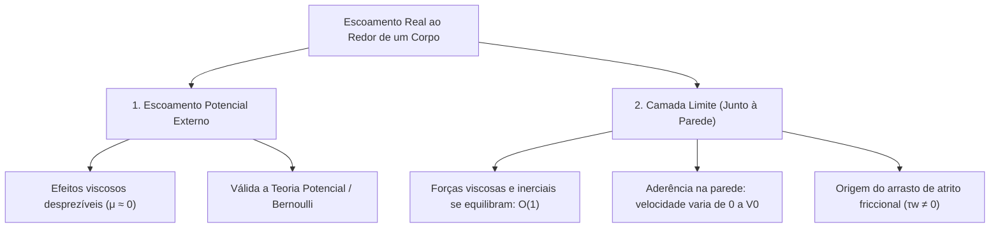

# Guia Didático e Intuitivo de Hidrodinâmica I (P2)
## Da Intuição Física às Equações da Camada Limite e Resistência Friccional de Navios
### Material de Preparação Teórica e Analítica para a Prova

> [!IMPORTANT]
> **Origem e Compromisso Pedagógico:**  
> Este material é a transformação didática oficial do conteúdo da P2 de Hidrodinâmica, fundamentado nas aulas do Prof. Edson Mesquita, D.Sc. e no documento de referência [`Resumo_Prova_2_Hidrodinamica_Camada_Limite_corrigido.md`](file:///c:/Users/Herlon%20Targino/Documents/quartz/content/Config/6.%20HID%20P2/U3/Resumo_Prova_2_Hidrodinamica_Camada_Limite_corrigido.md).  
> Ele preserva **100% dos conceitos, formulações matemáticas, hipóteses simplificadoras, constantes e dados experimentais da disciplina**, estruturando cada assunto na consagrada trilha didática:  
> **Entenda a Ideia $\longrightarrow$ Visualize o Fenômeno $\longrightarrow$ Entenda o Funcionamento $\longrightarrow$ Definição Técnica $\longrightarrow$ O que Memorizar $\longrightarrow$ Atenção para a Prova**.

---


---

# Bloco 1: O Paradoxo de d'Alembert e a Hipótese de Prandtl (1904)

---

## 1.1. O Paradoxo de d'Alembert e a Necessidade da Camada Limite

### A. Entenda a ideia
Imagine que você coloque a mão para fora da janela de um carro em alta velocidade. Você sente uma força enorme empurrando sua mão para trás — o arrasto do ar. Agora imagine um matemático do século XIX dizendo a você: *"Pelas minhas equações perfeitas de fluidos ideais, a força que você sente é rigorosamente zero!"*

Essa era a contradição embaraçosa da ciência antes de 1904, conhecida como o **Paradoxo de d'Alembert**:
* A teoria clássica dos **escoamentos potenciais** (que considerava fluidos ideais, incompressíveis e sem nenhuma viscosidade, $\mu = 0$) previa que um submarino ou navio totalmente submerso sofreria **força de resistência ao avanço rigorosamente nula**.
* Na prática da engenharia naval, qualquer canoa ou navio a vapor precisava de remadores fortes ou toneladas de carvão para vencer a resistência da água!

Por causa desse paradoxo, a hidrodinâmica teórica ficou separada da prática naval por décadas. Engenheiros como William Froude (1864) precisavam usar regras puramente empíricas obtidas em tanques de prova para projetar navios, pois a matemática dos físicos não explicava a realidade.

### B. Visualize o fenômeno
No escoamento ideal (sem atrito), o fluido contorna a proa do corpo acelerando e contorna a popa desacelerando em simetria perfeita. A pressão alta na proa empurra para trás, mas a pressão alta que se recupera na popa empurra para a frente com a mesma intensidade. As forças se cancelam perfeitamente!

```
Escoamento Potencial Ideal (Fluido sem viscosidade, μ = 0):
========================================================================
         Pressão Alta (+p)          Pressão Baixa (-p)          Pressão Alta (+p)
              [PROA]                   [MEIA-NAU]                    [POPA]
       --->   ( o o )                ~~~~~~~~~~~~~                ( o o )   --->
       Empurra para trás                                    Empurra para a frente
========================================================================
Resultado Teórico Clássico: Força Líquida de Arrasto = 0 (PARADOXO DE D'ALEMBERT!)
```

No fluido real (com viscosidade), as moléculas coladas ao corpo são freadas pelo atrito. A camada de fluido perde energia cinética e não consegue recuperar a pressão na popa, gerando arrasto de atrito e arrasto de pressão.

### C. Entenda o funcionamento
Quem resolveu essa contradição foi o engenheiro e físico alemão **Ludwig Prandtl**, em 1904, com uma sacada genial:

1. **A viscosidade não precisa agir em todo o oceano:**  
   A água tem viscosidade pequena ($\mu \sim 10^{-3}\,\text{Pa}\cdot\text{s}$). Longe do navio, essa viscosidade é insignificante, e o escoamento comporta-se exatamente como o escoamento potencial invíscido da teoria clássica.
2. **A viscosidade fica confinada a uma camada muito fina:**  
   Próximo à parede sólida do casco, por mais lisa que ela pareça, as moléculas do fluido "grudam" no metal. Essa região microscópica ou milimétrica junto ao casco é a **Camada Limite** (*Boundary Layer*).
3. **O equilíbrio de forças na camada limite:**  
   Nessa película delgada, a velocidade varia violentamente de zero (na parede) até a velocidade total da correnteza. Essa variação brusca gera tensões de atrito intensas. Assim, na camada limite, as **forças viscosas e as forças inerciais possuem a mesma ordem de grandeza** ($O(1)$).



### D. Conheça a definição técnica
> **A Hipótese de Prandtl (1904):**  
> Para escoamentos com alto número de Reynolds ($Re \gg 1$), o campo de escoamento ao redor de um corpo imerso pode ser dividido em duas regiões distintas:
> 1. **Região Externa:** onde os efeitos viscosos são negligenciáveis e o escoamento é irrotacional e potencial.
> 2. **Camada Limite:** uma delgada camada adjacente à fronteira sólida onde os efeitos viscosos são de magnitude comparável aos efeitos inerciais, governada pela condição de aderência à parede.

Sob o ponto de vista matemático, as equações da camada limite representam a solução assintótica singular das equações de Navier-Stokes quando o número de Reynolds tende a infinito ($Re \to \infty$).

### E. O que precisa memorizar
- **Paradoxo de d'Alembert:** corpos imersos em fluidos ideais sofrem arrasto nulo (inconsistência empírica).
- **Proposta de Prandtl (1904):** divisão em escoamento potencial externo (sem viscosidade) e camada limite (onde a viscosidade é crucial).
- **Ordem de grandeza:** na camada limite, forças inerciais e forças viscosas têm a mesma ordem ($O(1)$).

### F. Atenção para a prova
> [!WARNING]
> **Armadilha Clássica:**  
> Dizer que Prandtl "provou que a teoria do escoamento potencial é inútil". Isso é falso! Prandtl **salvou** a teoria do escoamento potencial ao mostrar que ela é perfeitamente válida na região externa ao redor do corpo. A camada limite apenas fornece a condição de contorno real para esse escoamento externo.

---

## 1.2. Condição de Não Escorregamento e Tensão de Cisalhamento na Parede

### A. Entenda a ideia
Por que poeira fina não sai do teto do carro mesmo quando você corre a $100\,\text{km/h}$ na estrada?  
Porque o ar que está em contato microscópico direto com a lataria do carro **não está se movendo em relação ao carro**. A velocidade relativa do ar colado à superfície é rigorosamente zero!

Essa é a **condição de não escorregamento** (*no-slip condition*): qualquer fluido viscoso (água, óleo, ar) adere firmemente à superfície sólida com a qual entra em contato.

### B. Visualize o fenômeno
Pense em um baralho sobre a mesa. Se você empurrar a carta de cima com a palma da mão para a direita, a carta de baixo (em contato com a mesa) fica parada. As cartas intermediárias deslizam umas sobre as outras, formando uma rampa inclinada de velocidades.

```
Perfil de Velocidades u(y) na Camada Limite:
========================================================================
y (distância normal)
 ^
 |             Velocidade Livre V0 (corrente não perturbada)
 |            ----------------------------------------> V0
 |          / 
 |        /   u(y) cresce suavemente com a distância y
 |      /
 |    /
 |  /
 |/__________________________________________________> u (velocidade)
 Parede Sólida (y = 0): u = 0 (NÃO ESCORREGAMENTO!)
========================================================================
```

### C. Entenda o funcionamento
1. **O Perfil de Velocidade $u(y)$:**  
   Em $y=0$ (na parede), o fluido está em repouso relativo: $u=0$. À medida que nos afastamos da parede ($y > 0$), as camadas de fluido sofrem cada vez menos influência da parede e ganham velocidade, até que atingem a velocidade livre $V_0$.
2. **O Gradiente de Velocidade ($\partial u/\partial y$):**  
   A inclinação dessa curva na parede mede o quão rápido a velocidade varia com a distância normal. Quanto mais inclinada for a reta tangente em $y=0$, mais as camadas de fluido estão se "esfregando" umas contra as outras.
3. **A Tensão de Cisalhamento na Parede ($\tau_w$):**  
   Pela Lei de Newton da Viscosidade, a força de atrito tangencial por unidade de área exercida pelo fluido sobre o corpo é o produto da viscosidade dinâmica pelo gradiente de velocidade na parede.

### D. Conheça a definição técnica
> **Tensão de Cisalhamento na Parede ($\tau_w$):**  
> É a força tangencial de atrito por unidade de área exercida pelo fluido em movimento sobre a superfície sólida:
> $$\tau_w = \mu \left. \frac{\partial u}{\partial y} \right|_{y=0}$$

* **$\tau_w$:** Tensão cisalhante na parede ($[\text{Pa} = \text{N/m}^2]$);
* **$\mu$:** Viscosidade dinâmica do fluido ($[\text{Pa}\cdot\text{s} = \text{kg/(m}\cdot\text{s)}]$);
* **$\left.\frac{\partial u}{\partial y}\right|_{y=0}$:** Gradiente normal de velocidade avaliado na parede ($[\text{s}^{-1}]$).

#### O Coeficiente de Fricção Local ($c_{f,x}$):
Para comparar o atrito em diferentes velocidades e fluidos, adimensionaliza-se $\tau_w$ dividindo-o pela **pressão dinâmica** da corrente livre ($\frac{1}{2}\rho V_0^2$):
$$c_{f,x} = \frac{\tau_w}{\frac{1}{2}\rho V_0^2}$$

* **$c_{f,x}$:** Coeficiente de fricção local em uma coordenada $x$ (adimensional);
* **$\rho$:** Massa específica do fluido ($[\text{kg/m}^3]$);
* **$V_0$:** Velocidade da corrente livre longe do corpo ($[\text{m/s}]$).

### E. O que precisa memorizar
- **Condição na parede ($y=0$):** $u(x,0) = 0$ (não escorregamento) e $v(x,0) = 0$ (impermeabilidade).
- **Fórmula de Newton na parede:** $\tau_w = \mu \left.\frac{\partial u}{\partial y}\right|_{y=0}$.
- **Coeficiente local:** $c_{f,x} = \frac{\tau_w}{\frac{1}{2}\rho V_0^2}$.

### F. Atenção para a prova
> [!WARNING]
> **Diferença de Escrita:**  
> Não confunda a viscosidade dinâmica $\mu$ com a viscosidade cinemática $\nu = \mu/\rho$. A tensão de parede $\tau_w$ utiliza diretamente a viscosidade dinâmica $\mu$.

---

## 1.3. Comparativo Fundamental: Regime Laminar vs. Regime Turbulento

### A. Entenda a ideia
Pense no trânsito de uma rodovia.  
* No **regime laminar**, os carros andam em faixas perfeitamente paralelas, sem trocar de pista. O carro na faixa da direita anda devagar, o do meio anda a média velocidade, e o da esquerda anda rápido. Quase não há atrito entre as faixas além do contato suave.
* No **regime turbulento**, os carros começam a trocar de faixa freneticamente para a esquerda e para a direita! Carros rápidos da faixa esquerda invadem a faixa lenta, e carros lentos da faixa direita invadem a pista rápida. Essa mistura caótica transfere energia violentamente entre as faixas e aumenta o atrito geral.

### B. Visualize o fenômeno

```
Comparação dos Perfis de Velocidade na Camada Limite:
========================================================================
y (altura)
 ^
 |           PERFIL LAMINAR                          PERFIL TURBULENTO
 |        (Curva Suave, Parabólica)             (Perfil "Cheio", Mais Retangular)
 |
 |              /                                       |
 |             /                                        |
 |            /                                         |
 |           /                                          |
 |          /                                          /
 |         /    Gradiente suave                       /   Gradiente muito íngreme!
 |        /     na parede                            /
 |       /                                          |
 +------/-----------------------------> u   +-------|-----------------------------> u
      y=0: Menor inclinação                       y=0: Inclinação muito maior!
      Menor atrito (τw,lam)                       Maior atrito (τw,turb > τw,lam)
========================================================================
```

### C. Entenda o funcionamento
No escoamento turbulento, os turbilhões tridimensionais (vórtices) transportam fluido em alta velocidade do topo da camada limite diretamente para as proximidades da parede sólida.
1. O núcleo da camada limite fica muito mais "cheio" e homogêneo (velocidade quase uniforme em quase toda a espessura).
2. Para que essa velocidade alta caia até zero na parede em uma distância minúscula, a curva de velocidade precisa fazer uma curva extremamente brusca junto à parede.
3. Isso faz com que a derivada $\partial \bar{u}/\partial y|_{y=0}$ seja **muito mais íngreme no regime turbulento do que no laminar**.
4. Como a tensão na parede é proporcional a esse gradiente, a tensão de atrito turbulenta é consideravelmente superior à laminar:
   $$\left. \frac{\partial u}{\partial y} \right|_{y=0, \text{lam}} < \left. \frac{\partial \bar{u}}{\partial y} \right|_{y=0, \text{turb}} \implies \tau_{w,\text{turb}} > \tau_{w,\text{lam}}$$

### D. Conheça a definição técnica
> **Comparação entre Regimes:**  
> * **Laminar:** escoamento ordenado em lâminas infinitesimais com troca molecular de quantidade de movimento; perfil parabólico suave com menor gradiente na parede e menor coeficiente de atrito ($c_f \propto Re^{-1/2}$).  
> * **Turbulento:** escoamento caótico com vórtices tridimensionais que promovem vigorosa mistura macroscópica; perfil médio preenchido com gradiente de parede abrupto, gerando maior tensão cisalhante e maior coeficiente de atrito ($c_f \propto Re^{-1/5}$).

### E. O que precisa memorizar
- O perfil turbulento médio é mais "assentado" (preenchido no núcleo).
- O gradiente de velocidade na parede é muito maior no turbulento: $\left.\frac{\partial\bar{u}}{\partial y}\right|_{\text{turb}} \gg \left.\frac{\partial u}{\partial y}\right|_{\text{lam}}$.
- O atrito na parede turbulento é sempre maior do que o laminar nas mesmas condições ($\tau_{w,\text{turb}} > \tau_{w,\text{lam}}$).

### F. Atenção para a prova
> [!WARNING]
> **Pegadinha Muito Comum:**  
> Alunos costumam pensar que, como a turbulência é caótica e "desperdiça energia", a velocidade média seria menor perto da parede. O oposto é verdadeiro: os vórtices puxam fluido rápido para perto da parede, tornando a variação junto à superfície muito mais íngreme, o que multiplica a força de atrito tangencial por 4 a 5 vezes!

---

# Bloco 2: As Simplificações de Navier-Stokes na Camada Limite

---

## 2.1. A Análise de Ordem de Grandeza de Prandtl

### A. Entenda a ideia
As equações de Navier-Stokes que governam o movimento dos fluidos são notoriamente complexas. No caso tridimensional completo, ninguém na história da matemática conseguiu provar se sempre existe uma solução suave única (um dos problemas do Prêmio do Milênio de 1 milhão de dólares do Clay Mathematics Institute!).

Prandtl percebeu que, para um navio ou placa plana onde o comprimento $L$ é da ordem de metros ou dezenas de metros e a espessura da camada limite $\delta$ é de poucos milímetros ($\delta \ll L$), muitos dos termos complicados das equações são tão minúsculos que podem ser jogados no lixo sem perder a precisão física!

### B. Visualize o fenômeno
Pense em uma folha de papel deitada sobre a mesa:
* Comprimento longitudinal ($x$): $L = 2\,\text{m}$ (grande!).
* Espessura normal ($y$): $\delta = 2\,\text{mm} = 0,002\,\text{m}$ (uma fração ínfima, $\delta/L = 1/1000$).

```
A Geometria da Camada Limite Delgada:
========================================================================
    Correnteza Livre V0 ------------------------------------>
    ======================================================== Borda exterior (y = δ)
    |  CAMADA LIMITE DELGADA (δ ~ milímetros)
    ======================================================== Parede sólida (y = 0)
    <----------------------- Comprimento L ~ metros ----------------------->
    
    Consequência Física:
    - O fluido varia sua velocidade de 0 a V0 em apenas 2 mm (direção y).
    - O fluido varia sua velocidade suavemente ao longo de 2 metros (direção x).
    Logo: Os gradientes em y são GIGANTESCOS em comparação com os gradientes em x!
========================================================================
```

### C. Entenda o funcionamento
Vamos acompanhar o raciocínio dimensional de Prandtl passo a passo:

1. **Adimensionalização das Variáveis:**  
   Prandtl normalizou as grandezas usando as escalas características:
   $$u^* = \frac{u}{V_0} \sim O(1), \quad x^* = \frac{x}{L} \sim O(1)$$
   $$y^* = \frac{y}{L} \sim O\left(\frac{\delta}{L}\right) = O(\bar{\delta}) \ll 1$$

2. **A Continuidade 2D e a Velocidade Normal ($v$):**  
   Pela conservação de massa:
   $$\frac{\partial u^*}{\partial x^*} + \frac{\partial v^*}{\partial y^*} = 0 \implies \frac{O(1)}{O(1)} + \frac{O(v^*)}{O(\bar{\delta})} = 0 \implies O(v^*) \sim O(\bar{\delta})$$
   Isso prova que a velocidade normal à parede ($v$) é minúscula, da ordem da espessura relativa da camada limite ($\bar{\delta} \ll 1$).

3. **Eliminação da Difusão Longitudinal na Direção $x$:**  
   Na equação de movimento em $x$, os termos viscosos são:
   $$\frac{1}{Re}\left(\underbrace{\frac{\partial^2 u^*}{\partial x^{*2}}}_{\text{difusão longitudinal}} + \underbrace{\frac{\partial^2 u^*}{\partial y^{*2}}}_{\text{difusão transversal}}\right)$$
   * A difusão longitudinal escala como $\frac{1}{Re} \cdot \frac{1}{1^2} = O(1/Re)$.
   * A difusão transversal escala como $\frac{1}{Re} \cdot \frac{1}{\bar{\delta}^2}$.
   
   Para que a viscosidade tenha força para equilibrar a inércia ($O(1)$) na camada limite, devemos ter:
   $$\frac{1}{Re \cdot \bar{\delta}^2} \sim O(1) \implies \bar{\delta} \sim O\left(\frac{1}{\sqrt{Re}}\right) \implies \frac{\delta}{L} \sim \frac{1}{\sqrt{Re_L}}$$
   Como o número de Reynolds é grande ($Re \gg 1$), a difusão longitudinal $O(1/Re)$ é desprezível e **desaparece da equação**!

4. **A Pressão através da Espessura da Camada Limite ($\partial p/\partial y \approx 0$):**  
   Na direção normal $y$, como $v$ é minúsculo ($O(\bar{\delta})$), todos os termos inerciais e viscosos são da ordem de $O(\bar{\delta}) \approx 0$. A equação da quantidade de movimento em $y$ reduz-se a:
   $$\frac{\partial p^*}{\partial y^*} \approx 0 \implies \frac{\partial p}{\partial y} \approx 0$$
   Isso tem um significado físico espetacular: **a pressão não varia ao longo da espessura da camada limite**. A pressão dentro da camada limite em qualquer ponto $(x,y)$ é exatamente igual à pressão que existe do lado de fora, no escoamento potencial externo:
   $$p(x,y) \approx p_e(x)$$

### D. Conheça a definição técnica
> **O Sistema de Equações de Camada Limite de Prandtl (2D, Permanente, Incompressível):**
> $$\begin{cases}
> \frac{\partial u}{\partial x} + \frac{\partial v}{\partial y} = 0 & \text{(Continuidade)} \\[10pt]
> u \frac{\partial u}{\partial x} + v \frac{\partial u}{\partial y} = -\frac{1}{\rho}\frac{dp}{dx} + \nu \frac{\partial^2 u}{\partial y^2} & \text{(Quantidade de Movimento em } x\text{)} \\[10pt]
> \frac{\partial p}{\partial y} \approx 0 & \text{(Pressão imposta pelo exterior)}
> \end{cases}$$

#### Acoplamento com a Equação de Bernoulli Externa:
No escoamento externo potencial invíscido, a Equação de Bernoulli relaciona o gradiente de pressão com a aceleração da corrente livre $V(x)$:
$$-\frac{1}{\rho}\frac{dp}{dx} = V(x)\frac{dV(x)}{dx}$$
Para uma placa plana perfeitamente paralela à corrente livre, a velocidade externa é constante ($V(x) = V_0 \implies dV/dx = 0$). Logo, o gradiente longitudinal de pressão é nulo:
$$\frac{dp}{dx} = 0 \quad \text{(Placa Plana)}$$

### E. O que precisa memorizar
- **Ordem da espessura:** $\frac{\delta}{L} \sim \frac{1}{\sqrt{Re_L}}$.
- **Difusão longitudinal descartada:** $\frac{\partial^2 u}{\partial x^2} \ll \frac{\partial^2 u}{\partial y^2}$.
- **Pressão transversal nula:** $\frac{\partial p}{\partial y} \approx 0 \implies p = p(x)$ imposta pelo escoamento externo via Bernoulli.

### F. Atenção para a prova
> [!WARNING]
> **Questão Típica de Concurso e Prova:**  
> "A Equação de Bernoulli pode ser aplicada dentro da camada limite?"  
> **NÃO!** Dentro da camada limite há atrito viscoso intenso e perda de energia mecânica. A Equação de Bernoulli só se aplica no **escoamento potencial externo**. O que acontece é que a pressão do escoamento externo calculada por Bernoulli é "transmitida" diretamente para o interior da camada limite porque $\partial p/\partial y = 0$.

---

# Bloco 3: O Método Integral de Von Kármán e o Volume de Controle

---

## 3.1. O Balanço Global no Volume de Controle

### A. Entenda a ideia
Resolver equações diferenciais ponto a ponto é difícil e, muitas vezes, desnecessário para a engenharia. Se você quer saber quanto peso perdeu em um mês, você não precisa medir as calorias queimadas por cada célula do seu corpo a cada segundo: basta subir na balança no primeiro dia e no trigésimo dia e subtrair os valores!

O **Método Integral** criado por Theodore von Kármán faz exatamente isso: ele traça uma "caixa imaginária" (um **Volume de Controle**) ao redor da camada limite e calcula apenas o que entra e o que sai dessa caixa. Pelo balanço global de quantidade de movimento, descobrimos a força de arrasto total sem precisar resolver Navier-Stokes!

### B. Visualize o fenômeno
Considere a placa plana sólida na base e o volume de controle retangular $AA'B'B$ de altura $\delta$, comprimento $L$ e largura $b$:

```
Volume de Controle Retangular AA'B'B envolvendo a Camada Limite:
========================================================================
                     Fronteira Superior A'B' (escapa massa m_topo > 0)
          A' ---------------------------------------------------- B'
             |                                                  ^ |
             |                                                  | |
   Entrada   |                                            u(y)  | | Saída
   Velocidade| ---> V0                                    --->  | | Perfil
   Uniforme  | ---> V0                                   --->   | | Retardado
             | ---> V0                                  --->    | | u(y) < V0
          A  ==================================================== B
             x = 0               Placa Sólida                   x = L
             Parede Impermeável (vazão de massa = 0, atrito τw atua aqui!)
========================================================================
```

### C. Entenda o funcionamento
Vamos analisar as quatro fronteiras da caixa:

1. **Fronteira de Entrada ($AA'$):**  
   O fluido entra com velocidade uniforme $V_0$. A vazão de massa que entra é $\dot{m}_{\text{entra}} = \rho (\delta b) V_0$.
2. **Fronteira da Parede Sólida ($AB$):**  
   A placa é impermeável; nenhuma gota atravessa o metal sólida ($\dot{m}_{\text{parede}} = 0$).
3. **Fronteira de Saída ($BB'$):**  
   O fluido sai com velocidade retardada pelo atrito, descrita pelo perfil $u(y) \le V_0$. A vazão de massa que sai por essa face é:
   $$\dot{m}_{\text{saída}} = \rho b \int_0^\delta u(y)\,dy$$
   Como $u(y) < V_0$, essa vazão de saída é **menor** do que a vazão que entrou por $AA'$!
4. **Fronteira Superior ($A'B'$):**  
   Para onde foi a massa que entrou e não conseguiu sair pela face direita?  
   Como o fluido é incompressível e a massa se conserva, o fluido acumulado é empurrado e **escapa pelo topo** do volume de controle!
   $$\dot{m}_{\text{topo}} = \dot{m}_{\text{entra}} - \dot{m}_{\text{saída}} = \rho b \int_0^\delta (V_0 - u)\,dy > 0$$

5. **O Balanço de Quantidade de Movimento (2ª Lei de Newton):**  
   O fluido entra rápido com muito momento linear e sai mais devagar com menos momento linear. Essa perda líquida de momento linear exige uma força externa freando o fluido:
   $$\vec{F}_{\text{placa}\to\text{fluido}} = -\rho b \int_0^\delta u(V_0 - u)\,dy\,\hat{i}$$
   * **O sinal negativo:** indica que a placa puxa o fluido para trás (sentido $-x$), retendo seu movimento.
   * **A Terceira Lei de Newton (Ação e Reação):** se a placa empurra o fluido para trás com força $-\vec{F}$, o fluido reage e empurra a placa para a frente com força de mesmo módulo e sentido oposto ($+x$). Essa força que atua no corpo é o **Arrasto de Atrito Friccional** ($F_D$):
     $$F_D = +\rho b \int_0^\delta u(V_0 - u)\,dy$$

### D. Conheça a definição técnica
> **Balanço Integral da Camada Limite:**  
> A força total de atrito exercida pelo fluido sobre uma das faces da placa plana lisa de comprimento $L$ e largura $b$ é dada pela integral do déficit de fluxo de quantidade de movimento:
> $$F_D = \rho b \int_0^\delta u(y) [V_0 - u(y)]\,dy$$

### E. O que precisa memorizar
- Há vazão de massa escapando pelo topo do volume de controle ($\dot{m}_{\text{topo}} > 0$).
- A placa exerce força retardadora sobre o fluido (sinal negativo, sentido $-x$).
- O arrasto sobre a placa é positivo ($+x$), em estrito acordo com a Terceira Lei de Newton.

---

## 3.2. Adoção do Perfil Parabólico de Velocidades

### A. Entenda a ideia
Para resolver a integral $\int_0^\delta u(V_0 - u)dy$, precisamos saber qual é a "cara" da curva de velocidade $u(y)$. Como não conhecemos a fórmula analítica exata antecipadamente, aproximamos a curva por um polinômio simples: uma parábola de segundo grau $u(y) = a y^2 + b y + c$.

### B. Visualize o fenômeno e as Condições de Contorno
Para descobrir os três coeficientes ($a, b, c$), impomos 3 condições físicas simples:
1. Na parede ($y=0$), a velocidade é zero: $u(0) = 0$.
2. No topo da camada ($y=\delta$), a velocidade atinge a corrente livre: $u(\delta) = V_0$.
3. No topo da camada ($y=\delta$), a curva deve "encaixar perfeitamente" no escoamento externo sem descontinuidade, ou seja, sua derivada deve ser nula: $\left.\frac{\partial u}{\partial y}\right|_{y=\delta} = 0$.

```
Condições Matemáticas de Contorno para o Perfil Parabólico:
========================================================================
y = δ  ----------------------------- Derivada nula (curva deita): ∂u/∂y = 0
       |                             Velocidade atinge corrente livre: u = V0
       |
       |  Perfil parabólico suave: u/V0 = 2(y/δ) - (y/δ)²
       |
y = 0  ============================= Parede sólida: u = 0 (aderência)
========================================================================
```

### C. Entenda o funcionamento (Dedução Algébrica Passo a Passo)
1. **Primeira condição ($y=0 \implies u=0$):**  
   $$u(0) = a(0)^2 + b(0) + c = 0 \implies c = 0$$
   O perfil fica: $u(y) = a y^2 + b y$.

2. **Terceira condição (Derivada no topo, $\partial u/\partial y|_{y=\delta} = 0$):**  
   Derivando: $\frac{\partial u}{\partial y} = 2ay + b$.  
   Em $y=\delta$:
   $$2a\delta + b = 0 \implies b = -2a\delta$$

3. **Segunda condição (Velocidade no topo, $u(\delta) = V_0$):**  
   Substituindo $y=\delta$ e $b = -2a\delta$:
   $$u(\delta) = a\delta^2 + (-2a\delta)\delta = V_0$$
   $$a\delta^2 - 2a\delta^2 = V_0 \implies -a\delta^2 = V_0 \implies a = -\frac{V_0}{\delta^2}$$
   Encontrando $b$:
   $$b = -2\left(-\frac{V_0}{\delta^2}\right)\delta = \frac{2V_0}{\delta}$$

4. **Montagem Final da Equação do Perfil Parabólico:**  
   $$u(y) = -\frac{V_0}{\delta^2}y^2 + \frac{2V_0}{\delta}y \implies \frac{u(y)}{V_0} = 2\left(\frac{y}{\delta}\right) - \left(\frac{y}{\delta}\right)^2$$

### D. Conheça a definição técnica
> **Perfil Parabólico de Velocidades no Método Integral:**
> $$\frac{u(y)}{V_0} = 2\left(\frac{y}{\delta}\right) - \left(\frac{y}{\delta}\right)^2$$
> * **Condição de fechamento:** obtido adotando $u(\delta) = V_0$ e $\partial u/\partial y|_{y=\delta} = 0$.

### E. O que precisa memorizar
- O perfil parabólico é uma **aproximação simplificadora** e não a solução exata.
- No método integral usa-se matematicamente $u(\delta) = V_0$ para fechar os coeficientes do polinômio, enquanto a convenção física experimental adota $u = 0,99 V_0$.

---

# Bloco 4: Visualização do Escoamento, Linhas de Corrente e Função de Corrente

---

## 4.1. Linhas de Corrente em 2D e 3D

### A. Entenda a ideia
Se você pudesse congelar o tempo em um rio e desenhar setas em todas as moléculas de água apontando para onde elas querem ir naquele instante, e depois traçasse curvas que tangenciam perfeitamente todas essas setinhas, você teria desenhado as **linhas de corrente** (*streamlines*).  
Como a velocidade é sempre paralela à linha de corrente, **nenhuma gota de fluido pode atravessar uma linha de corrente**. Elas funcionam como "paredes imaginárias" feitas pelo próprio movimento do fluido.

### B. Visualize o fenômeno

```
Linha de Corrente e o Vetor Velocidade Tangente:
========================================================================
                 Vetor Velocidade V = (u, v)
                      ^
                     /
                    /  (Tangência perfeita!)
                   /
           _______/________________ Curva: Linha de Corrente
         /       / 
       /       dy
     /_______dx
     
     Inclinação da linha de corrente: dy/dx
     Inclinação do vetor velocidade:  v/u
     Condição de tangência: dy/dx = v/u  ===>  v dx - u dy = 0 !
========================================================================
```

### C. Entenda o funcionamento e a Definição Técnica
1. **No Plano Bidimensional (2D):**  
   O elemento diferencial de linha é $d\vec{s} = dx\,\hat{i} + dy\,\hat{j}$ e o vetor velocidade é $\vec{V} = u\,\hat{i} + v\,\hat{j}$.  
   Para que sejam paralelos, o produto vetorial deve se anular: $\vec{V} \times d\vec{s} = \mathbf{0}$, o que conduz à equação diferencial:
   $$v\,dx - u\,dy = 0 \iff \frac{dx}{u} = \frac{dy}{v}$$

2. **No Espaço Tridimensional (3D):**  
   Com três componentes de velocidade $\vec{V} = (u, v, w)$ e $d\vec{s} = (dx, dy, dz)$, a condição vetorial $\vec{V} \times d\vec{s} = \mathbf{0}$ desdobra-se em três igualdades escalares simétricas:
   $$\begin{cases}
   w\,dy - v\,dz = 0 \\[4pt]
   u\,dz - w\,dx = 0 \\[4pt]
   v\,dx - u\,dy = 0
   \end{cases} \iff \frac{dx}{u} = \frac{dy}{v} = \frac{dz}{w}$$

---

## 4.2. A Função de Corrente ($\psi$) e a Continuidade Automática

### A. Entenda a ideia
Em problemas bidimensionais incompressíveis, temos duas componentes desconhecidas ($u$ e $v$) que precisam obedecer obrigatoriamente à equação da continuidade ($\partial u/\partial x + \partial v/\partial y = 0$).  
A **função de corrente** ($\psi$) é um truque matemático elegante: ela combina $u$ e $v$ em uma única função escalar de tal forma que a conservação da massa seja satisfeita **100% das vezes automaticamente**, sem que precisemos nos preocupar com ela!
### B. Definição Técnica e Funcionamento
Define-se a função escalar $\psi(x,y)$ pelas relações:
$$u = \frac{\partial \psi}{\partial y} \quad \text{e} \quad v = -\frac{\partial \psi}{\partial x}$$

Substituindo essas definições diretamente na Equação da Continuidade 2D incompressível:
$$\frac{\partial u}{\partial x} + \frac{\partial v}{\partial y} = \frac{\partial}{\partial x}\left(\frac{\partial \psi}{\partial y}\right) + \frac{\partial}{\partial y}\left(-\frac{\partial \psi}{\partial x}\right) = \frac{\partial^2 \psi}{\partial x \partial y} - \frac{\partial^2 \psi}{\partial y \partial x}$$

Pelo Teorema de Schwarz do cálculo diferencial, para qualquer função contínua e suave, a ordem das derivadas cruzadas não altera o resultado ($\frac{\partial^2 \psi}{\partial x \partial y} = \frac{\partial^2 \psi}{\partial y \partial x}$). Portanto:
$$\frac{\partial^2 \psi}{\partial x \partial y} - \frac{\partial^2 \psi}{\partial y \partial x} \equiv 0$$

> **Conclusão Fundamental:**  
> A existência da função de corrente $\psi$ garante que a massa se conserva identicamente em qualquer escoamento 2D incompressível.

---

# Bloco 5: A Solução Analítica Exata de Blasius para Placa Plana Laminar

---

## 5.1. A Ideia da Similaridade e a EDO de Blasius

### A. Entenda a ideia
Em 1907, Paul Blasius (orientando de doutorado de Prandtl) encarou o desafio de encontrar a solução exata das equações da camada limite laminar sobre uma placa plana.  
O escoamento depende de duas variáveis espaciais independentes: a distância longitudinal $x$ e a distância normal $y$. Isso exigia resolver uma Equação Diferencial Parcial (EDP), algo muito complexo.

Blasius teve uma intuição brilhante: **os perfis de velocidade em diferentes posições $x$ têm exatamente o mesmo formato geométrico**, apenas esticando verticalmente à medida que a camada limite engrossa!  
Se você tirar uma foto do perfil de velocidade em $x = 1\,\text{m}$ e outra foto em $x = 2\,\text{m}$, as duas curvas são idênticas, apenas em escalas diferentes. Isso é o conceito de **similaridade**.

```
A Semelhança de Perfis de Blasius (Perfis Auto-Semelhantes):
========================================================================
y (altura)
 ^
 |             x = 0,5 m (fino)       x = 1,0 m (médio)       x = 2,0 m (espesso)
 |                /                      /                       /
 |               /                      /                       /
 |              /                      /                       /
 |             /                      /                       /
 |            /                      /                       /
 |           /                      /                       /
 +----------/----------------------/-----------------------/-------------> x
          Parede sólida (A forma da curva é SEMPRE a mesma!)
========================================================================
```

### B. Entenda o funcionamento
1. **A Variável de Similaridade ($\eta$):**  
   Blasius fundiu as duas coordenadas espaciais ($x$ e $y$) em uma única variável adimensional chamada $\eta$ (eta):
   $$\eta = y \sqrt{\frac{V_0}{\nu x}}$$
   * Se você estiver na parede ($y=0$), tem sempre $\eta = 0$, não importa o valor de $x$.
   * Se você estiver na borda da camada limite ($y=\delta$), tem sempre $\eta \approx 5$, não importa se está no começo ou no fim da placa!

2. **A Função de Corrente Adimensionalizada ($f(\eta)$):**  
   Blasius escreveu a função de corrente como:
   $$\psi(x, y) = \sqrt{\nu x V_0} \cdot f(\eta)$$
   Ao fazer isso, a velocidade longitudinal resulta em uma função simples da derivada de $f$:
   $$u = \frac{\partial \psi}{\partial y} = V_0 f'(\eta) \implies \frac{u}{V_0} = f'(\eta)$$
   Assim, a função $f'(\eta)$ representa diretamente o perfil de velocidades adimensional!

3. **A Equação Diferencial Ordinária (EDO) de Blasius:**  
   Substituindo $u$ e suas derivadas na equação da quantidade de movimento de Prandtl, todas as dependências explícitas de $x$ e $y$ se cancelam milagrosamente! A complexa equação diferencial parcial transforma-se em uma única **Equação Diferencial Ordinária (EDO) de 3ª ordem**:
   $$f''' + \frac{1}{2} f f'' = 0$$
   *(Multiplicando por 2, ela assume a forma perfeitamente equivalente: $2f''' + ff'' = 0$)*.

4. **As Condições de Contorno de Blasius:**  
   * Na parede sólida ($\eta = 0$): impermeabilidade $f(0) = 0$ e aderência $f'(0) = 0$.
   * Longe da parede ($\eta \to \infty$): a velocidade atinge a corrente livre, logo $f'(\infty) = 1$.

### C. Conheça a definição técnica e os Resultados Numéricos
Como a EDO de Blasius é não linear, ela não tem solução analítica fechada por funções elementares, sendo integrada numericamente (*shooting method*). Os resultados universais obtidos são:

1. **A Derivada na Parede ($f''(0) = 0,332$):**  
   Mede a inclinação da velocidade na parede, fornecendo a tensão de cisalhamento:
   $$\tau_w = 0,332 \frac{\rho V_0^2}{\sqrt{Re_x}}$$

2. **A Espessura da Camada Limite Laminar ($\delta$):**  
   Numericamente, para atingir 99% da corrente livre ($u/V_0 = f'(\eta) = 0,99$), obtém-se $\eta \approx 5,0$. Substituindo na definição de $\eta$:
   $$5,0 = \delta \sqrt{\frac{V_0}{\nu x}} \implies \delta(x) = \frac{5 x}{\sqrt{Re_x}}$$

3. **O Coeficiente de Atrito Local ($c_{f,x}$):**  
   Adimensionalizando $\tau_w$ pela pressão dinâmica ($\frac{1}{2}\rho V_0^2$), o valor $0,332$ é multiplicado por 2:
   $$c_{f,x} = \frac{\tau_w}{\frac{1}{2}\rho V_0^2} = \frac{2 \cdot 0,332}{\sqrt{Re_x}} = \frac{0,664}{\sqrt{Re_x}} = 0,664 Re_x^{-1/2}$$

4. **O Coeficiente de Atrito Médio da Placa ($C_F$):**  
   Integrando o coeficiente local $c_{f,x}$ ao longo de todo o comprimento $L$ da placa ($\frac{1}{L}\int_0^L x^{-1/2}dx = 2 L^{-1/2}$), o coeficiente total resulta no **dobro de $0,664$**:
   $$C_F = \frac{1,328}{\sqrt{Re_L}} = 1,328 Re_L^{-1/2}$$

5. **Confirmação Experimental de Satish Dhawan (1953):**  
   Em 1953, o pesquisador Satish Dhawan (no Caltech) realizou medições experimentais diretas da força de cisalhamento em placas planas usando pequenas peças móveis com transdutores de força, comprovando com exatidão extraordinária os coeficientes teóricos $0,664$ e $1,328$ deduzidos por Blasius quase meio século antes!

### D. O que precisa memorizar
- **EDO de Blasius:** $f''' + \frac{1}{2}ff'' = 0 \iff 2f''' + ff'' = 0$.
- **Condições:** $f(0)=0, \ f'(0)=0, \ f'(\infty)=1$.
- **As 4 constantes-chave:**
  - $0,332 \longrightarrow$ derivada na parede $f''(0)$.
  - $5,0 \longrightarrow$ posição onde a velocidade atinge 99% da corrente livre ($u = 0,99 V_0$).
  - $0,664 \longrightarrow$ coeficiente de atrito local ($c_{f,x} = 0,664/\sqrt{Re_x}$).
  - $1,328 \longrightarrow$ coeficiente médio total da placa ($C_F = 1,328/\sqrt{Re_L}$, exatamente o dobro de $0,664$).

---

# Bloco 6: A Transição Laminar-Turbulenta e o Reynolds Crítico

---

## 6.1. O Mecanismo da Transição e Valores de Projeto

### A. Entenda a ideia
Quando você acende um incenso ou cigarro em uma sala sem vento, a fumaça sobe inicialmente em um fio liso, reto e perfeitamente estável (regime laminar). De repente, a poucos centímetros de altura, formam-se pequenas ondas que se enrolam e a fumaça se desfaz em uma nuvem caótica e espalhada (regime turbulento).  
Sobre o casco de um navio ou sobre uma placa plana, acontece exatamente a mesma coisa: o escoamento nasce laminar no bordo de ataque ($x=0$) e, após percorrer uma certa distância, transiciona para o regime turbulento.

```
Evolução do Escoamento ao Longo da Placa Plana:
========================================================================
V0 --->   Bordo de Ataque (x = 0)
========================================================================
   LAMINAR            TRANSIÇÃO              TURBULENTO
   (Linhas retas)     (Ondas de Tollmien)    (Turbilhões caóticos, mistura intensa)
   ------------------ ~ ~ ~ ~ ~ ~ ~ ~ ~ ~ ~  @@@@ @@@ @@@@@ @@@@ @@@@@
========================================================================
   x = 0              x = x_cr (Ponto Crítico)             x = L (Bordo de Fuga)
   Re_x < Re_cr                              Re_x > Re_cr
========================================================================
```

### B. Conheça a definição técnica
O início da transição é determinado pelo **Número de Reynolds Crítico** ($Re_{cr}$):
$$Re_{cr} = \frac{\rho V_0 x_{cr}}{\mu}$$
* **$x_{cr}$:** Distância medida a partir do bordo de ataque ($x=0$) até o ponto onde a transição se inicia ($[\text{m}]$).

#### Os Valores de Referência da Disciplina:
O valor exato de $Re_{cr}$ depende do nível de perturbações da corrente livre e da rugosidade da superfície:
1. **Condições Ideais de Laboratório (túneis de vento ultra-silenciosos, Novo PNA):**  
   $$Re_{cr} \approx 3 \times 10^6 \quad (3.000.000)$$
2. **Valor Prático de Projeto em Engenharia e Hidrodinâmica Naval:**  
   $$Re_{cr} \approx 5 \times 10^5 \quad (500.000)$$
3. **Valor Histórico de Blasius:**  
   $$Re_{cr} \approx 4,5 \times 10^5 \quad (450.000)$$

### C. O que precisa memorizar
- Na engenharia prática adota-se comumente $Re_{cr} \approx 5 \times 10^5$.
- Antes de $x_{cr}$, a camada limite é laminar; depois de $x_{cr}$, torna-se turbulenta.

---

# Bloco 7: A Turbulência, Equações RANS e Tensões de Reynolds

---

## 7.1. A Decomposição de Reynolds e o Problema de Fechamento

### A. Entenda a ideia
Na turbulência, a velocidade da água em um ponto oscila furiosamente milhares de vezes por segundo. É impossível e impraticável na engenharia naval prever cada tremor microscópico de cada partícula.  
Por isso, Osborne Reynolds propôs separar qualquer propriedade instantânea do escoamento em duas fatias:
1. Uma **parcela média temporal** ($\bar{u}$): o valor médio calmo que um velocímetro comum consegue ler.
2. Uma **parcela flutuante** ($u'$): o tremor instantâneo em torno da média (cuja média temporal é zero, $\overline{u'} = 0$).

$$u(t) = \bar{u} + u'(t)$$

```
Decomposição de Reynolds: Sinal Instantâneo de Velocidade:
========================================================================
Velocidade u
 ^
 |          /\    /\        /\            u(t) = Velocidade Instantânea
 |   /\    /  \  /  \  /\  /  \  /\
 | -/--\--/----\-/----\--\/----\-/--\---- Velocidade Média ū (constante no tempo)
 | /    \/      V      \/       V    \
 | 
 +-----------------------------------------> Tempo t
    Flutuação instantânea: u'(t) = u(t) - ū
    Média das flutuações puras: ū' = 0
    Média do produto das flutuações: u'v' ≠ 0 (NÃO É ZERO!)
========================================================================
```

### B. Entenda o funcionamento: O que são as Tensões de Reynolds?
Quando aplicamos a média temporal às equações de Navier-Stokes, os termos lineares comportam-se de forma simples ($\overline{\bar{u} + u'} = \bar{u}$).  
Porém, os termos convectivos contêm produtos de velocidades ($u \cdot v$):
$$\overline{u \cdot v} = \overline{(\bar{u} + u')(\bar{v} + v')} = \bar{u}\bar{v} + \overline{u'v'}$$

O termo $\overline{u'v'}$ **não é zero**! Ele representa a correlação física entre o tremor longitudinal e o tremor transversal: quando uma partícula salta para cima ($v' > 0$), ela traz consigo velocidade longitudinal menor do que a média ($u' < 0$). O produto médio resulta negativo!

Multiplicado pela massa específica e com sinal invertido, surge o termo:
$$-\rho \overline{u'v'}$$

Esse termo é a famosa **Tensão de Reynolds** (ou tensão aparente turbulenta).  
* **Significado Físico:** Embora tenha dimensão de tensão ($[\text{Pa}]$), ela não é uma força de atrito molecular real; ela representa o **transporte convectivo violento de quantidade de movimento promovido pelos turbilhões**.

#### O Problema de Fechamento da Turbulência:
As equações médias resultantes são chamadas de **Equações RANS** (*Reynolds-Averaged Navier-Stokes*).  
O grande drama das equações RANS é que a média introduziu novos termos desconhecidos ($-\rho\overline{u'v'}$, $-\rho\overline{u'^2}$, etc.) sem nos dar novas equações de conservação!  
Temos **mais incógnitas do que equações**, o que impede a resolução direta do sistema. Essa lacuna matemática é chamada de **Problema de Fechamento da Turbulência**, exigindo que engenheiros criem "modelos de turbulência" para aproximar as tensões de Reynolds.

### C. Atenção para a prova: A Exceção das Forças de Pico
> [!WARNING]
> **Aviso Crítico da Apostila do Professor:**  
> As equações RANS calculam apenas valores médios no tempo. Por isso, **o modelo RANS é perfeitamente inadequado para prever fenômenos governados por forças de pico instantâneas**, tais como:
> 1. **Cavitação em pás de hélice** (onde uma queda brusca instantânea de pressão causa colapso de bolhas).
> 2. **Rupturas estruturais por fadiga ou impacto de ondas (*slamming*)**, onde o navio quebra devido a um pico extremo de força que a média temporal RANS simplesmente "apaga".

---

# Bloco 8: A Estrutura da Camada Limite Turbulenta e as Leis de Parede

---

## 8.1. As Regiões da Camada Limite Turbulenta

### A. Entenda a ideia
Na camada limite turbulenta, o escoamento organiza-se em camadas sobrepostas com personalidades físicas completamente diferentes:
1. **Bem colado à parede:** os turbilhões não conseguem girar porque a parede sólida "prende" o fluido. Ali, a viscosidade molecular reina absoluta em uma película microscópica.
2. **Um pouco mais afastado:** os turbilhões começam a mandar no escoamento e a velocidade cresce conforme uma curva logarítmica universal.
3. **Longe da parede:** o fluido já quase não sente a parede e mistura-se com a correnteza livre.

### B. Visualize o fenômeno e as Delimitações Aproximadas

```
As Regiões Físicas da Camada Limite Turbulenta sobre Parede Lisa:
====================================================================================
y = δ   ----------------------------------------------------------------------------
        |                                                                          |
        |   REGIÃO EXTERNA (Outer Layer / Wake Region)                             |
        |   Abrange cerca de 85% da espessura total δ                             |
        |   Governada pela correnteza livre e esteira externa                     |
        |                                                                          |
y ~ 0,15δ - - - - - - - - - - - - - - - - - - - - - - - - - - - - - - - - - - - - -
        |   CAMADA LOGARÍTMICA DE SOBREPOSIÇÃO (Ocupa cerca de 20% de δ)          |
y+ = 30 - - - - - - - - - - - - - - - - - - - - - - - - - - - - - - - - - - - - - -
        |   ZONA DE TRANSIÇÃO E AMORTECIMENTO (Buffer Layer)                      |
y+ = 5  - - - - - - - - - - - - - - - - - - - - - - - - - - - - - - - - - - - - - -
        |   SUBCAMADA VISCOSA (Ocupa cerca de 1% de δ) - Domínio Viscoso (u+ = y+)  |
y = 0   ============================================================================
====================================================================================
* Nota da Apostila: As proporções indicadas (1%, 5%, 15%, 20% e 85%) são delimitações 
físicas aproximadas de escalas reportadas na literatura e não parcelas disjuntas 
que devam somar rigidamente 100%. A subcamada viscosa somada à transição ocupa ~5% de δ;
a região interna abrange ~15% de δ; a camada logarítmica abrange ~20% de δ; e a externa ~85% de δ.
```

### C. Conheça as Variáveis Adimensionais de Parede ($u^+$ e $y^+$)
Para descrever essas regiões com uma fórmula universal que funcione tanto para água quanto para ar ou óleo, definem-se as variáveis adimensionais de parede com base na **Velocidade de Atrito** ($u_\tau$):

1. **Velocidade de Atrito ($u_\tau$):**  
   $$u_\tau = \sqrt{\frac{\tau_w}{\rho}} \quad [\text{m/s}]$$
   *(Embora chamada de velocidade, é uma escala de tensão de cisalhamento expressa em unidade de m/s)*.

2. **Velocidade Adimensional ($u^+$) e Distância Adimensional ($y^+$):**  
   $$u^+ = \frac{\bar{u}}{u_\tau} \qquad \text{e} \qquad y^+ = \frac{y\,u_\tau}{\nu} = \frac{\rho y u_\tau}{\mu}$$
   * $y^+$ funciona como um "número de Reynolds local baseado na distância à parede".

### D. As Leis de Parede em Cada Região

#### 1. Subcamada Viscosa ($y^+ < 5$):
Imediatamente colada à parede sólida, os turbilhões são amortecidos. A tensão de cisalhamento é puramente molecular ($\tau_w \approx \mu \frac{\bar{u}}{y}$).  
Reescrevendo em variáveis adimensionais, obtém-se a **Solução Linear de Taylor (1916)**:
$$u^+ = y^+$$

#### 2. Camada Logarítmica de Sobreposição ($y^+ > 30$ e $y/\delta < 0,15$):
Nessa região, a inércia dos turbilhões equilibra a tensão da parede.  
* **Dedução Teórica de Prandtl (1925):** usando a teoria do comprimento de mistura ($l = k y$, com a constante de Von Kármán $k = 0,41$ e constante de parede lisa $A = 5,0$):
  $$u^+ = \frac{1}{k}\ln y^+ + A \implies u^+ = \frac{1}{0,41}\ln y^+ + 5,0 \implies u^+ = 2,439 \ln y^+ + 5,0$$
* **Ajuste Empírico Experimental de Monin & Yaglom (1971):**  
  Ajustando curvas sobre dados experimentais de túneis de vento, Monin e Yaglom propuseram:
  $$u^+ = 2,5 \ln y^+ + 5,1 \quad (\text{para } y^+ > 30)$$
  E para a **região externa** ($y/\delta < 0,15$), propuseram a lei do defeito de velocidade:
  $$\frac{V_0 - \bar{u}}{u_\tau} = -2,5 \ln\left(\frac{y}{\delta}\right) + 2,35$$

---

# Bloco 9: Parâmetros Integrais e a Equação do Momento de Von Kármán

---

## 9.1. O Significado Físico das Espessuras Integrais ($\delta^*$ e $\theta$)

### A. Entenda a ideia
A espessura comum $\delta$ é difícil de medir porque o perfil de velocidade se aproxima da corrente livre de forma assintótica e suave (onde termina exatamente a camada limite: em 99%, em 99,5% ou em 99,9%?).  
Por isso, os engenheiros utilizam duas medidas integrais exatas, obtidas por balanços de conservação:
1. **Espessura de Deslocamento ($\delta^*$):** quanto o escoamento foi "empurrado" para fora pela perda de vazão de massa.
2. **Espessura de Quantidade de Movimento ($\theta$):** quanta força foi perdida pelo escoamento pela perda de momento linear.

### B. Visualize o fenômeno

```
Significado Físico da Espessura de Deslocamento δ*:
========================================================================
     Linha de corrente original (Sem atrito viscoso)
     ----------------------------------------------------------------->
     
     Linha de corrente real defletida (Com camada limite)
             /-------------------------------------------------------->
            /  ^
           /   | A linha de corrente externa é EMPURRADA para fora
          /    | por uma distância exatamente igual a δ* !
     ====/=====v====================================================== Parede
========================================================================
```

### C. Conheça as Definições Técnicas

1. **Espessura de Deslocamento ($\delta^*$):**  
   Quantifica o déficit de vazão de massa no interior da camada limite:
   $$\delta^* = \int_0^\infty \left(1 - \frac{\bar{u}}{V_0}\right) dy$$

2. **Espessura de Quantidade de Movimento ($\theta$):**  
   Quantifica o déficit no fluxo de quantidade de movimento linear:
   $$\theta = \int_0^\infty \frac{\bar{u}}{V_0}\left(1 - \frac{\bar{u}}{V_0}\right) dy$$

Para qualquer escoamento real sobre placa plana lisa, como $\bar{u}/V_0 < 1$, a função integranda de $\theta$ é sempre menor do que a de $\delta^*$. Logo, tem-se sempre:
$$\delta^* > \theta$$

---

## 9.2. A Equação do Momento de Von Kármán e a Origem do Fator 2

### A. Entenda o funcionamento e a Dedução
Ao integrar a equação da quantidade de movimento ao longo da camada limite com gradiente de pressão nulo ($dp/dx = 0$), Theodore von Kármán chegou à relação fundamental entre a tensão de cisalhamento na parede $\tau_w$ e a taxa de crescimento da espessura de quantidade de movimento:
$$\frac{\tau_w}{\rho V_0^2} = \frac{d\theta}{dx}$$

Como na engenharia o coeficiente de atrito local ($c_{f,x}$) é normalizado pela **pressão dinâmica** ($\frac{1}{2}\rho V_0^2$):
$$c_{f,x} = \frac{\tau_w}{\frac{1}{2}\rho V_0^2} = 2 \cdot \left(\frac{\tau_w}{\rho V_0^2}\right)$$

Substituindo $\frac{\tau_w}{\rho V_0^2} = \frac{d\theta}{dx}$, surge a célebre equação:
$$c_{f,x} = 2 \frac{d\theta}{dx}$$

> **Por que o fator 2 aparece?**  
> O fator 2 provém exclusivamente da convenção de dividir a tensão pela pressão dinâmica ($\frac{1}{2}\rho V_0^2$), cujo denominador contém a fração $1/2$. Ao inverter a fração na divisão, surge o fator 2 multiplicativo. Ele **não tem nenhuma relação** com as duas faces da placa ou com o grau do polinômio!

---

# Bloco 10: Resistência Friccional Turbulenta de Prandtl (Lei 1/7)

---

## 10.1. A Dedução pela Lei da Potência e Limites de Validade

### A. Entenda a ideia
Para calcular o arrasto turbulento sem precisar de cálculos complexos, Prandtl adotou uma fórmula empírica simples proposta por Blasius para tubos: o perfil de velocidade turbulento médio pode ser aproximado por uma **lei de potência com expoente $1/7$**:
$$\frac{\bar{u}}{V_0} = \left(\frac{y}{\delta}\right)^{1/7}$$

### B. Conheça as Equações e Resultados Integrados
1. **Cálculo de $\theta$ para o perfil $1/7$:**  
   Substituindo na integral de quantidade de movimento:
   $$\theta = \int_0^\delta \left(\frac{y}{\delta}\right)^{1/7}\left[1 - \left(\frac{y}{\delta}\right)^{1/7}\right] dy = \frac{7}{72}\delta$$

2. **Crescimento da Espessura e Coeficientes de Atrito:**  
   Igualando a relação de Von Kármán ($c_{f,x} = 2 d\theta/dx$) à fórmula empírica de tensão e integrando em $x$, Prandtl obteve os resultados analíticos clássicos:
   * **Espessura da Camada Limite Turbulenta:**
     $$\delta(x) \approx \frac{0,38 x}{Re_x^{1/5}} \quad (\text{ou } 0,3773 x Re_x^{-1/5})$$
   * **Coeficiente de Atrito Local:**
     $$c_{f,x} = 0,58693 Re_x^{-1/5} \approx \frac{0,587}{Re_x^{1/5}}$$
   * **Coeficiente de Resistência Médio Total da Placa:**
     $$C_F = \frac{1}{L}\int_0^L c_{f,x}\,dx \approx \frac{0,734}{Re_L^{1/5}} \quad (\text{ou } 0,7336 Re_L^{-1/5})$$

### C. Atenção para a prova: Limite Estrito de Validade
> [!WARNING]
> **Condição de Validade da Lei 1/7:**  
> A lei da potência $1/7$ foi calibrada para números de Reynolds moderados de laboratório:
> $$Re_L < 10^7$$
> Ela **não é aplicável a navios reais em escala plena**, cujos números de Reynolds operacionais atingem a faixa de $10^8$ a $10^9$! Para navios reais, são necessárias as formulações da linha ITTC e Schoenherr.

---

# Bloco 11: Formulações Navais de Resistência Friccional

---

## 11.1. Formulação de Schoenherr (1932) e a Margem ATTC-1947

### A. Equação Implícita de Schoenherr
Karl Schoenherr deduziu em 1932 uma expressão baseada na lei logarítmica de parede que atende a uma ampla faixa de números de Reynolds ($10^5 < Re < 10^9$):
$$\frac{0,24213}{\sqrt{C_F}} = \log_{10}(Re_L \cdot C_F)$$
* Como $C_F$ aparece nos dois lados da equação (dentro da raiz e dentro do logaritmo), ela é chamada de **equação implícita**, exigindo cálculo iterativo.
* Para cálculos rápidos de estimativa preliminar sem iteração, a apostila apresenta a fórmula explícita aproximada:
  $$C_F = \frac{1}{\left[3,5 \log_{10}(Re_L) - 5,96\right]^2}$$

### B. A Margem de Rugosidade da ATTC-1947 ($\Delta C_F$)
Modelos testados em tanques de prova são feitos de madeira encerada ou parafina lisa. Navios reais são feitos de chapas de aço soldadas, com juntas, soldas e tintas que apresentam rugosidade física.  
Em 1947, a conferência norte-americana ATTC (*American Towing Tank Conference*) estabeleceu a adição de uma constante fixa para compensar essa **rugosidade**:
$$C_{F,\text{navio}} = C_{F,\text{Schoenherr}} + 0,0004$$

---

## 11.2. Fórmula de Granville para a Popa e a Linha ITTC-1957

### A. Fórmula de Granville para a Popa ($x = L$)
Na proa do navio a camada limite nasce fina, mas na popa ($x=L$) ela é espessa e interage diretamente com o propulsor e o leme.  
Granville deduziu uma fórmula para calcular o coeficiente de atrito local especificamente na popa ($c_{f,L}$) a partir do coeficiente médio total ($C_F$):
$$c_{f,L} = \frac{C_F}{1 - 2,439\sqrt{\frac{C_F}{2}}} \quad (\text{com constante de Von Kármán } k = 0,41)$$

### B. Linha de Hughes (1954) e Linha de Correlação ITTC-1957
* **Linha bidimensional de Hughes (1954):**
  $$C_F = \frac{0,066}{(\log_{10}Re - 2,03)^2}$$
* **Linha de Correlação Modelo-Navio ITTC-1957:**
  $$C_F = \frac{0,075}{(\log_{10}Re - 2)^2}$$

> **O que a Linha ITTC-1957 realmente representa?**  
> A linha ITTC-1957 elevou o numerador de Hughes em cerca de 12% ($0,066 \times 1,12 \approx 0,075$) e alterou o denominador para $(\log_{10}Re - 2)^2$.  
> **Ressalva do Professor:** A linha ITTC-1957 **não representa o atrito físico tridimensional real do casco**. Ela é uma **convenção pragmática adotada internacionalmente** para permitir a extrapolação padronizada de resultados medidos em modelos de pequena escala para o navio real, compensando de forma simplificada os efeitos de escala e forma.

---

# Bloco 12: Aplicação Numérica Completa — Arrasto sobre Chapa de Madeira Compensada

---

## 12.1. O Exercício Trabalhado pelo Professor em Sala de Aula

### Enunciado e Dados Físicos:
Uma chapa de madeira compensada de dimensões $4 \times 8\text{ ft}$ é transportada no teto de um automóvel a uma velocidade de $56\text{ km/h}$, perfeitamente alinhada com o escoamento de ar a $20\ ^\circ\text{C}$ e $1\text{ atm}$.

* **Dimensões:** Comprimento $L = 2,44\text{ m}$ (dimensão de $8\text{ ft}$); Largura $b = 1,22\text{ m}$ (dimensão de $4\text{ ft}$).
* **Velocidade:** $V = 56\text{ km/h} = \frac{56}{3,6} \approx 15,56\text{ m/s}$.
* **Propriedades do Ar:** $\rho = 1,2\text{ kg/m}^3$ e $\mu = 1,8 \times 10^{-5}\text{ kg/(m}\cdot\text{s)}$.

---

### Resolução Analítica Passo a Passo:

#### 1. Número de Reynolds no Bordo de Fuga ($x = L$):
$$Re_L = \frac{\rho V L}{\mu} = \frac{1,2 \cdot 15,5556 \cdot 2,44}{1,8 \times 10^{-5}} = \frac{45,547}{1,8 \times 10^{-5}} \approx \mathbf{2,53 \times 10^6}$$
*(Como $Re_L > 5 \times 10^5$, o escoamento real sobre a chapa sofre transição natural para turbulento)*.

#### 2. Item a) Espessura da Camada Limite Laminar no Bordo de Fuga ($\delta$):
$$\delta = \frac{5 L}{\sqrt{Re_L}} = \frac{5 \cdot 2,44}{\sqrt{2,53 \times 10^6}} = \frac{12,2}{1590,6} \approx 0,00767\text{ m} \approx \mathbf{7,67\text{ mm}}$$

#### 3. Parâmetros de Área e Pressão Dinâmica:
* **Área Molhada Total (2 faces da chapa, superior e inferior):**
  $$A_{\text{total}} = 2 \cdot (b \cdot L) = 2 \cdot (1,22 \cdot 2,44) = \mathbf{5,9536\text{ m}^2}$$
* **Pressão Dinâmica da Corrente Livre:**
  $$q = \frac{1}{2}\rho V^2 = \frac{1}{2} \cdot 1,2 \cdot (15,5556)^2 = 0,6 \cdot 241,975 \approx \mathbf{145,2\text{ Pa}}$$

#### 4. Item b) Arrasto Considerando Escoamento Laminar ($F_L$):
* **Coeficiente de Blasius:**
  $$C_{f,L} = \frac{1,328}{\sqrt{Re_L}} = \frac{1,328}{1590,6} \approx \mathbf{0,000835}$$
* **Força de Arrasto Laminar Total:**
  $$F_L = C_{f,L} \cdot q \cdot A_{\text{total}} = 0,000835 \cdot 145,2\text{ Pa} \cdot 5,9536\text{ m}^2 \approx \mathbf{0,72\text{ N}}$$

#### 5. Item c) Arrasto Considerando Escoamento Turbulento ($F_T$) e Comparação:
* **Coeficiente Turbulento (Madeira Lisa):**
  $$C_{f,T} = \frac{0,074}{Re_L^{0,2}} = \frac{0,074}{(2,53 \times 10^6)^{0,2}} = \frac{0,074}{19,08} \approx \mathbf{0,00388}$$
* **Força de Arrasto Turbulento Total:**
  $$F_T = C_{f,T} \cdot q \cdot A_{\text{total}} = 0,00388 \cdot 145,2\text{ Pa} \cdot 5,9536\text{ m}^2 \approx \mathbf{3,36\text{ N}}$$
  *(Nota de aula: com o arredondamento intermediário das anotações do professor, $C_{f,T} \approx 0,00377 \implies F_T \approx 3,3\text{ N}$)*.
* **Comparação entre os Regimes:**
  $$\frac{F_T}{F_L} = \frac{3,36\text{ N}}{0,72\text{ N}} \approx \mathbf{4,65\text{ vezes}}$$
  **Conclusão Física:** O arrasto no regime turbulento é cerca de **4,6 a 4,7 vezes maior** do que no regime laminar, devido ao intenso transporte de quantidade de movimento que aumenta drasticamente a velocidade junto à parede e a tensão de cisalhamento.

---

# Bloco 13: Compêndio Geral de Fórmulas e Relações para a Prova

| Grandeza ou Fenômeno | Equação / Fórmula | Significado das Variáveis | Aplicação Prática |
| :--- | :--- | :--- | :--- |
| **Tensão de Parede** | $\tau_w = \mu \left.\frac{\partial u}{\partial y}\right\|_{y=0}$ | $\mu$: viscosidade; $\partial u/\partial y$: gradiente na parede. | Lei de Newton na parede sólida. |
| **Coeficiente Local** | $c_{f,x} = \frac{\tau_w}{\frac{1}{2}\rho V_0^2}$ | $\rho$: densidade; $V_0$: velocidade livre. | Adimensionalização do atrito local. |
| **Ordem de Escala** | $\frac{\delta}{L} \sim \frac{1}{\sqrt{Re_L}}$ | $\delta$: espessura; $L$: comprimento da placa. | Camada limite fina laminar de Prandtl. |
| **Linha de Corrente 2D** | $v\,dx - u\,dy = 0$ | $u, v$: velocidades horizontal e vertical. | Traçado de linhas tangentes à velocidade. |
| **Função de Corrente** | $u = \frac{\partial\psi}{\partial y}, \ v = -\frac{\partial\psi}{\partial x}$ | $\psi$: função corrente escalar. | Satisfação idêntica da continuidade 2D. |
| **EDO de Blasius** | $f''' + \frac{1}{2}ff'' = 0$ | $f(\eta)$: função similar; $\eta = y\sqrt{V_0/\nu x}$. | Camada limite laminar exata sobre placa. |
| **Espessura Laminar** | $\delta(x) = \frac{5x}{\sqrt{Re_x}}$ | $Re_x = \rho V_0 x / \mu$. | Convenção formal para $u = 0,99 V_0$. |
| **Fricção Laminar** | $c_{f,x} = \frac{0,664}{\sqrt{Re_x}}, \ C_F = \frac{1,328}{\sqrt{Re_L}}$ | $c_{f,x}$: local; $C_F$: médio total na placa. | Solução exata de Blasius ($Re < 5\cdot 10^5$). |
| **Velocidade de Atrito**| $u_\tau = \sqrt{\tau_w/\rho}$ | $\tau_w$: tensão de parede; $\rho$: densidade. | Escala de velocidade na parede turbulenta. |
| **Subcamada Viscosa** | $u^+ = y^+$ | $u^+ = \bar{u}/u_\tau; \ y^+ = y u_\tau / \nu$. | Região colada à parede lisa ($y^+ < 5$). |
| **Esp. Deslocamento** | $\delta^* = \int_0^\infty (1 - \bar{u}/V_0)dy$ | Déficit de vazão mássica na camada. | Deflexão externa das linhas de corrente. |
| **Esp. Movimento** | $\theta = \int_0^\infty \frac{\bar{u}}{V_0}(1 - \frac{\bar{u}}{V_0})dy$ | Déficit de fluxo de momento linear. | Perda total de momento no escoamento. |
| **Eq. de Von Kármán** | $c_{f,x} = 2 \frac{d\theta}{dx}$ | $\theta$: espessura de momento; $c_{f,x}$: atrito local. | Balanço de momento sobre placa ($dp/dx=0$). |
| **Turbulento (Lei 1/7)** | $C_F = \frac{0,734}{Re_L^{1/5}}$ | $\delta(x) \approx \frac{0,38x}{Re_x^{1/5}}; \ c_{f,x} = \frac{0,587}{Re_x^{1/5}}$. | Camada turbulenta moderada ($Re_L < 10^7$). |
| **Schoenherr Implícita**| $\frac{0,24213}{\sqrt{C_F}} = \log_{10}(Re_L C_F)$ | $C_F$: coeficiente de placa turbulenta. | Linha base para navios ($10^5 < Re < 10^9$). |
| **Granville na Popa** | $c_{f,L} = \frac{C_F}{1 - 2,439\sqrt{C_F/2}}$ | $c_{f,L}$: atrito local na popa ($x=L$). | Avaliação de atrito junto ao propulsor. |
| **Linha ITTC-1957** | $C_F = \frac{0,075}{(\log_{10} Re - 2)^2}$ | Linha pragmática de correlação internacional. | Extrapolação padrão modelo-navio. |
| **Margem de Rugosidade**| $\Delta C_F = 0,0004$ | Margem aditiva da conferência ATTC-1947. | Acabamento real de cascos de aço soldado. |

---

# Bloco 14: Perguntas Conceituais Integradoras (Perfeitas para Revisão)

### P1. Por que a espessura da camada limite ($\delta$) cresce ao longo da placa plana no sentido do escoamento?
> **Resposta Intuitiva:** À medida que o fluido avança sobre a placa, o atrito viscoso na parede continua desacelerando mais e mais partículas. A camada de fluido "prejudicada" pelo atrito vai se acumulando e se propagando para cima por difusão viscosa transversal ($\nu \partial^2 u/\partial y^2$). Por isso, a zona de influência da parede precisa engrossar ao longo de $x$, crescendo proporcionalmente a $\sqrt{x}$ no regime laminar ($\delta \propto x / \sqrt{Re_x} = \sqrt{\nu x / V_0}$).

### P2. Como a hipótese da camada limite de Prandtl permitiu superar o Paradoxo de d'Alembert?
> **Resposta Intuitiva:** O Paradoxo de d'Alembert previa arrasto nulo porque desprezava totalmente a viscosidade em todo o campo fluido. Prandtl demonstrou que a viscosidade molecular não precisa afetar todo o oceano: ela fica confinada a uma camada delgada colada ao corpo. Nessa fina película, a condição de não escorregamento impõe velocidade zero na parede, gerando um gradiente de velocidade acentuado e, consequentemente, uma tensão cisalhante real ($\tau_w \neq 0$) responsável pelo arrasto de atrito friccional.

### P3. Por que a tensão de atrito na parede ($\tau_w$) é muito maior no regime turbulento do que no laminar?
> **Resposta Intuitiva:** No regime laminar, o atrito é puramente molecular e suave (camadas paralelas deslizando). No regime turbulento, os vórtices tridimensionais realizam uma mistura violenta, arremessando partículas rápidas da correnteza livre para perto da parede. Isso faz com que a velocidade média caia de um valor muito alto até zero em uma distância minúscula, gerando um gradiente de velocidade na parede ($\partial\bar{u}/\partial y|_{y=0}$) muito mais íngreme, o que multiplica a tensão de atrito $\tau_w$ por quase 5 vezes.

### P4. Qual é a diferença entre a Convenção Física Formal de Espessura e a Condição de Contorno do Método Integral?
> **Resposta Intuitiva:** No escoamento real de Blasius, o perfil assintótico só atinge a velocidade livre $V_0$ exatamente no infinito ($y \to \infty$). Para contornar isso em laboratório, adota-se a **convenção física formal** de que a borda da camada limite ocorre onde a velocidade atinge 99% da corrente livre ($u = 0,99 V_0$), o que resulta em $\delta = 5x/\sqrt{Re_x}$. Já no **método integral**, utiliza-se a aproximação matemática $u(\delta) = V_0$ e derivada nula $\partial u/\partial y|_{y=\delta} = 0$ apenas como condições de contorno simplificadoras para calcular os coeficientes do polinômio parabólico.

### P5. Por que a linha ITTC-1957 não representa o atrito físico real tridimensional do casco?
> **Resposta Intuitiva:** O atrito físico local em um casco real varia tridimensionalmente ponto a ponto devido às curvas do navio, bordos de ataque e esteira da popa. A linha ITTC-1957 não mede isso: ela foi criada como uma convenção matemática internacional pragmática (elevando a linha de Hughes em 12% e alterando seu denominador) para permitir que tanques de provas no mundo inteiro extrapolem a resistência de modelos reduzidos para navios reais com a mesma fórmula padronizada.
